# TP-RAG 工程師實作規格

日期：2026-10-30｜更新：2026-11-02｜依功能模組與功能頁整理｜狀態：依現行原型整理，未決項目不視為核定需求。

## 0. 閱讀方式與畫面對照

本規格以目前 UI 為對照，依「功能模組 → 功能頁」整理。每頁搭配畫面截圖、操作流程、欄位規則與驗收條件，不需要開啟本機程式或其他專案文件即可閱讀。

截圖中的帳號、案例與營養數值為示範資料；畫面可操作不代表正式後端或串接已完成。未定案的規則標示「待確認」，驗收條件不代表已通過正式驗收。

交付判讀原則：已確認的文字規則與驗收條件為實作依據；截圖與標示「原型／示範」的內容用於畫面對照。兩者有差異時，下文會明列，不把舊示範選項當成已核定流程。待確認項目不可直接以示範值實作為正式業務規則。

### 0.1 模組與功能頁對照

| 模組 | 功能頁／子畫面 | 本文 |
| --- | --- | --- |
| 知識庫與檔案匯入管理 | 12 類資料維護、各類表單、體重標準、匯入與紀錄、異動明細 | §2 |
| 問卷內容管理 | 欄位庫、欄位與選項表單、問卷版本、版本組成表單 | §3 |
| 計算流程與規則 | 優先序、公式與來源、固定範例、互動試算 | §4 |
| 使用者推薦歷史紀錄 | 清單、問卷內容、處理紀錄、最終食譜 | §5 |
| API 監控與用量 | API 格式說明、文件視窗、串接資訊、呼叫紀錄、單筆紀錄、AI Token | §6 |
| 帳號與權限管理 | 登入／登出、後台帳號、角色權限、最高管理員重置密碼 | §7 |

## 1. 各功能頁通用的操作規則

各頁沿用以下操作方式；個別功能的欄位與例外在對應章節說明。

| 操作 | 說明 |
| --- | --- |
| 切換頁面 | 使用左側選單進入各模組及功能頁 |
| 新增／編輯 | 多數資料以彈出視窗編輯；既有營養模板在原頁整份編輯 |
| 儲存 | 先檢查必填、格式及重複資料；有錯誤時顯示原因，修正後再儲存 |
| 取消／離開 | 不保存修改；已有未儲存內容時，先確認是否放棄 |
| 檢視 | 唯讀內容只供查看，關閉不修改資料 |

**驗收：** 取消不改資料；錯誤可修正後重新儲存；唯讀內容不能修改。

### 刪除、停用與保留（Q11 已確認）

適用知識庫資料、問卷欄位與版本；帳號／角色仍須遵守 §7 的管理員及歸屬帳號保護規則。

| 情況／操作 | 規則與畫面提醒 |
| --- | --- |
| 未被引用的資料 | 可以刪除；刪除前再次確認，取消不變更資料 |
| 已被引用的資料 | 阻擋刪除，列出使用位置，提供停用操作；引用指其他資料正在使用它，例如模板／規則使用營養元素、問卷版本選用欄位 |
| 停用前 | 若仍被啟用中的模板或規則使用，列出受影響的位置與數量，提醒將影響後續推薦與判斷，確認後才停用 |
| 停用後 | 知識庫資料保留既有引用供查閱，禁止新增選用，不再參與後續推薦或判斷；欄位庫停用不改已發布問卷的固定內容，依 §3.2 |
| 曾發布的問卷版本 | 包含已被新版取代的停用舊版，皆唯讀保留、不可刪除；發布新版時舊版自動停用，依 §3.2 操作 |
| 歷史推薦與異動紀錄 | 持續保留，不因來源刪除或停用改變既有內容；不提供退版或批次復原 |

**驗收：** 未引用資料須確認後才刪除；被引用資料阻擋刪除並顯示使用位置；停用前顯示啟用中模板／規則的影響位置；取消不改狀態；停用知識庫資料不能新增選用或參與後續推薦／判斷；已發布問卷固定內容依 §3.2 保留，歷史結果與前後異動資料維持不變。以上為已確認實作需求，不代表現行原型已具備全部提醒與刪除功能。

## 2. 知識庫與檔案匯入管理

### 2.1 共用清單與資料契約

目的：依固定 schema 管理可新增的資料列、營養元素及規則。共 12 類，各類畫面與欄位分別列於下列章節。

| 共用項目 | 行為 |
| --- | --- |
| 工具列 | 資料類型、模板選擇（僅模板）、關鍵字、全部／啟用／停用、搜尋、匯出、新增 |
| 內容 | 每種類型自己的欄位與表單，不允許管理者自由新增系統欄位 |
| 識別 | 元素／模板／資料／規則均保留 ID；來源列 `sourceRows`、來源原文另留追查 |
| 資料列 | 一般資料原型保存 `id/cells/children/status`；三類營養調整改存 `rules[]`。此為來源結構描述，不要求正式資料庫照搬陣列欄位 |
| 新增／編輯 | 共用視窗，識別值不得重複；BCS 以分數＋動物狀態判重，犬種以犬種＋尺寸判重 |
| 刪除／停用 | 依 §1、Q11：未引用可確認刪除；已引用阻擋刪除並列使用位置，可確認停用。停用後保留資料與引用，不供新增選用及後續推薦／判斷 |
| 匯出 | JSON，完整當前類型；模板只匯出所選模板；包含停用資料、不受搜尋篩選限制。犬種匯出含共用體重標準 |
| 保存與生效 | 保留修改前後值及上下文；正式功能儲存成功後立即用於後續推薦與判斷，不需審核／發布（Q10）；不回寫 Excel、不改歷史案例。目前原型尚未同步計算與 RAG |

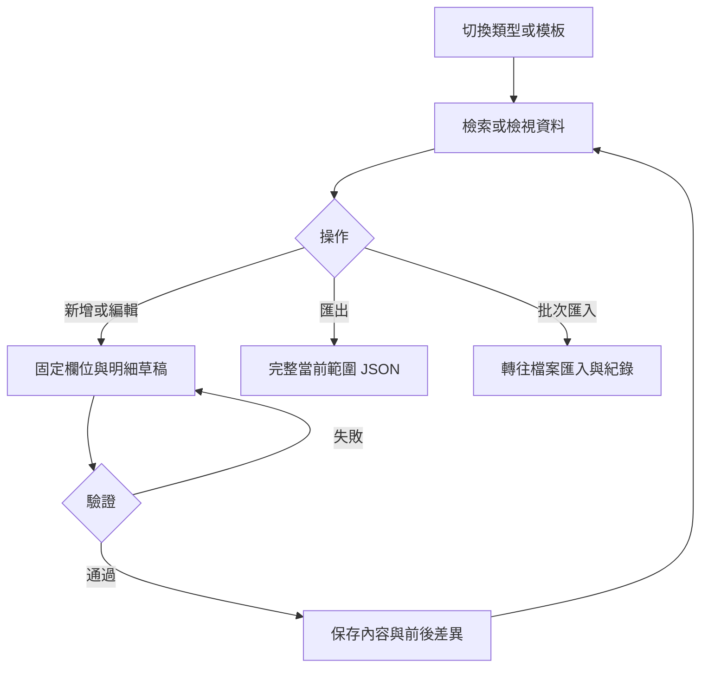

#### 檢視與編輯狀態

清單或模板檢視畫面都不能直接修改資料；必須由對應按鈕進入編輯。各頁截圖依下表區分，欄位限制仍依各節規則。

| 頁面 | 檢視 → 編輯入口 | 編輯位置 |
| --- | --- | --- |
| 營養標準模板 | 模板檢視頁點「編輯」 | 原頁開放欄位輸入，出現「儲存變更／取消」 |
| 營養元素及其餘資料類型 | 清單該列點「檢視／編輯」 | 開啟可直接輸入的編輯視窗，出現「儲存／取消／關閉」；視窗內不需再按一次編輯 |
| 共用體重分類標準 | 犬種與體型頁點「編輯體重標準」 | 開啟共用標準編輯視窗 |

| 操作結果 | 模板原頁編輯 | 其他資料／體重標準編輯視窗 |
| --- | --- | --- |
| 儲存成功 | 更新整份模板，回到原頁唯讀檢視 | 更新資料並關閉視窗，回到清單或體重標準檢視 |
| 取消／關閉 | 按取消後確認放棄，還原為編輯前資料 | 沒有修改時直接關閉；已有修改則先確認是否放棄，不儲存本次變更 |
| 驗證失敗 | 保留輸入與編輯狀態，顯示錯誤 | 視窗保持開啟、保留輸入並顯示錯誤，修正後可重送 |

新增資料會直接進入新增表單，不需要先經過唯讀檢視；儲存與取消規則同上。以上「儲存成功」指通過表單驗證並套用內容；目前為瀏覽器示範，若本機保存失敗須提示，不能當成正式後端已保存。

**驗收 K0：** 類型切換顯示自己的欄位；搜尋／狀態篩選不改資料；取消不落資料；匯出範圍不被篩選截斷；新增資料不得誤變成新增 schema 欄位。

### 2.2 營養標準模板

**檢視模式：** 模板基本資料與營養標準值皆為唯讀；點右上「編輯」才開放輸入。

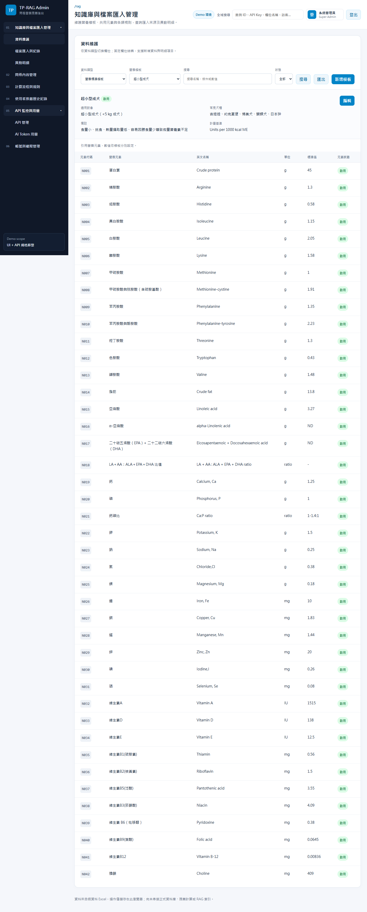

**編輯模式：** 在同一頁修改模板名稱、狀態、固定內容與元素引用／標準值；元素名稱及單位仍由主檔決定。「儲存變更」通過驗證後回到檢視，「取消」確認放棄後還原。

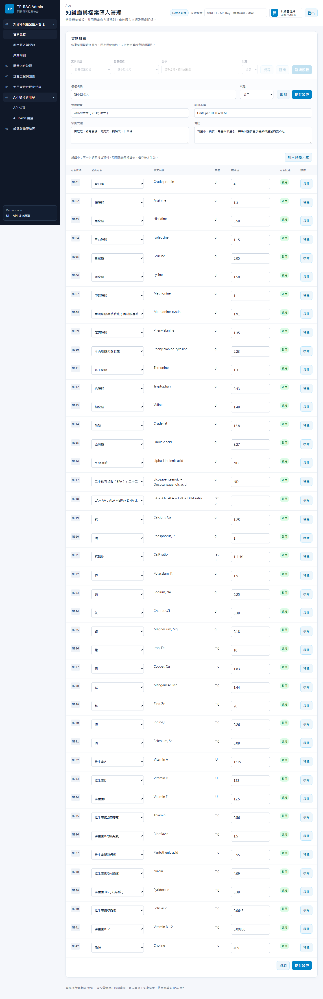

初始九個模板：超小型、小型、中型、大型、超大型成犬、高齡犬、幼犬、大型及超大型幼犬生長前期／後期。數量為示範初值，非系統上限。

| 欄位 | 型別／規則 |
| --- | --- |
| `id/name/status` | 穩定 ID、必填不重名名稱、啟用／停用 |
| `meta` | 固定適用對象、常見犬種、備註、計量基準；內容可修改 |
| `items[].elementId` | 引用共用元素 ID，不得重複；新增引用只可選啟用元素，原有停用引用可保留 |
| `items[].value` | 保留空白、0、非負數字、ND、N/A、`-`、比例或範圍；負數及不符格式字串阻擋 |
| 元素名稱／英文／單位 | 從元素主檔顯示，本頁不能改主檔 |
| 編輯行為 | 單一編輯入口；同頁一次改基本資料與引用，加入／移除引用後整份儲存或取消；新增列捲動並聚焦 |
| 編輯鎖定 | 顯示全部引用，暫停類型、模板、搜尋與匯出切換；離開選單確認放棄，重整由瀏覽器提示 |
| 紀錄 | 整份修改記一次異動，未改內容不顯示虛構差異 |

**驗收 K1：** 名稱重複、重複引用、負數阻擋；空白與 0／ND 往返不失真；同元素在不同模板的數值獨立；模板適用條件如何與最終體型／生命階段連結待 Q5。

### 2.3 營養元素主檔

**清單檢視：** 此處為營養元素的唯讀清單；點該列「檢視／編輯」開啟下方表單。

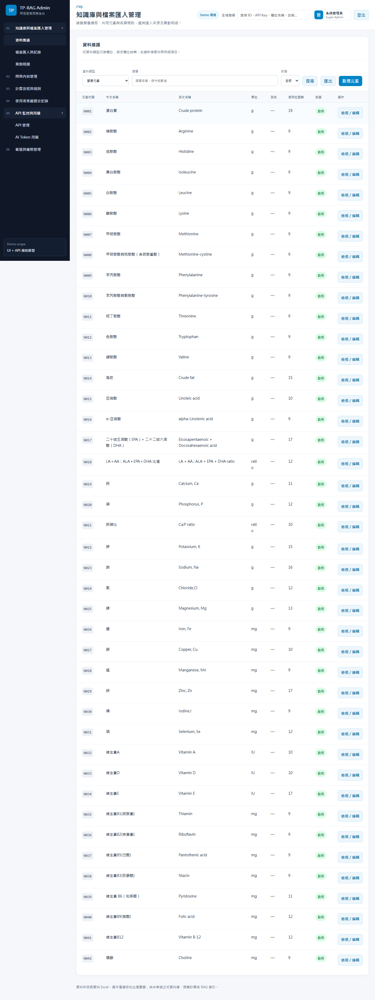

**編輯視窗：** 開啟後即可輸入，不需再按編輯。名稱、英文名稱、別名與狀態可修改；已被引用的單位仍鎖定，元素代碼不能修改。 儲存、取消及驗證失敗的處理依 §2.1。

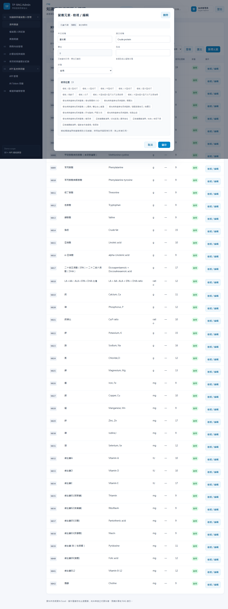

初始 42 項來自模板快照，不代表完整核定元素字典。

| 欄位／動作 | 規則 |
| --- | --- |
| ID | 建立後固定，以 ID 被模板及規則引用；現有示範 ID 不能直接當正式匯入代碼政策 |
| 中文名、英文名、單位、別名 | 中文名及單位必填；別名以逗號分隔；中文或非空英文名稱不分大小寫判重 |
| 單位 | 已被任一模板、疾病、排便、亞健康規則引用時鎖定 |
| 使用位置 | 列引用模板及三類規則所屬資料，顯示使用位置數 |
| 刪除／停用 | 未引用可確認刪除；已引用只能停用，先列使用位置與影響提醒。停用保留既有引用，禁止新增引用且不參與後續推薦／判斷（§1、Q11） |
| 未對應名稱 | 保留來源，人工對應；`CI`、`curde fat`、主檔缺少的 Vitamin C 等不能猜測合併或補單位 |

**驗收 K2：** 改名不斷引用；被規則引用亦會鎖單位；停用不移除舊引用，但不能再選入或參與後續推薦／判斷；字典擴充不等於演算法自動支援新元素，正式計算參與規則待 Q6。

### 2.4 MER 係數

**清單檢視：** 此處為MER 係數的唯讀清單；點該列「檢視／編輯」開啟下方表單。

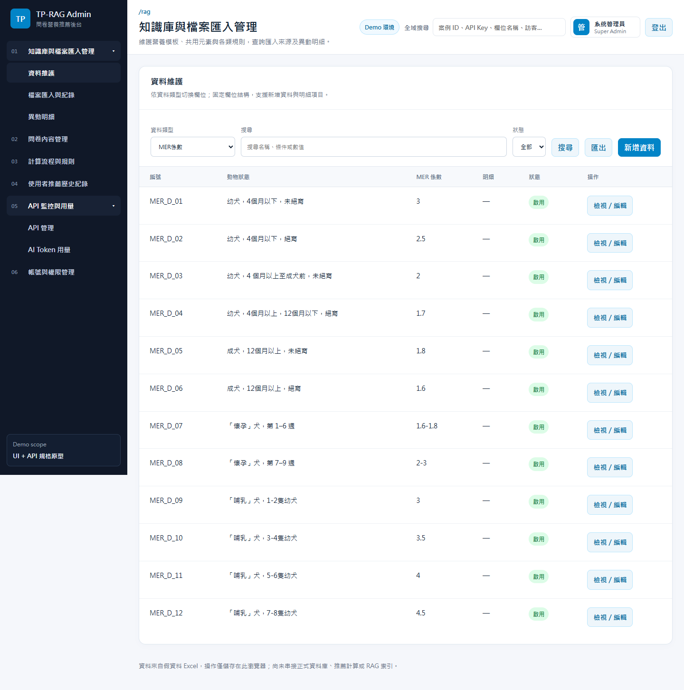

**編輯視窗：** 開啟後即可輸入，不需再按編輯。可修改動物狀態與係數上下限；一般、懷孕、哺乳只開放其對應欄位。 儲存、取消及驗證失敗的處理依 §2.1。

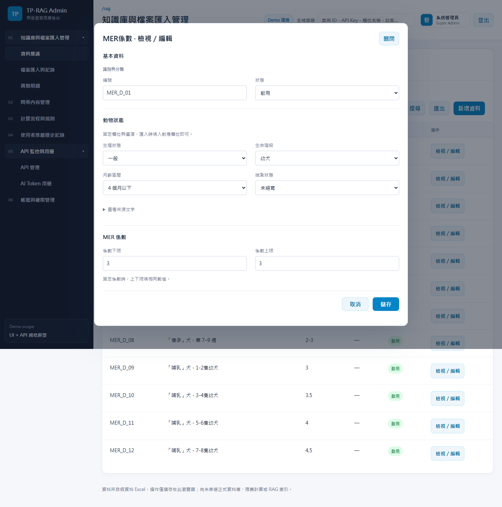

固定 schema，無 AI／自由條件編輯器。

| 欄位 | 選項／驗證 |
| --- | --- |
| 編號、狀態 | 編號必填唯一；啟用／停用 |
| `merProfile.physiology` | normal／pregnant／lactating |
| `stage/ageBand/neutered` | puppy／adult；under4／from4ToAdult／from4To12／from12；不限定／false／true |
| `gestationWeeks` | 1to6／7to9，懷孕時顯示與必選 |
| `pupCountBand` | 1to2／3to4／5to6／7to8，哺乳時顯示與必選 |
| `coefficient.min/max` | 非負有限數值，max ≥ min；固定值填相同上下限 |
| 一般狀態 | 必選生命階段與月齡區間；只顯示適用欄位，來源原文保留 |

**驗收 K3：** 切換一般／懷孕／哺乳只要求相關欄位；係數倒置阻擋。區間代碼對應的精確端點與複合狀態取值待 Q5，不能由 AI 推定。

### 2.5 犬生命階段判斷表

**清單檢視：** 此處為犬生命階段的唯讀清單；點該列「檢視／編輯」開啟下方表單。

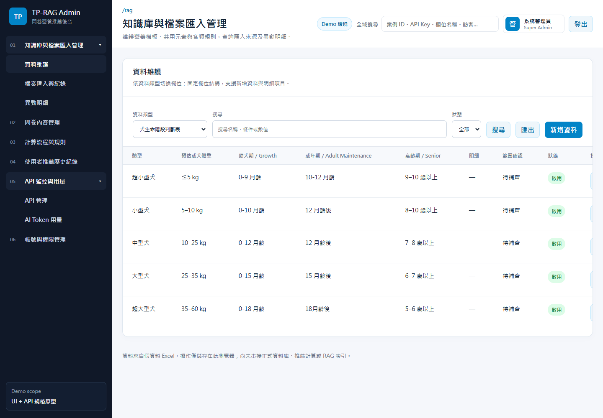

**編輯視窗：** 開啟後即可輸入，不需再按編輯。可修改體型、狀態及月齡上下限；參考成犬體重不參與階段判斷，未完整資料可保存為待補齊。 儲存、取消及驗證失敗的處理依 §2.1。

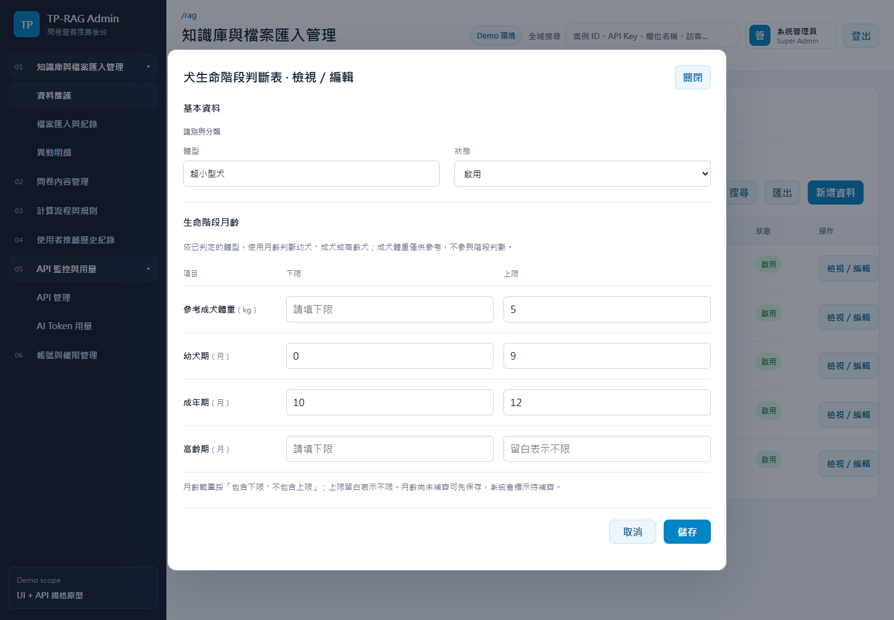

| 欄位 | 型別／規則 |
| --- | --- |
| 體型、狀態 | 體型必填唯一；啟用／停用 |
| `lifeProfile.weightMinKg/weightMaxKg` | 非負數或空白，僅供成犬體重參考，不決定體型或規則完成與否 |
| `growthMinMonths/growthMaxMonths` | 幼犬期下上限，月 |
| `adultMinMonths/adultMaxMonths` | 成年期下上限，月 |
| `seniorMinMonths/seniorMaxMonths` | 高齡期下上限，月；上限可空白代表不限 |
| 月齡完整條件 | 三期下限已填，幼犬及成年上限已填；上下限有效，幼犬上限＝成年下限、成年上限＝高齡下限 |
| `reviewState` | 欄位未齊 `pending`，清單顯示待補齊；完整 `confirmed`，顯示格式完整，不代表營養規則已核定 |
| `executionEligible` | 原型為完整且啟用；尚未接推薦引擎 |
| 端點慣例 | 畫面採含下限、不含上限；此為固定範本建議，仍待客戶核定，見 Q5 |

**驗收 K4：** 不完整可存待補齊；參考體重留白不阻擋月齡完成；非負數、上下限及三期銜接檢查有效；保留原始文字，不用來源「9–10 歲以上」猜高齡起點。

### 2.6 活動量加成

**清單檢視：** 此處為活動量的唯讀清單；點該列「檢視／編輯」開啟下方表單。

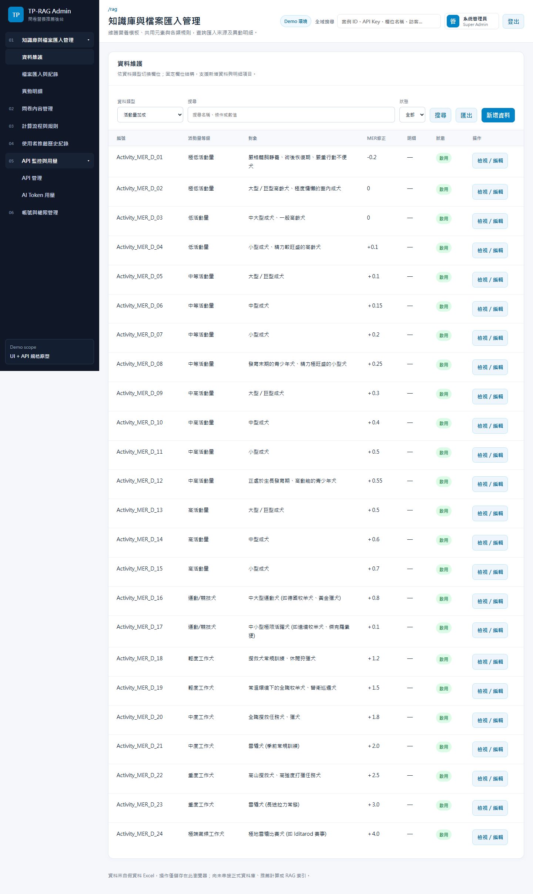

**編輯視窗：** 開啟後即可輸入，不需再按編輯。可修改活動等級、說明、適用對象、MER 修正與狀態。 儲存、取消及驗證失敗的處理依 §2.1。

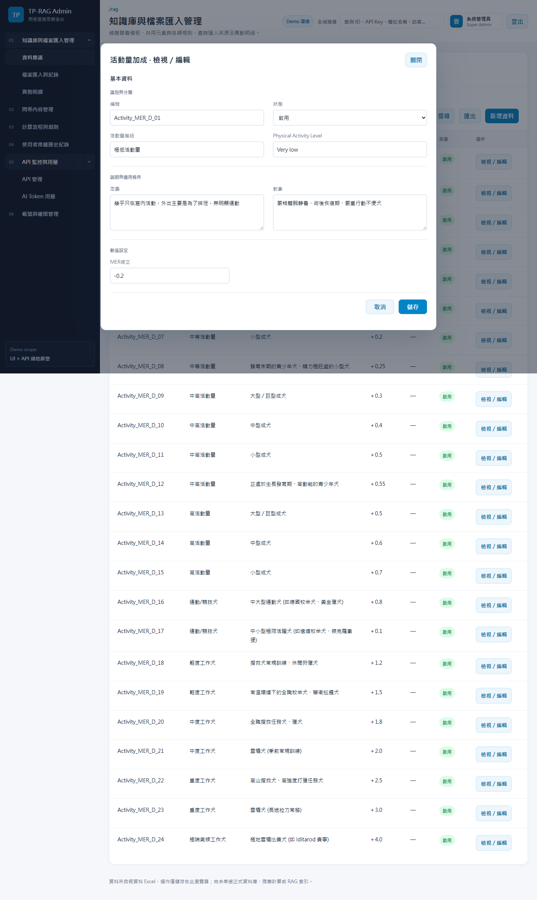

| 欄位 | 規則 |
| --- | --- |
| 編號、活動量等級、英文名 | 編號必填唯一，其餘依來源維護 |
| 定義、對象 | 文字說明，不把普通文字自動轉成通用判斷器 |
| MER 修正 | 數值，可正、零、負；加在基準係數，非百分比連乘 |
| 狀態 | 啟用／停用 |

**驗收 K5：** 顯示與保存來源第六欄修正值；未改值保存保留原型別；問卷活動值到資料列的固定對照待 Q2。

### 2.7 BCS 加成

**清單檢視：** 此處為BCS的唯讀清單；點該列「檢視／編輯」開啟下方表單。

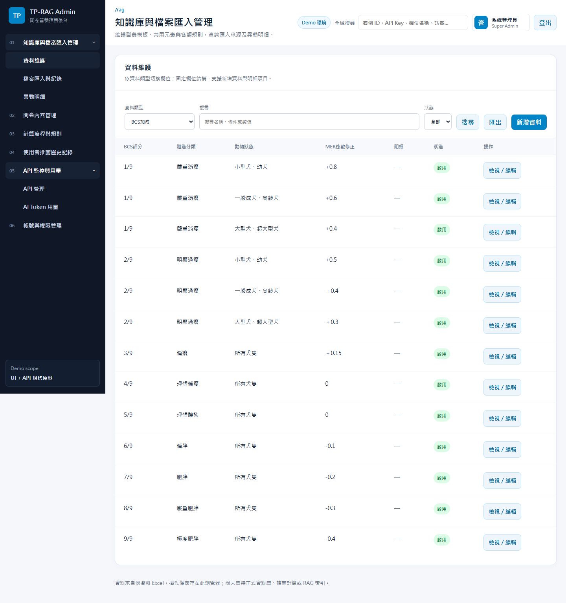

**編輯視窗：** 開啟後即可輸入，不需再按編輯。以 1–9 分選單維護分數，並編輯動物狀態與修正值；分數不是分數除法或範圍。 儲存、取消及驗證失敗的處理依 §2.1。

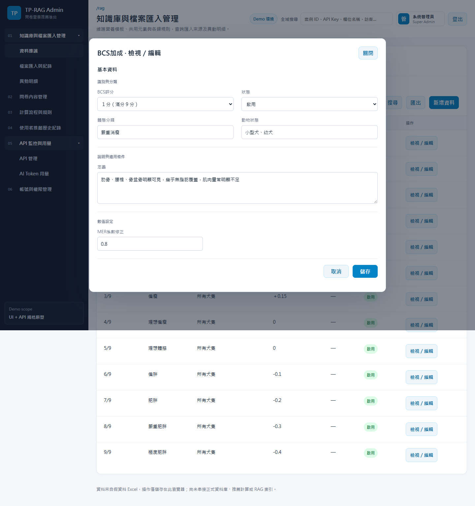

| 欄位 | 規則 |
| --- | --- |
| 分數 | 固定整數 1–9；保存 `bcsScore={score,scale:9}`，顯示 1/9–9/9，不當除法或範圍 |
| 體態分類、定義、動物狀態 | 保留來源；相同分數的不同動物狀態可獨立記錄 |
| MER 係數修正 | 數值加成，正負皆可能；保留原型別及全形正號原值 |
| 判重與排序 | 分數＋動物狀態判重；數字分數遞增，同分保持原順序 |

**驗收 K6：** 九分制與問卷一致；同分不同狀態可存、相同組合阻擋；不因畫面文字轉型把空白／null 當零。

### 2.8 過敏原清單

**清單檢視：** 此處為過敏原的唯讀清單；點該列「檢視／編輯」開啟下方表單。

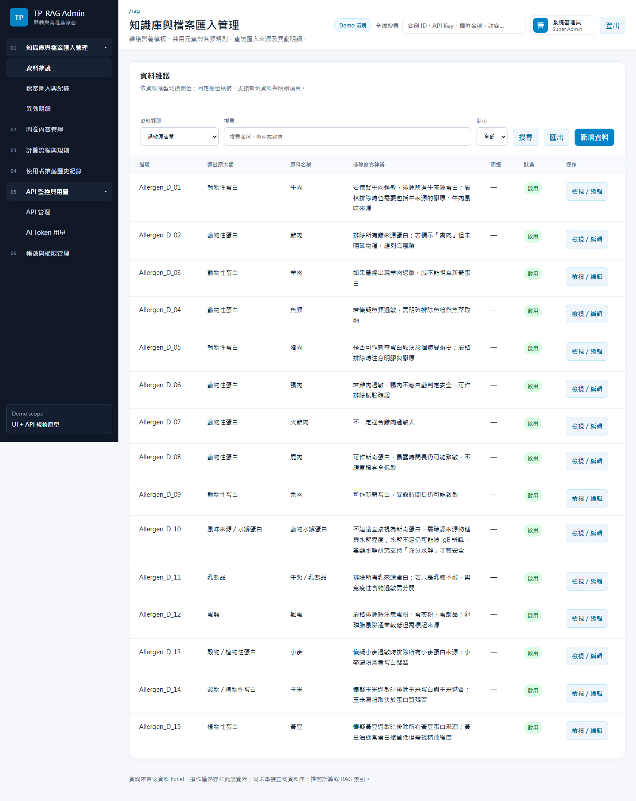

**編輯視窗：** 開啟後即可輸入，不需再按編輯。可修改分類、原料名稱、過敏來源與排除建議等固定欄位。 儲存、取消及驗證失敗的處理依 §2.1。

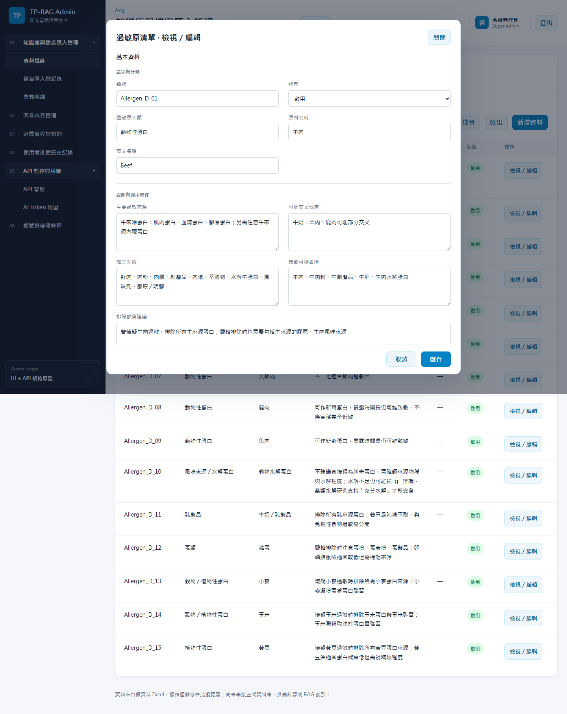

| 欄位組 | 欄位 |
| --- | --- |
| 識別 | 編號（必填唯一）、過敏原大類、原料名稱、英文名稱、狀態 |
| 說明 | 主要過敏來源、可能交叉反應、加工型態、標籤可能名稱、排除飲食建議 |

**驗收 K7：** 長說明完整保存，表格截短不截斷原資料；不可重複編號；最終結果必須排除命中的過敏原；問卷值的固定對照及交叉反應的具體處理仍待 Q2、Q7。

### 2.9 慢性病與遺傳性疾病營養

**清單檢視：** 此處為疾病營養的唯讀清單；點該列「檢視／編輯」開啟下方表單。

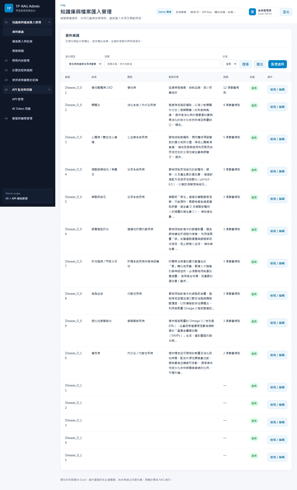

**編輯視窗：** 開啟後即可輸入，不需再按編輯。可修改疾病說明，展開既有規則或新增／移除營養調整規則；規則使用共用元素。 儲存、取消及驗證失敗的處理依 §2.1。

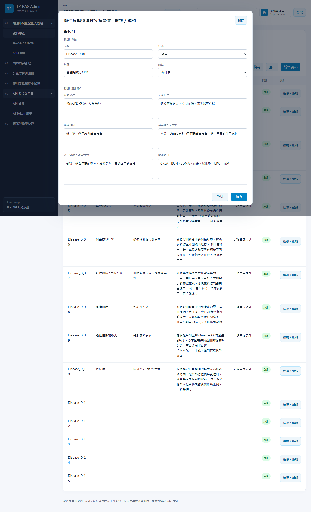

| 區域 | 欄位 |
| --- | --- |
| 基本資料 | 編號（必填唯一）、疾病、類型、好發品種、營養目標、狀態 |
| 說明 | 建議限制、建議增加／支持、避免食物／餵食方式、監測項目 |
| 營養規則 | 共用 §2.13 `rules[]`；來源營養建議、生命階段、規則屬性／值整理為明細，不遺失跨列資訊 |

**驗收 K8：** 可增刪多個營養規則；原始列可追查；只允許明確生命階段值，不把合併儲存格中的元素名稱當生命階段；規則衝突待 Q4。

### 2.10 排便分類法

**清單檢視：** 此處為排便分類的唯讀清單；點該列「檢視／編輯」開啟下方表單。

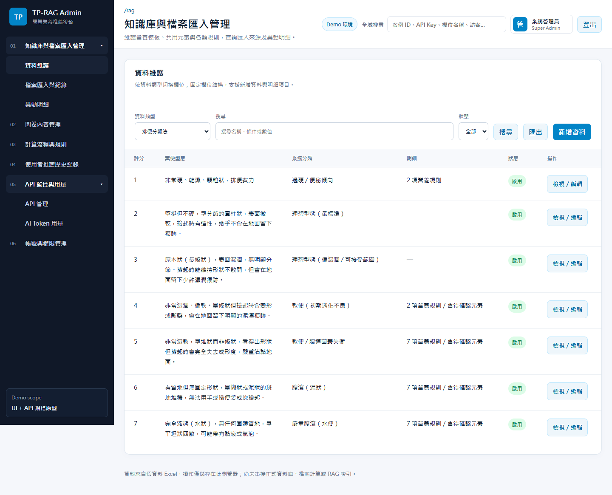

**編輯視窗：** 開啟後即可輸入，不需再按編輯。可修改評分、分類、說明與警示，並新增／移除營養調整規則。 儲存、取消及驗證失敗的處理依 §2.1。

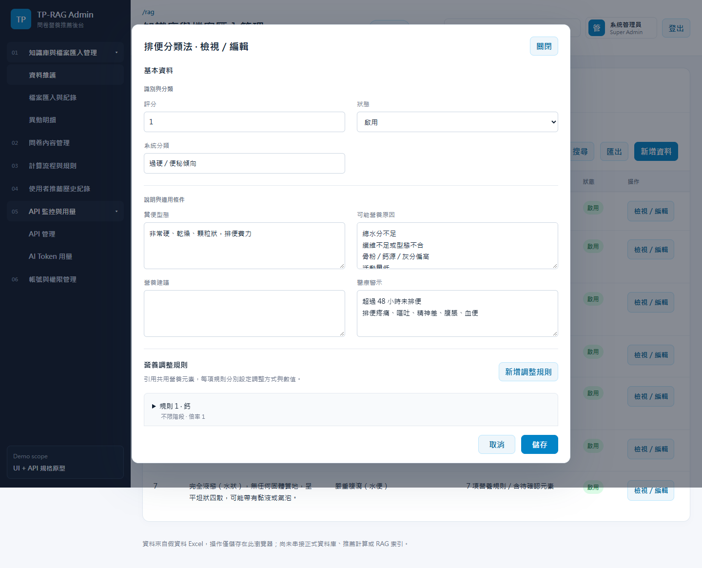

| 區域 | 欄位 |
| --- | --- |
| 基本資料 | 評分（必填識別值）、糞便型態、系統分類、可能營養原因、狀態 |
| 說明 | 營養建議、醫療警示 |
| 規則 | 來源營養調整方向、屬性及值整理成 §2.13 明細 |

**驗收 K9：** 可維護多項規則與完整警示；問卷 `hard/normal/soft/watery` 與來源數字評分的對照尚未核定，不能自行推定。

### 2.11 飲水量清單

**清單檢視：** 此處為飲水量的唯讀清單；點該列「檢視／編輯」開啟下方表單。

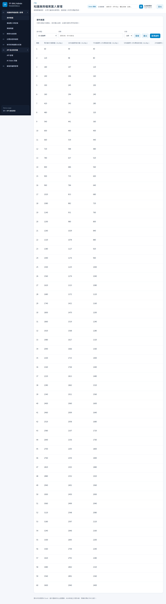

**編輯視窗：** 開啟後即可輸入，不需再按編輯。可修改體重、總水分及各乾濕食比例的飲水值；空白與零分開保存。 儲存、取消及驗證失敗的處理依 §2.1。

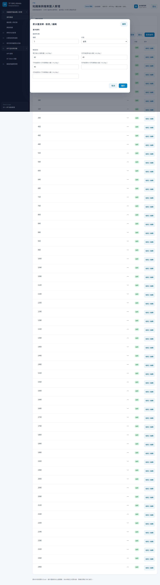

計算查表行為另見 §4.2。

| 欄位 | 規則 |
| --- | --- |
| 體重 | kg，必填且不重複 |
| 每日總水分 | mL/day，非負數值或來源空白 |
| 額外飲水四欄 | 100%乾、75/25、50/50、25/75；非負數值或空白 |
| 空白 | 保留未提供，不能當零或自動依其他欄補值 |

**驗收 K10：** 各比例獨立保存；負值與非數字阻擋。正式維護資料成功更新後立即用於後續推薦與判斷（Q10）；目前原型尚未連到試算資料，不得宣稱此整合已完成。

### 2.12 亞健康觀察清單

**清單檢視：** 此處為亞健康的唯讀清單；點該列「檢視／編輯」開啟下方表單。

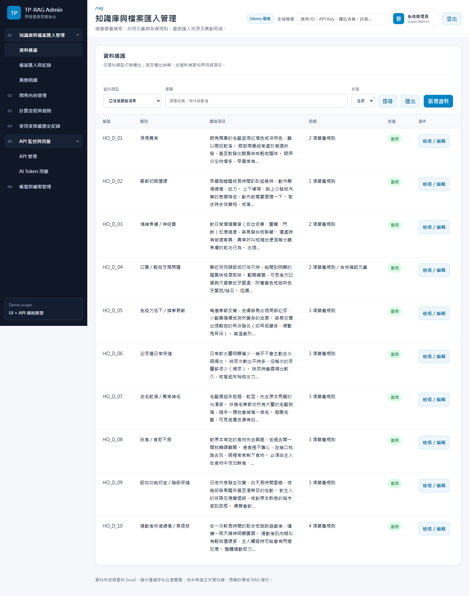

**編輯視窗：** 開啟後即可輸入，不需再按編輯。可修改觀察與程度說明，並新增／移除營養調整規則。 儲存、取消及驗證失敗的處理依 §2.1。

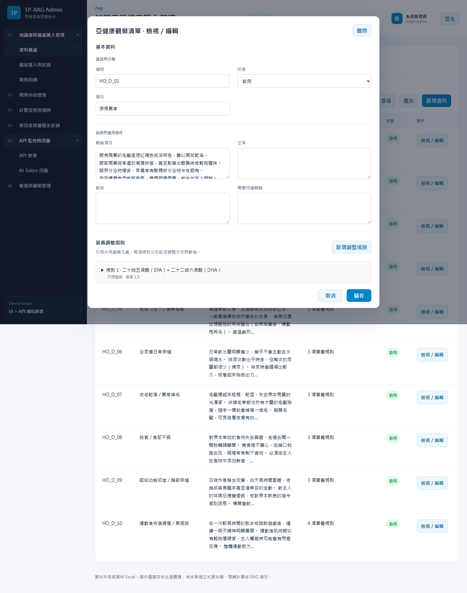

| 區域 | 欄位 |
| --- | --- |
| 基本資料 | 編號（必填唯一）、類別、觀察項目、狀態 |
| 說明 | 正常、輕微、需要持續觀察 |
| 規則 | 營養建議、規則屬性及值整理成 §2.13 明細 |

**驗收 K11：** 說明空白原樣保留；多個共用元素規則可增刪；未對應元素標示待確認，不假裝正式可執行。

### 2.13 疾病／排便／亞健康共用營養調整明細

視窗以可收合卡片呈現，主檔與模板數值各自維護。

| key | 規則 |
| --- | --- |
| `id` | 明細穩定識別碼；原型為示範產生值 |
| `elementId/sourceName` | 共用元素引用＋來源原名；舊來源未對應可保留但標記待確認，新規則需選元素 |
| `phase` | 適用階段；來源只有明確 Puppy／Adult 才當生命階段，其他保留來源 |
| `method/value` | multiplier：非負數字；比例格式：如 `1:1`；正式比例語義及上下限待 Q4、Q6 |
| `overridable` | 對應來源 isOverridable：true 可被其他規則覆蓋，允許覆蓋的候選結果取高；false 不可被其他規則覆蓋；null 為尚未確認，處理方式待定。詳見 §4.1 |
| `sourceRows` | 保留來源列，便於核對同一資料跨列規則 |

**驗收 K12：** 停用元素不能新增引用；非數字倍率、負倍率及不符格式比例阻擋；同一資料規則修改可追到規則 ID、元素及調整值。未對應／未核定規則能否參與推薦與判斷待 Q6；知識庫不設發布或審核步驟，不把本機可儲存當作可執行。

### 2.14 犬種與體型分類、共用體重標準

**清單檢視：** 此處為犬種與體型的唯讀清單；點該列「檢視／編輯」開啟下方表單。

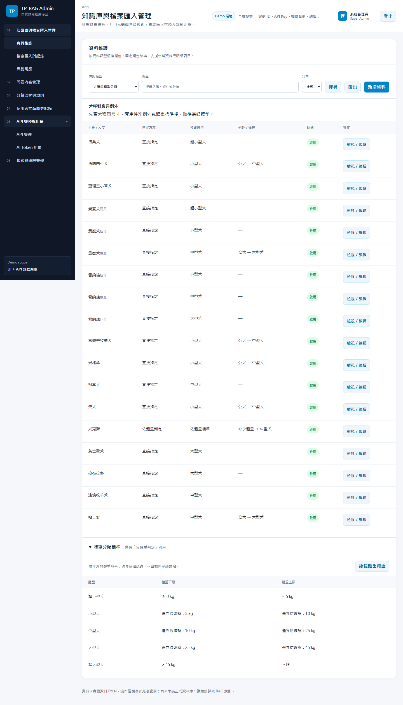

**編輯視窗：** 開啟後即可輸入，不需再按編輯。可修改犬種、尺寸、狀態與判定方式；依判定方式顯示預設／公犬例外，或缺少體重時的暫用體型。 儲存、取消及驗證失敗的處理依 §2.1。

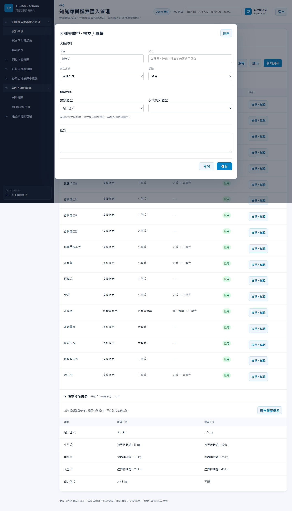

**共用標準編輯：** 在上方犬種與體型頁點「編輯體重標準」開啟；修改的是五種體型共用的區間與端點包含關係，不是單一犬種。儲存後關閉視窗並更新標準；取消不套用修改，驗證失敗留在視窗。

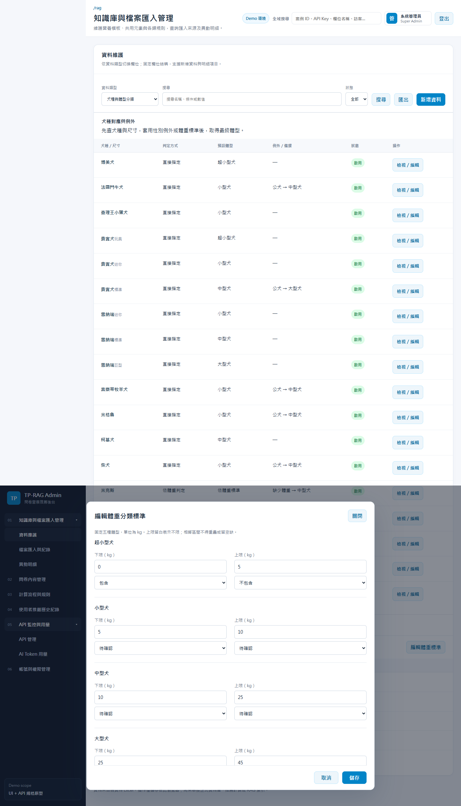

此頁包含犬種／尺寸對照與共用體重標準，目前展示 18 筆犬種資料。

| 欄位 | 規則 |
| --- | --- |
| 犬種、尺寸 | 犬種必填；相同犬種＋尺寸不得重複；玩具／迷你／標準等以尺寸區別 |
| 判定方式 | 直接指定／依體重判定 |
| 直接指定 | 顯示預設體型（必選）、公犬例外體型；公犬例外優先 |
| 依體重判定 | 顯示缺少體重時暫用體型；有體重查共用標準；無體重、無備援時需補資料 |
| 備註、狀態 | 保留來源文字；啟用／停用 |
| 五種體型 | 超小型犬、小型犬、中型犬、大型犬、超大型犬 |
| 體重標準 | 每型 `min/max/minIncluded/maxIncluded`，kg；初始切點 5、10、25、45，包含關係有待確認值 |
| 標準驗證 | 非負、上限大於下限；相鄰值銜接；已確認端點一含一不含；僅末區可無上限；首區從 0 且含下限 |

**驗收 K13：** 切判定方式隱藏不適用欄位，保存不留錯誤分支值；重複犬種尺寸阻擋；已確認邊界不重疊不缺口；未確認端點不推斷。最終體型為模板及其他體型條件共用輸入；需依體重分類時使用實際體重，不使用生命階段表中的預估成犬體重。此判定流程尚未接入計算引擎。

### 2.15 檔案匯入與紀錄

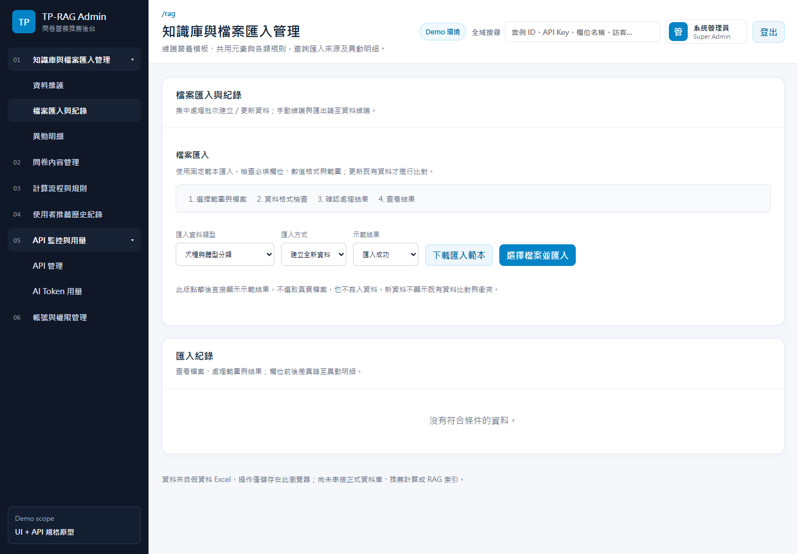

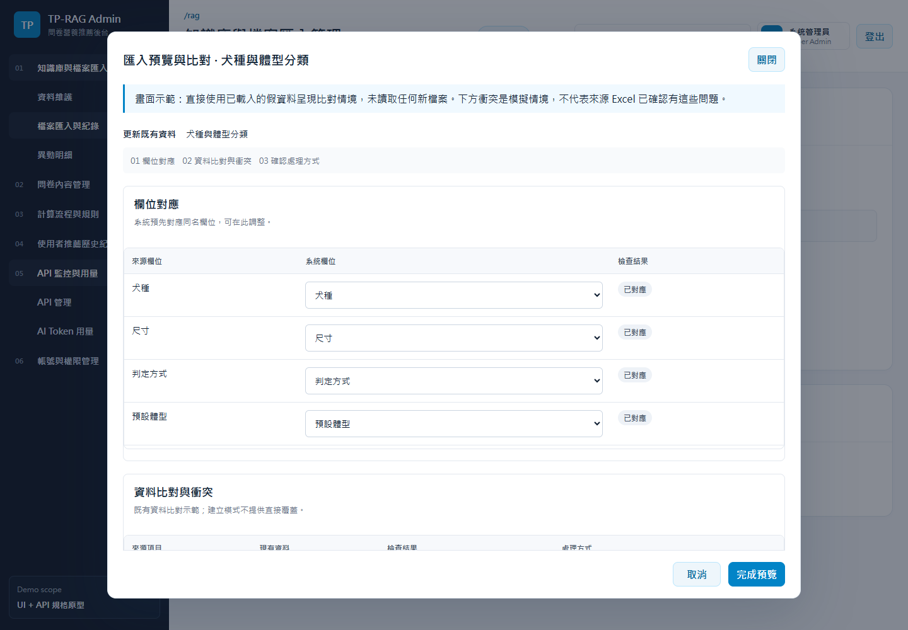

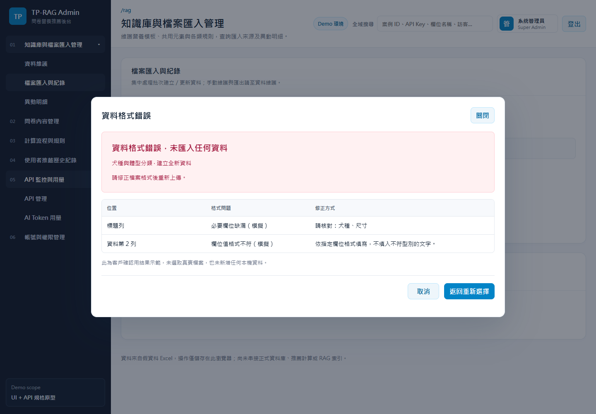

**現行按鈕直接展示模擬結果，不選檔、不呼叫 AI、不修改資料、不新增匯入或異動紀錄。** 正式匯入仍待實作；已確認的更新與錯誤處理規則見下表及 Q8。

**正式匯入流程（Q8、Q10）：** 下圖為交付流程；上方截圖中的「全新／略過／保留現有」是舊示範操作，不作本次正式更新流程的驗收依據。

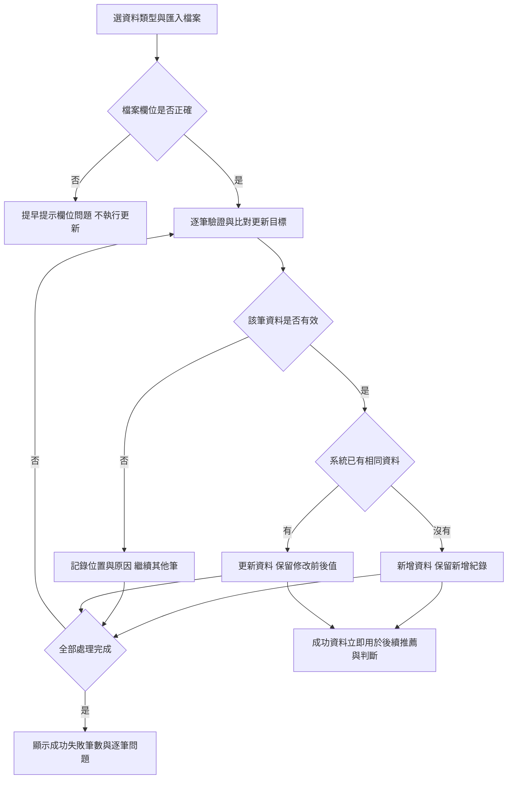

| 項目 | 現行畫面／已記錄方向 |
| --- | --- |
| 範圍 | 當前資料類型；更新模板才選既有目標模板 |
| 下載範本 | 真正 CSV，Excel 可開啟；不可用 .xlsx 副檔名偽裝；生命階段固定月齡欄位，MER 固定狀態欄位 |
| 全新模式 | 預設模式；成功／錯誤為示範選擇，錯誤列標題或資料位置、缺漏欄位與修正方式；成功筆數不是實際入庫證據 |
| 更新預覽 | 來源欄位→系統欄位可選擇或不匯入；展示識別重複、名稱／別名、單位／內容差異等模擬情境 |
| 衝突處理 | 略過、更新既有、確認對應後保留現有；目前僅記畫面選擇與待確認數，未構成正式提交驗證 |
| 匯入紀錄 | 時間、來源檔案、範圍、筆數、結果、前往資料維護；目前可能有過去本機資料，現行示範不產生新紀錄 |
| 新增／更新／保留（Q8） | 以系統現有資料為主：檔案與系統皆有則更新；檔案有、系統沒有則直接新增；系統有、檔案沒有則保留原資料與狀態，不因本次匯入刪除或停用 |
| 正式更新與例外（Q8） | 更新資料保留前後值，新增資料保留新增紀錄；欄位錯誤先提醒；個別資料錯誤時繼續處理有效資料，完成後明確列出問題資料與原因。現行示範的略過／保留選項尚未依此調整 |
| 正式匯入方向 | 穩定代碼優先，中英文／已核定別名次之，不模糊合併；未知元素人工建立或對應；同名不同單位不直接覆蓋；模板值更新不順便改共用主檔 |

**原型對照：** 舊示範尚有全新／更新兩分支及略過／保留選項，未依 Q8 調整。

**驗收 I1：** 下載範本副檔名正確。**正式驗收（Q8、Q10）：** 匯入時既有資料更新並保留前後值，系統沒有的資料直接新增並留新增紀錄；系統有而檔案未含的資料與狀態維持不變，不刪除或停用；先檢查檔案欄位，錯誤時提早提示，不進入資料更新；個別資料錯誤不阻止其他有效資料匯入，完成後逐筆指出問題資料、位置及原因，列出成功／失敗筆數。成功新增／更新立即用於後續推薦與判斷，不需審核。真實選檔、解析、更新入庫及紀錄仍待實作；不能用展示成功訊息取代。

### 2.16 異動明細與前往修改

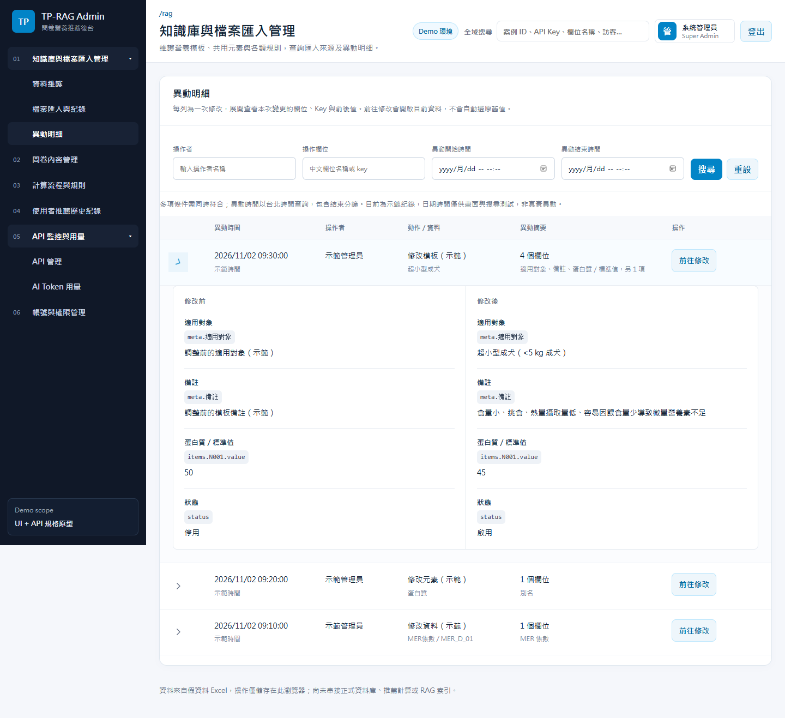

**搜尋操作：** 在清單上方輸入操作者、操作欄位或異動時間，按「搜尋」套用；文字欄位可按 Enter 搜尋。「重設」清空條件並顯示全部可查紀錄。

| 搜尋參數 | 規則 |
| --- | --- |
| 操作者 | 以操作者名稱部分比對，不分英文大小寫，忽略輸入前後空白 |
| 操作欄位 | 以異動欄位中文名稱或完整 key 路徑部分比對，不分英文大小寫；例如備註、aliases、meta.備註 |
| 異動開始／結束時間 | 以台北時間查詢；任一端可留白；包含開始時間與結束時間所選的整分鐘 |
| 多條件 | AND，同一筆異動必須同時符合所有已填條件；全部留白則查全部 |
| 欄位命中 | 任一變更欄位符合即列出該次異動，展開後仍顯示當次全部前後差異，不只顯示命中欄位 |
| 時間錯誤 | 開始晚於結束時顯示錯誤，不套用錯誤區間，保留原查詢結果及輸入供修正 |
| 無結果 | 顯示「沒有符合條件的異動紀錄」，保留搜尋條件 |
| 異動時間顯示 | 獨立欄位以台北時間顯示 YYYY/MM/DD HH:mm:ss；示範資料亦顯示完整日期時間，並逐列標示「示範時間」，可測試時間搜尋，不代表真實異動 |
| 缺少時間 | 真實或舊紀錄缺少可判定時間時顯示「未提供時間」，指定時間條件時不列入，不補造真實事件時間 |
| 查詢後操作 | 展開及前往修改仍對應原異動紀錄，不能因篩選後列序改變而跳到其他資料 |

| 區域／規則 | 定義 |
| --- | --- |
| 主列 | 一次修改一列；異動時間與操作者各自獨立成欄、動作／資料、變更欄位數、最多三欄摘要、展開箭頭、前往修改 |
| 詳情 | 預設收合，逐筆獨立；兩側同順序列中文欄位名、key path、修改前後值，不直接丟整包 JSON |
| 比較 | 模板元素按 elementId、資料與規則優先按 ID 比較；新增／刪除只列受影響欄位，排除重複衍生 metadata |
| 值呈現 | 空白、未提供 null、不存在 undefined、0、布林分開顯示 |
| 前往修改 | 開啟目前資料，模板原頁編輯並聚焦，其他資料用對應視窗；不自動還原歷史值 |
| 不可定位 | 舊紀錄缺上下文不跳錯資料；資料或欄位已不存在時須提示無法定位，不得開啟錯誤資料 |
| 無真實差異 | 原型提供三筆逐列標示的示範；不寫 localStorage。實際有差異後使用真實本機紀錄；前後相同不編造變更 |

**驗收 I2：** 操作者／操作欄位／時間可單獨或交叉搜尋；中文及 key 可命中；時間區間、錯誤提示、重設與無結果正確；篩選後仍能展開及前往正確資料。無修改保存不新增可見差異；新增引用不讓其他列誤判；展開不影響其他列；修正重新確認儲存才更新。異動明細只提供查詢前後差異與前往修改目前資料；不包含歷史版本退回或匯入批次復原。紀錄持續保存（Q9），並保留修改前後資料（Q8）；記錄真實操作者及維護紀錄完整性的技術方式由工程師處理。

## 3. 問卷內容管理

### 3.1 欄位庫、題目與選項編輯

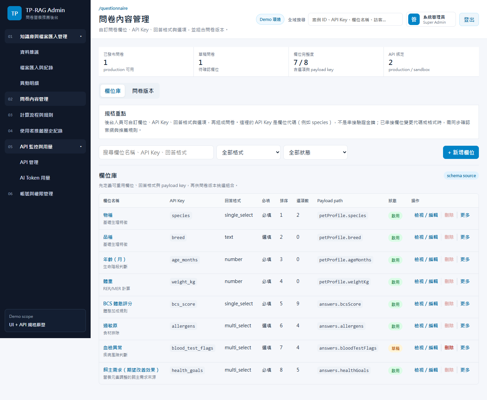

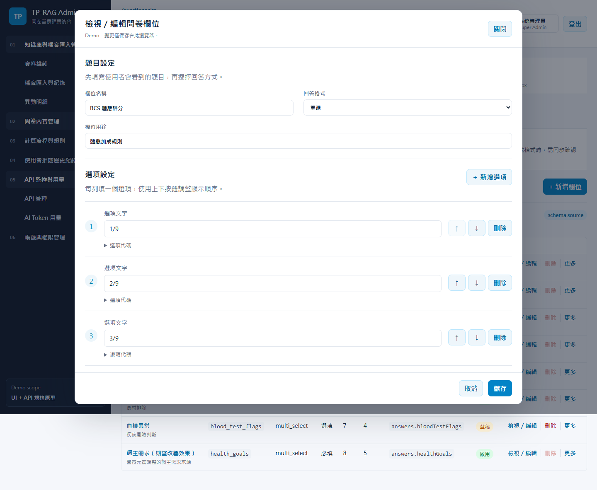

目的：維護可重用題目；題目與版本組合分開。

| 欄位 | 規則 |
| --- | --- |
| 題目名稱、用途 | 名稱必填，用途文字說明 |
| 回答格式 | `text/number/single_select/multi_select/select/slider` |
| 必填、排序、狀態 | 必填布林；排序正整數；啟用／草稿／停用 |
| 選項 | 文字＋穩定代碼；可新增、刪除、上下排序；修改文字不改代碼 |
| 選項驗證 | 文字／代碼不得空白，代碼不可重複；單選／多選／下拉至少一個選項 |
| 串接資訊 | 系統產生欄位代碼與 Payload path，畫面唯讀；欄位代碼符合英文字母／底線起頭，後接英數／底線且不可重複 |
| 缺少定義 | 數字最小最大值、slider 級距、條件必填、多語待確認；停用題目不再供新增選用，已發布版本維持當次固定內容（§3.2），不能從格式選單推定已具備 |

| 目前欄位 key | 格式 | 初始狀態／必填 | Payload path |
| --- | --- | --- | --- |
| `species` | single_select | 啟用／是；犬、貓 | `petProfile.species` |
| `breed` | text | 啟用／否 | `petProfile.breed` |
| `age_months` | number | 啟用／是 | `petProfile.ageMonths` |
| `weight_kg` | number | 啟用／是 | `petProfile.weightKg` |
| `bcs_score` | single_select | 啟用／是；1/9–9/9，代碼 1–9 | `answers.bcsScore` |
| `allergens` | multi_select | 啟用／否 | `answers.allergens` |
| `blood_test_flags` | multi_select | 草稿／否 | `answers.bloodTestFlags` |
| `health_goals` | multi_select | 啟用／是 | `answers.healthGoals` |

`health_goals` 初始五選項：維持目前健康體態 `maintain_health`、毛髮保養 `skin_coat`、關節與體力 `joint_strength`、腸胃消化 `digestion`、體重管理 `weight_management`。選項數由實際陣列計算，不能使用來源示範 `count` 常數作真實數量。

**驗收 QF1：** 九個 BCS 分數逐一保存；選項增刪改序後數量一致；非選擇格式不殘留生效選項；取消不改欄位。性別、絕育、活動量、疾病、排便、亞健康等計算輸入尚未完整建在欄位庫，見 Q2。

### 3.2 問卷版本與欄位組成

已發布問卷唯讀；需要修改時，先「複製為草稿」。草稿儲存不影響目前官網問卷；確認發布後，新版生效、舊版自動停用，不需審核。

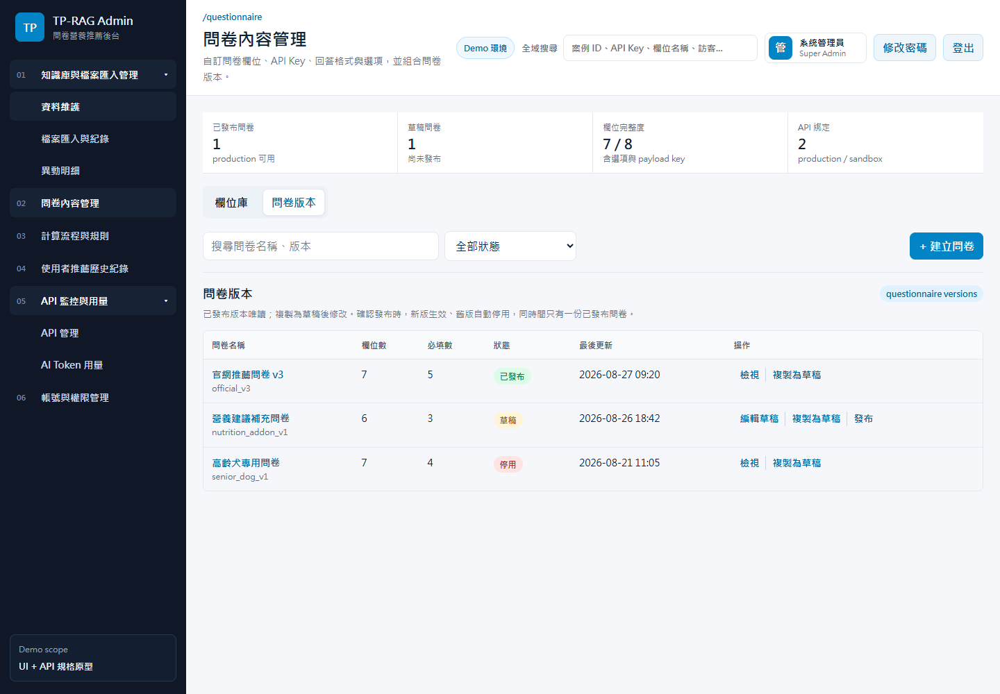

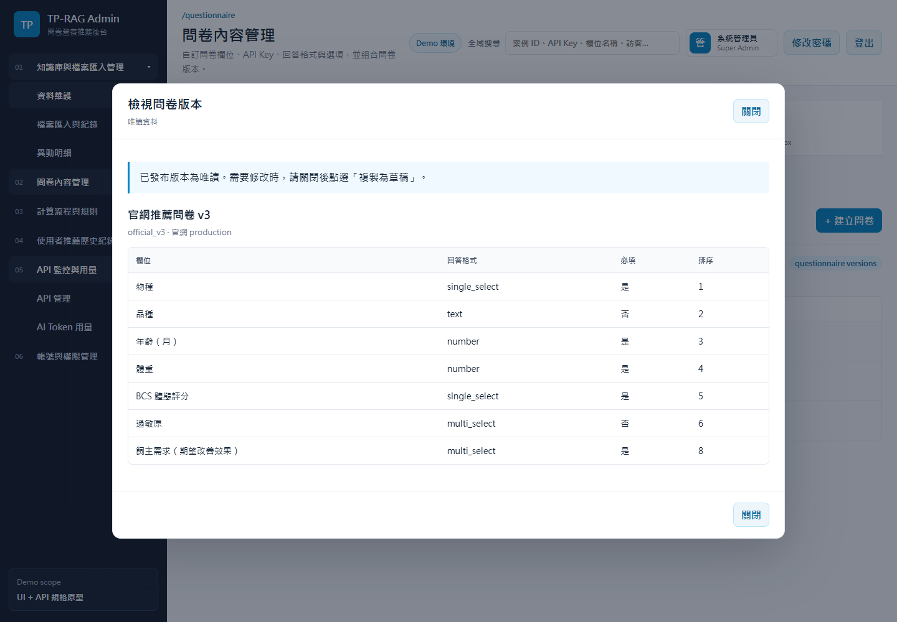

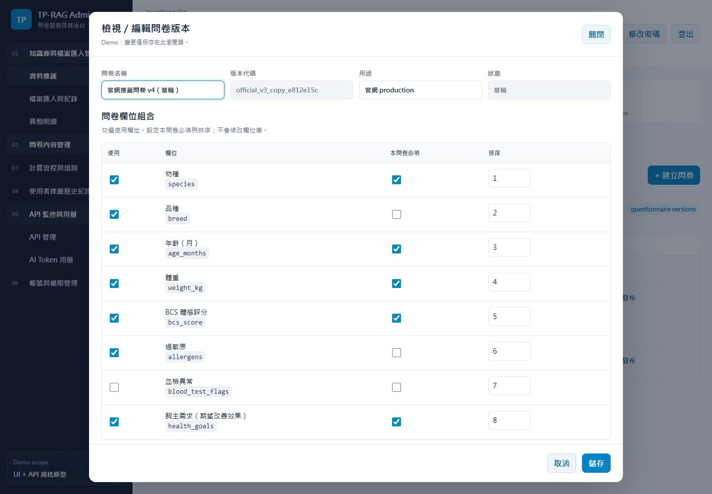

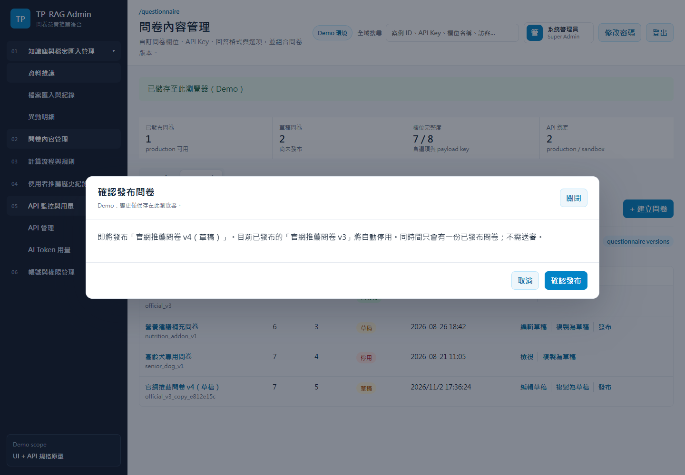

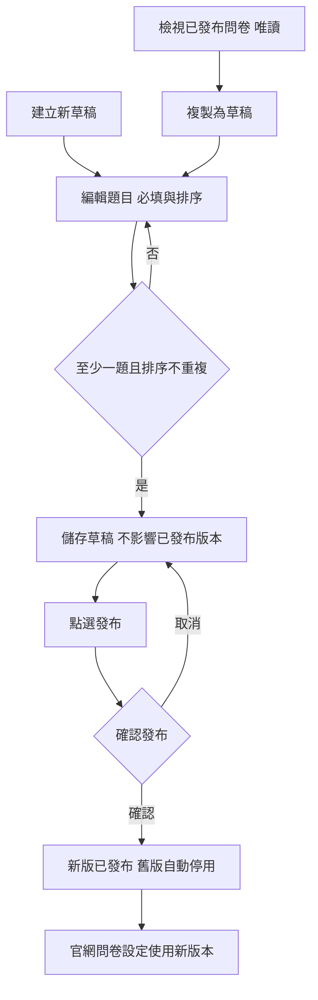

| 欄位／狀態／操作 | 規則 |
| --- | --- |
| 名稱、版本代碼、用途 | 名稱與新增版本代碼必填；代碼唯一，既有版本代碼唯讀 |
| 草稿 | 可修改題目、必填與排序；儲存維持草稿，不等於發布 |
| 已發布 | 唯讀，不可直接修改；同時間最多一份 |
| 停用 | 保留舊版本供檢視，不作為目前官網問卷；如需調整，複製為草稿 |
| 刪除保護 | 曾發布版本連同停用舊版皆保留、不可刪除；欄位或版本已被使用時阻擋刪除並列出使用位置，依 §1、Q11；歷史內容不變 |
| 複製為草稿 | 建立獨立版本與唯一代碼；帶入來源名稱、用途、題目組成，修改不回寫來源 |
| 題目組成 | 每題 key、required、order；至少一題，排序不可重複，依排序保存；必填與排序不回寫欄位庫 |
| 摘要 | 題數、必填數從組成計算，儲存更新時間 |
| 發布 | 只對已儲存草稿操作；確認提示新版名稱及將停用的舊版名稱；確認後一起切換狀態，不需送審 |
| 取消發布 | 不改任何版本狀態與目前官網問卷 |
| 已發布內容 | 固定當次題目、選項、必填與排序；後續欄位庫修改不直接影響已發布內容，需經新版發布生效 |
| 官網問卷設定 | 取目前已發布版本，不固定取清單第一筆；歷史推薦紀錄保留當次內容 |
| 初始官網版本 | official_v3：7 題、5 必填；草稿血檢題未選入 |

**驗收 QF2：** 已發布與停用版本只供檢視；複製產生獨立草稿；取消編輯不寫回；儲存草稿不影響目前發布版本；空組成、重複排序及重複版本代碼阻擋；取消發布不改狀態；確認後新版已發布、舊版停用且已發布數量為一，重新整理仍維持；官網設定改取新版，歷史紀錄不變。

## 4. 計算流程與規則

### 4.1 營養規則優先序

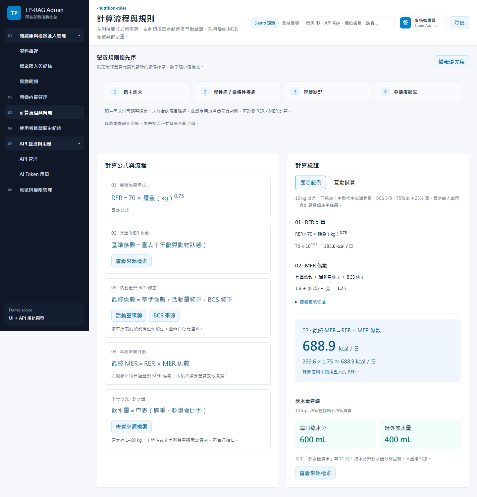

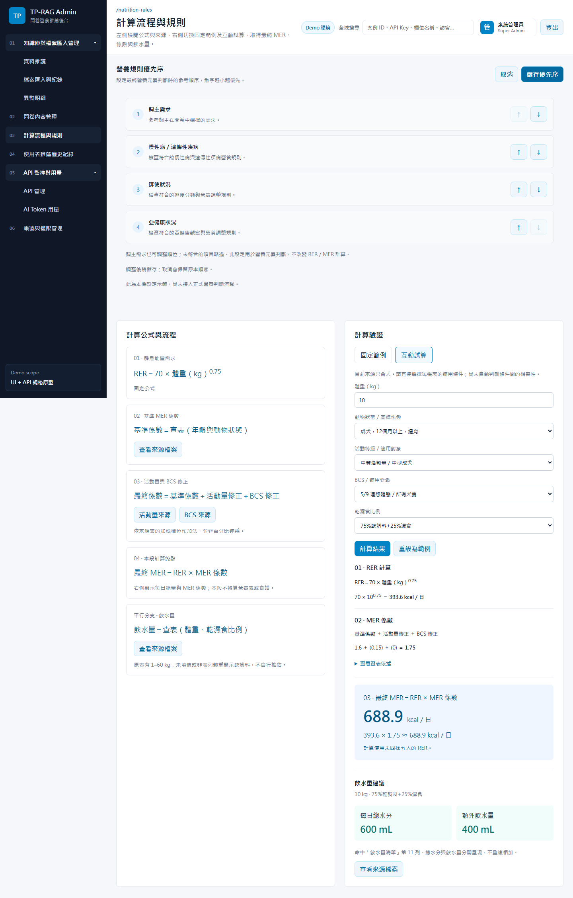

此區設定四類營養規則的順序；目前僅提供排序設定，完整套用方式仍待確認。

| 規則 | 定義 |
| --- | --- |
| 固定分類 | `owner-needs` 飼主需求、`disease` 疾病、`stool` 排便、`subhealth` 亞健康 |
| 預設 | 上述順序，飼主需求第一；全部可排序，不鎖定第一名 |
| 編輯 | 上下移動；邊界箭頭不可移出；取消還原、儲存後生效 |
| 驗證 | 恰好四項，不重複、不缺項、不接受未知 ID |
| 保存 | 原型保存 `schema/order/updatedAt`；失敗保留草稿並顯示錯誤 |
| 邊界 | 不改 RER／MER 算式；目前未接營養計算或歷史。四類順序用於執行與追蹤，不代表倍率接續連乘或後一類直接覆寫前一類；同元素結果依下表取高及不可覆蓋規則處理，剩餘業務規則見 §8 |

**驗收 C1：** 四項任意排列可保存與取消；壞資料不採用；保存失敗不冒充成功。同一元素各規則皆以模板基礎值分別計算，可覆蓋結果取高、不連乘；尚未定案的衝突與去重方式見 Q4。

#### 已確認：營養規則覆蓋與取高

| 項目 | 規則 |
| --- | --- |
| 過敏原 | 最終結果一定排除已命中的過敏原，不因其他營養規則或覆蓋設定而取消排除 |
| 適用來源 | 慢性病與遺傳性疾病營養、排便分類法、亞健康觀察清單，依各筆營養元素規則的 isOverridable 判斷 |
| isOverridable=true | 可被其他規則覆蓋；同一營養元素符合且允許覆蓋的候選結果取較高值 |
| isOverridable=false | 不可被允許覆蓋的規則取代；同一元素有多條不可覆蓋規則時，亦以同一模板基礎值分別計算並取較高結果 |
| 計算基礎 | 各規則使用同一份模板基礎值各別計算候選結果，不以前一條已調整結果作為下一條倍率的基數 |
| 不採用的算法 | 不把不同規則倍率接續相乘，也不自行把倍率或增加量累加 |

**已確認範例：** 同一營養素模板值為 10；疾病 ×1.2、排便 ×1.5，且兩者皆允許覆蓋。候選值分別為 12 與 15，最後取 **15**，不是 10 ×1.2 ×1.5＝18。

**驗收 C3：** 上述範例輸出 15；多條不可覆蓋規則的候選值亦取高，且不被允許覆蓋規則取代；最終結果仍排除命中的過敏原。此為確認後的正式實作規則，現有試算頁尚未接入營養元素調整引擎。

待客戶更新文件後討論：同規則跨分類重複命中、比例值與範圍值的比較及套用方式，暫不制定算法，以客戶後續文件為依據。未填覆蓋狀態，以及低於模板基礎值時模板值是否列入比較，亦保留待確認。已確認的單一數值取高、不連乘及過敏原最終排除原則不變。

### 4.2 公式、固定範例與互動試算

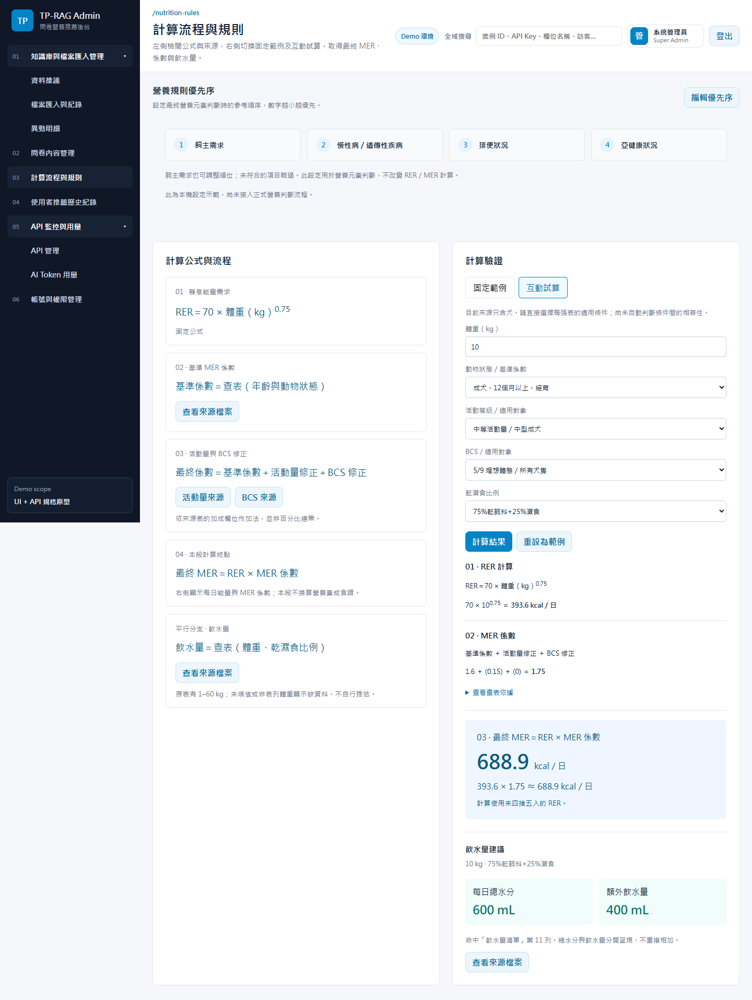

本段目前終點是 MER 與飲水量，不包含正式營養元素或食譜計算。

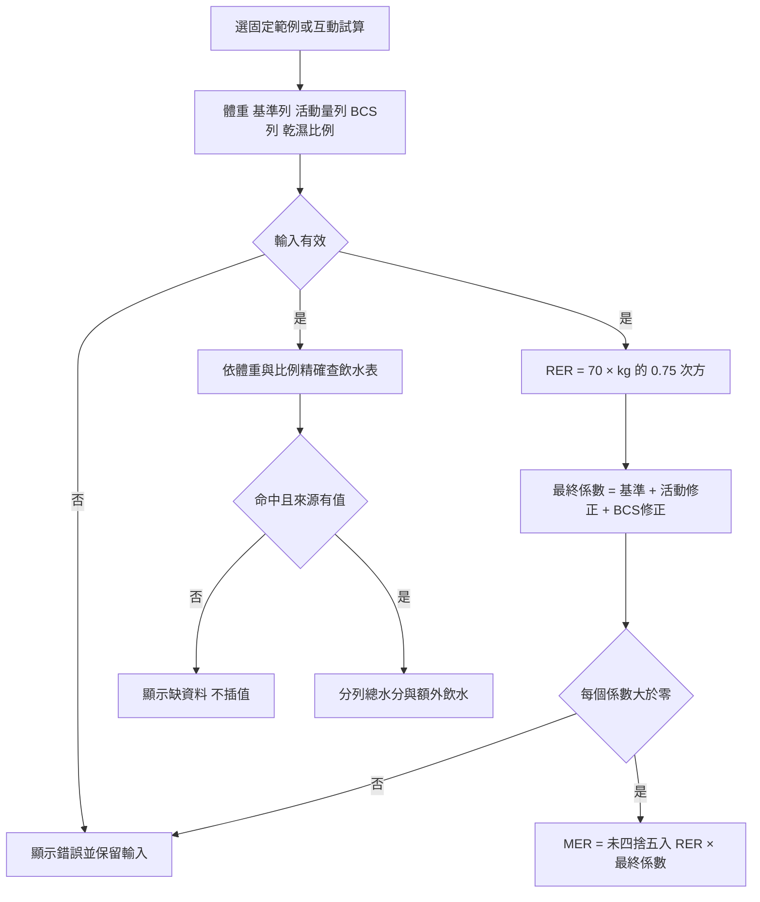

| 輸入／輸出 | 規則 |
| --- | --- |
| 體重 | 必填、有限數值、>0 kg |
| 基準、活動、BCS | 選來源表有效資料列；尚不自動判斷三者適用條件相容性 |
| 基準係數範圍 | 來源允許單值或上下限，對每個端點加活動與 BCS 修正後計算 MER 範圍 |
| 乾濕比例 | 100%乾、75%乾＋25%濕、50%乾＋50%濕、25%乾＋75%濕 |
| 飲水 | 來源 1–60 kg；精確查表，不插值；未命中與命中但欄位空白顯示不同說明；總水分不再加額外飲水 |
| 顯示精度 | RER、MER 主結果一位小數；內部不先四捨五入 RER，係數加總消除浮點尾差 |
| 改輸入 | 提示需重新計算，不把舊結果顯示成新輸入的結果；可重設為範例 |
| 來源視窗 | 展示 Excel 檔名、工作表、列號與原值；空白不當作零 |

**驗收 C2：** 固定 10 kg 範例與互動同輸入產出相同結果；0／負值／非數字體重、無效列及非正係數均阻擋；飲水空白不推估。

### 4.3 待整合的完整推薦決策鏈

以下為待整合的完整推薦流程，尚未在現行試算與歷史紀錄完整呈現。

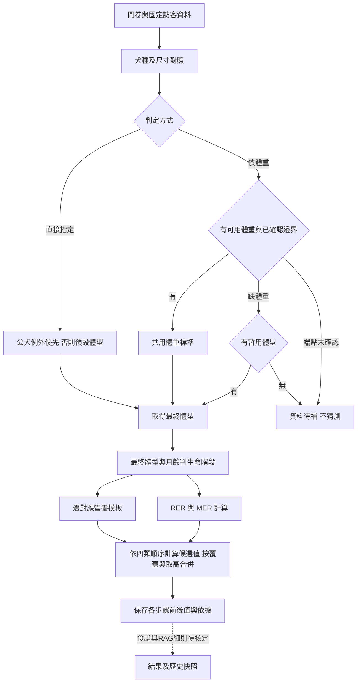

已確認：先依犬種、尺寸、公犬例外取得體型；設定依體重判定者使用實際體重分類。再以最終體型與月齡判生命階段，最後選對應模板。「犬生命階段判斷表」中的預估成犬體重僅為參考，不參與體型或生命階段判斷，也不作為模板選擇條件。模板對照、多命中衝突、未知犬種及月齡／週齡換算仍見 Q2、Q4、Q5。

## 5. 使用者推薦歷史紀錄

### 5.1 清單

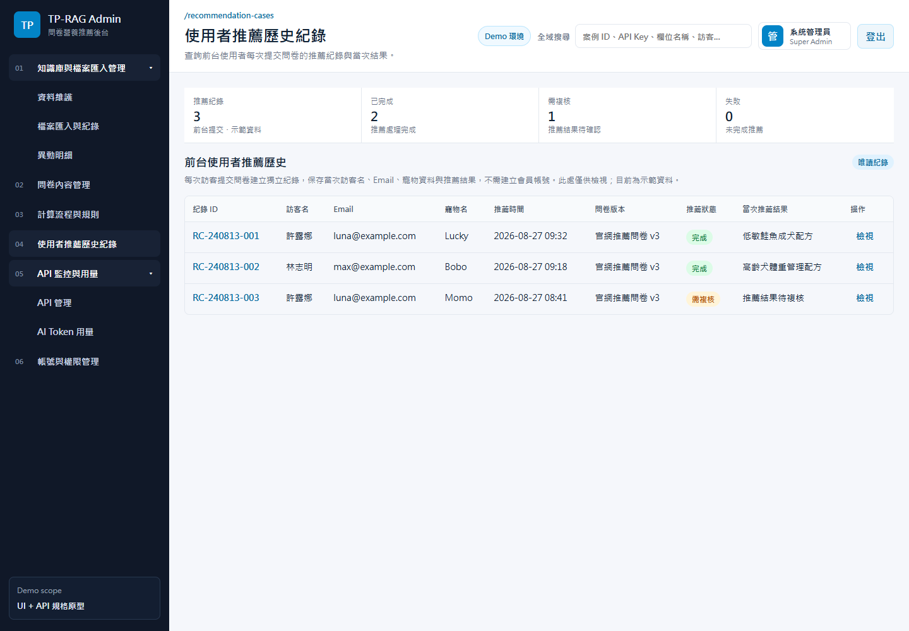

目的：追查每次訪客提交及其當次輸出，不要求會員帳號。

| 區域 | 欄位／規則 |
| --- | --- |
| 摘要 | 總筆數、完成、需複核、失敗；依畫面實際資料集合計數 |
| 清單 | 紀錄 ID、訪客名、Email、寵物名、提交時間、問卷版本、推薦狀態、當次結果、檢視 |
| 範圍 | 目前排除 `apiLogs` 中 source=sandbox 的關聯案件；此為原型篩選方式，正式環境隔離由工程師設計，不作需求端待答事項 |
| 操作 | 點 ID 或檢視開唯讀詳情；無編輯推薦歷史入口 |

**驗收 H1：** 每次提交獨立紀錄、保留當次聯絡資訊與版本；摘要與清單一致；沒有結果快照時明示，不用目前規則補算冒充歷史。

### 5.2 詳情：問卷內容

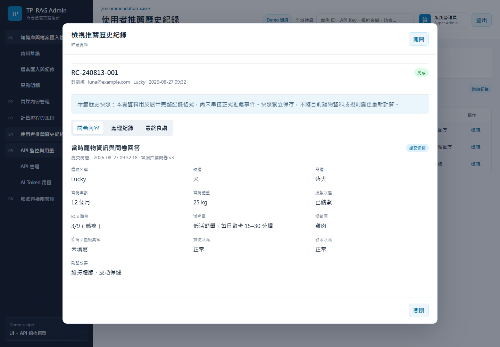

上方顯示案例、訪客、Email、寵物、時間與狀態；預設「問卷內容」頁籤，顯示當時寵物資訊及作答。快照獨立於目前主檔，缺快照時顯示尚未提供提示。

**驗收 H2：** 改目前問卷或知識庫不重算歷史作答；切頁籤不改資料；固定訪客資料的收集位置、Email 必填及驗證要求待客戶資料補齊（Q2）。

### 5.3 詳情：處理紀錄

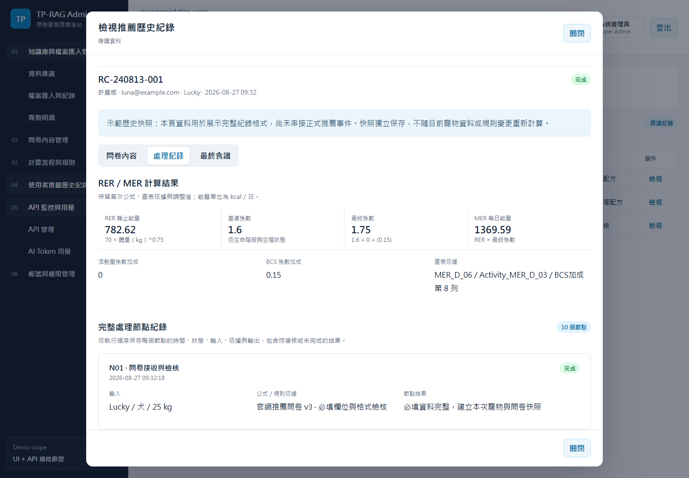

| 區域 | 快照內容 |
| --- | --- |
| 能量 | RER、基準係數、最終係數、MER；活動／BCS 加成、依據 |
| 節點 | `id/time/name/status/input/basis/output`；依當次順序保存，包含未完成與需複核節點 |
| 執行版本 | flow、calculation、rules、index、ranking；可展開完整紀錄 JSON |
| 限制 | 目前示範節點仍為舊流程，尚無 §4.3 的最終體型、模板命中及每項營養素逐步前後值 |

**驗收 H3：** 可重現當次依據與版本、不隨現有設定改變；正式新決策鏈須補每步輸入／輸出及調整來源，規則與串接待辦見 Q4、Q7。

### 5.4 詳情：最終食譜、需複核及缺資料

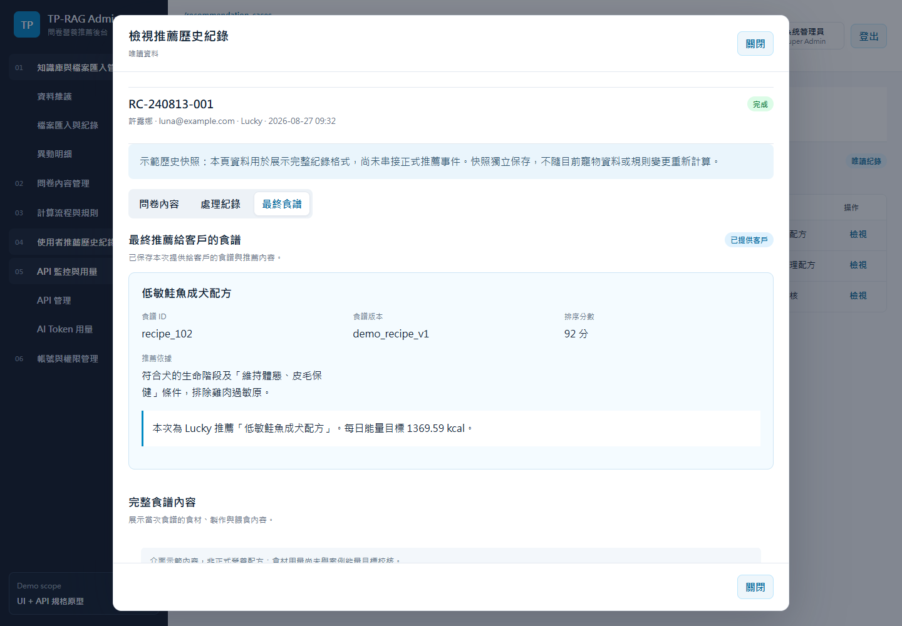

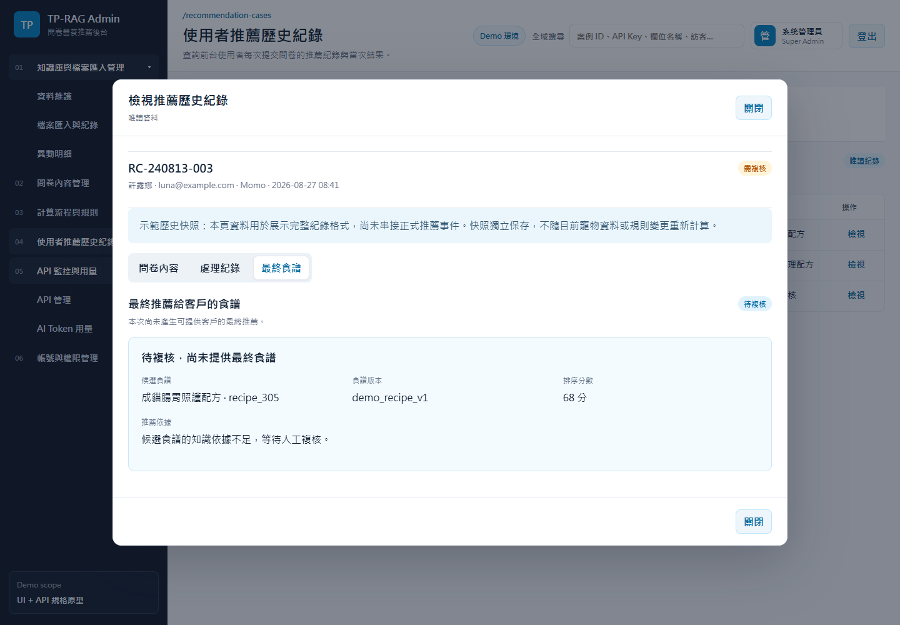

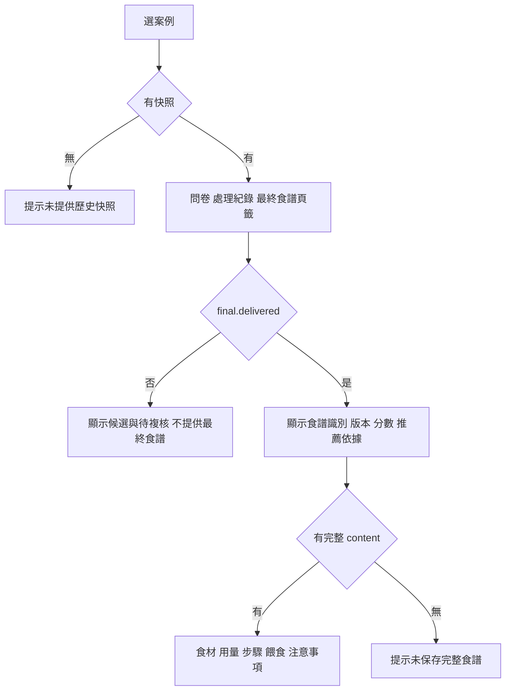

| 狀態 | 呈現規則 |
| --- | --- |
| 完成且 delivered=true | 食譜 ID、名稱、版本、排序分數、推薦依據、訊息與完整內容（若有） |
| 需複核且 delivered=false | 顯示候選食譜與原因，明示未提供最終食譜，不展示為已交付 |
| 無 content | 明示缺食材用量、步驟、餵食等內容，不自行生成 |
| 失敗 | 資料狀態已有失敗，但當前清單範例中的失敗案例被 sandbox 條件排除；失敗時應呈現的內容待 Q7，回應格式由工程師設計 |

「需複核」目前只是歷史結果的顯示狀態，不等於已核定人工審核、駁回或重跑操作；Q10 的免審核指知識庫更新，兩者不可混為同一流程。

**推薦方向（Q7）：** 由 AI 整合相關資料產出食譜，依先前第一階段範例對照；具體範例版本尚待確認，不將目前靜態示範視為正式推薦實作。

**驗收 H4：** 複核前不把候選當正式結果；缺內容提示正確；示範食譜保留「非正式營養配方、未校核能量」提示。若正式流程需保留人工複核，其責任及後續操作待 Q7；不得僅憑示範狀態新增審核、駁回或重跑功能。食譜依第一階段範例對照。

## 6. API 監控與用量

### 6.1 API 管理：格式說明與文件

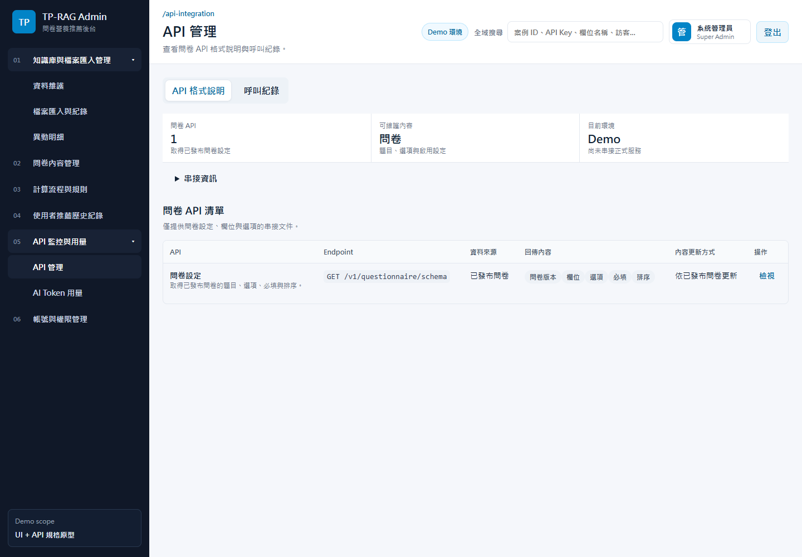

目的：供官網工程師取得問卷結構與驗證／錯誤格式。目前僅有一個問卷設定 API，串接資訊預設收合。

| 契約項目 | 現行文件內容 |
| --- | --- |
| Endpoint | `GET /v1/questionnaire/schema`；不傳 JSON Body |
| Header | `x-api-key`、`Accept: application/json`；欄位的 `key` 與驗證金鑰不同 |
| 連線 | Demo 尚未連線；Base URL、環境與實際金鑰於串接時提供 |
| 成功外層 | `success:boolean`、`message:string`、`data:object`、`traceId:string` |
| 問卷內容 | `data.version`、`data.fields[]`；每題 `key/label/type/required/order`，選擇題另有 `options[{label,value}]` |
| 失敗外層 | `success:false`、`message`、`data:null`、`error.code`、`traceId` |
| 錯誤碼文件 | 401 金鑰缺失／無效；403 無權限；共用資訊另列 404／422／500；適用此 GET 端點的狀態碼及 error.code 完整表由工程師定義 |
| 管理問卷內容 | 從文件跳往問卷欄位庫 |

此圖表達文件宣告，尚無實際服務。**驗收 API1：** GET 無 Body、驗證金鑰位於 Header；成功與失敗外層一致；API 必須回傳唯一已發布問卷的題目、選項、必填及排序；文件範例與呼叫紀錄應對應各自的版本或當次快照，不使用不同版本的示範題目代替。

### 6.2 API 管理：呼叫紀錄與詳情

只列 `/v1/questionnaire/schema`，不混入舊推薦 endpoint。

| 區域 | 欄位／行為 |
| --- | --- |
| 篩選 | 開始日期、結束日期、全部／成功／失敗、關鍵字；搜尋及重設；關鍵字可 Enter 送出 |
| 搜尋範圍 | endpoint、來源、關聯案例、錯誤訊息；日期含當日；開始晚於結束時提示錯誤 |
| 狀態分組 | 成功為 2xx；失敗為 ≥400；3xx 分類由工程師依正式 API 行為定義 |
| 清單 | 時間、method＋endpoint、狀態碼、耗時、來源、錯誤、檢視 |
| 詳情 | 時間、狀態、耗時、來源、錯誤、關聯紀錄、Request／Response；敏感金鑰遮蔽，GET 不含 Body |
| 無結果 | 顯示「沒有符合條件的呼叫紀錄」 |

**驗收 API2：** 篩選可重設且錯誤日期不當作有效查詢；單筆視窗唯讀、驗證金鑰遮蔽。目前 Response 由示範 schema 拼出，非真實當次快照；正式請求／回應紀錄格式由工程師設計；紀錄持續保存，檢視權限由最高管理員設定（Q9）。

### 6.3 AI Token 用量

| 區域 | 內容 |
| --- | --- |
| 摘要 | AI 呼叫筆數、輸入 Token 合計、輸出 Token 合計、總 Token 合計 |
| 紀錄 | 時間、模型、用途、輸入／輸出／總 Token、關聯紀錄 ID |
| 統計邊界 | 目前加總整個示範陣列；不等於問卷 API 呼叫次數，也不是實際帳務 |

**驗收 API3：** 摘要等於指定資料集合的加總，關聯 ID 保留；檢視權限由最高管理員設定，只顯示用量、不顯示費用；費用以後續帳單為主，雲端環境費用由客戶負擔；紀錄持續保存（Q9）。模型名稱只是紀錄範例，不指定正式使用模型。

## 7. 帳號與權限管理

### 7.1 登入與登出

目的：後台人員先登入，再依帳號與角色進入可查看的頁面。訪客填寫前台問卷不使用此登入。

**登入畫面：** 輸入帳號及密碼，可切換顯示密碼；忘記密碼請聯絡最高管理員。

**登入失敗：** 帳號或密碼錯誤、帳號停用或角色停用時，不進入後台，顯示統一錯誤提示。

| 欄位／操作 | 規則 |
| --- | --- |
| 帳號 | 必填，對應後台帳號；去除前後空白 |
| 密碼 | 必填，預設遮蔽；可勾選顯示，不改密碼內容 |
| 登入成功 | 顯示登入者姓名與角色；若有原先要進入的頁面且有查看權限，返回該頁；否則進入第一個有權限的模組。未指定目標時預設左側第一個「知識庫與檔案匯入管理 → 資料維護」；無該頁查看權限時，改進入第一個有權限的模組 |
| 頁面權限 | 導航僅顯示角色可查看的模組；沒有任何可查看頁面時提示聯絡管理員 |
| 登出 | 點頂列「登出」並確認後回登入畫面，清除本次示範登入狀態 |
| 忘記密碼 | 由最高管理員處理，不提供自行註冊或寄信重設入口 |
| 錯誤 | 登入失敗保留表單供修正，不顯示後台內容；正式密碼驗證與安全措施由工程師設計 |

**原型界線：** 目前為瀏覽器端示範驗證，不是正式帳號驗證服務。初始啟用示範帳號 admin／nutrition／ops 使用畫面所列示範密碼；sessionStorage 僅保存示範帳號識別，不保存輸入密碼。正式後端驗證、登入狀態保存及到期政策仍需實作。

**驗收 A3：** 未登入先顯示登入畫面；空值不送出；錯誤或停用帳號不能進入；正確啟用帳號登入後顯示對應身分；登出後回登入；重新登入的預設入口為資料維護，不沿用上次的匯入／異動子頁。前端隱藏頁面不取代後端授權。

### 7.2 後台帳號頁

目的：維護後台操作者及其角色，不建立訪客會員。

| 欄位 | 型別／規則 |
| --- | --- |
| 姓名、Email | 必填文字；Email 使用 email 輸入驗證 |
| 帳號 `account` | 新帳號由最高管理員以 Email 開通，登入帳號自動帶入同一 Email 且不可手改；Email 不可重複。既有示範短帳號維持相容 |
| 角色 `role` | 從角色清單選擇；選取後權限摘要跟隨角色 |
| 權限摘要 `scope` | 衍生顯示，不由帳號任意填寫 |
| 狀態 | 啟用／停用 |

流程：清單 → 新增或檢視／編輯 → 驗證 → 儲存 → 更新清單。編輯最後一位啟用 Super Admin 時，不可停用或改成其他角色。清單有搜尋、角色篩選及部分刪除入口，新帳號僅由最高管理員開通，使用者登入後會收到修改自己密碼的提醒；初始密碼的交付方式仍待確認。最高管理員可由該列「重置密碼」為其他帳號設定新密碼，見 §7.4。

**驗收 A1：** 重複帳號被阻擋；既有帳號不可改識別碼；角色變動更新摘要；始終保留至少一位啟用系統管理員。

**最高管理員開通：** 新增帳號時填寫姓名、Email 及角色，登入帳號自動使用 Email。須明確選擇啟用中的角色；一般管理者不可開通。

### 7.3 角色權限頁與編輯視窗

角色代碼、名稱、說明、權限範圍說明、套用帳號數、狀態；代碼既有值唯讀、名稱不可重複，帳號數由帳號關聯計算。

| 權限 | 規則 |
| --- | --- |
| 進入／查看 `view` | 以目前七個模組的穩定 `moduleId` 表示 |
| 寫入 `write` | 允許時必須同時允許查看；API 管理、Token、推薦歷史不開放寫入 |
| 刪除 `del` | 允許時必須同時允許查看；目前只有帳號、問卷、知識庫列為可配置，不代表各頁已有正式刪除能力 |
| Super Admin | 必須啟用，保持各模組可用的完整權限；不能藉表單移除 |
| 停用角色 | 必須沒有任何帳號歸屬。若仍有帳號，先提示數量與帳號姓名，需到後台帳號逐一變更角色；即使帳號本身已停用，也不可保留歸屬 |
| 更名／範圍修改 | 同步更新套用此角色的帳號名稱與摘要 |

| 預設角色 | 查看範圍 | 可寫入／刪除範圍 |
| --- | --- | --- |
| Super Admin | 全部 | 依上述模組能力 |
| 營養師 | 問卷、計算、知識庫、推薦歷史 | 寫入前三者；問卷與知識庫有刪除設定 |
| 工程 | API、推薦歷史、Token、知識庫 | 無 |
| 唯讀 | 推薦歷史 | 無 |

**驗收 A2：** 角色仍有帳號歸屬時停用被阻擋；所有帳號轉移後才可停用，包含已停用帳號也需轉移。寫入／刪除卻不允許查看時阻擋；Super Admin 防護有效；更名後帳號對應一致。角色 UI 並未證明後端授權檢查，正式後端授權檢查由工程師實作。

**停用前提醒：** 編輯角色時顯示目前歸屬的帳號數與姓名，提醒先將所有帳號轉移至其他角色。

**阻擋停用：** 帳號尚未全部轉移就儲存停用，保留表單並提示「請先將所有帳號更改為其他角色，才能停用」，原角色狀態不變。不自動轉移帳號，也不將「停用角色」與「停用個別帳號」混為同一操作。

### 7.4 最高管理員重置其他帳號密碼

已確認：由最高管理員直接設定新密碼，不寄送重設連結。

**操作入口：** 最高管理員在後台帳號清單點目標帳號的「重置密碼」。目前登入帳號本身不提供此入口；其他角色無此操作權限。

**重置視窗：** 顯示目標姓名及帳號，輸入新密碼與確認新密碼；此操作只改密碼，不修改帳號角色或啟用狀態。

| 欄位／狀態 | 規則 |
| --- | --- |
| 目標帳號 | 顯示姓名與帳號供核對，唯讀 |
| 新密碼、確認新密碼 | 必填且遮蔽；兩次內容須完全一致；正式密碼長度與強度驗證由工程師設計，不把示範密碼當正式規則 |
| 執行權限 | 依最高管理員角色識別判斷，不依可改名稱或按鈕是否顯示判斷；送出時再次檢查權限與目標存在 |
| 確認重置 | 通過驗證後套用新密碼並關閉視窗，回帳號清單顯示結果；不在提示中顯示密碼 |
| 取消／關閉 | 已輸入內容時先確認放棄；不變更目標密碼 |
| 驗證失敗 | 視窗保留，顯示錯誤供修正；原密碼不變 |
| 失去權限／目標不存在 | 阻擋提交，不套用變更 |

**密碼不一致：** 保留視窗，不執行重置。

**完成提示：** 返回清單，不顯示新密碼。

**原型界線：** 新密碼只在本次頁面開啟期間的記憶體中生效，可用於同頁登出後登入；重新整理後還原示範密碼，不寫入 localStorage／sessionStorage，也未變更正式系統密碼。正式實作需由後端驗證最高管理員身分並處理密碼保存，不能將此示範作為正式認證機制。

**驗收 A4：** 最高管理員可替其他帳號重置；一般角色看不到入口且不能執行；自身無此入口；空值或兩次不同阻擋；取消不變更；成功後新密碼可登入、舊密碼失效；角色及啟用狀態不變。正式重置後是否讓對方既有登入失效、是否要求首次登入改密碼及密碼交付方式待 Q1。

### 7.5 使用者登入後修改自己的密碼

最高管理員以 Email 開通新帳號後，使用者登入可進入可查看的後台頁面，頁面上方顯示修改密碼提醒；點提醒的「修改密碼」或頂列同名按鈕，開啟自己的密碼表單。

| 欄位／操作 | 規則 |
| --- | --- |
| 目前密碼 | 必填且遮蔽，須驗證正確 |
| 新密碼、確認新密碼 | 必填且遮蔽，兩次內容須一致 |
| 儲存新密碼 | 驗證通過後完成修改、關閉表單並移除新帳號提醒；新密碼可登入，舊密碼失效 |
| 取消／驗證錯誤 | 取消不修改密碼；已輸入時先確認放棄。驗證錯誤保留表單供修正；尚未完成修改時提醒保留 |
| 權限 | 登入者只能修改自己的密碼；替別人重置仍限最高管理員，兩種操作分開 |

**原型界線：** 新帳號使用畫面標示的示範密碼登入，不寄送開通或密碼郵件。修改密碼只在本次開啟期間生效，不保存輸入密碼；重新整理仍還原示範密碼。正式密碼驗證與保存由工程師實作，初始密碼交付方式待 Q1。此版提供登入後提醒，不自行新增強制攔截流程。

**驗收 A5：** 最高管理員才能以 Email 開通新帳號，重複 Email 被阻擋；新使用者登入後看到提醒；錯誤目前密碼或兩次新密碼不一致時不修改；取消後提醒仍存在，成功後移除；使用者不能藉此修改別人的密碼。

## 8. 規則判斷待討論

以下為會影響推薦或計算結果的業務規則，需討論確認後實作；目前示範數值與文字不作最終核定。

| 討論主題 | 需釐清內容 | 對應章節 |
| --- | --- | --- |
| 營養規則命中與調整 | 已確認模板基礎值各別計算、可覆蓋結果取高、不連乘，過敏原最終必排除。多條不可覆蓋規則亦已確認取高；重複命中及比例／範圍值處理待客戶更新文件後討論；未填覆蓋狀態另待確認 | §4.1、Q4 |
| 體型、生命階段與模板判定 | 已確認體型依犬種／尺寸／公犬例外與實際體重分類；生命階段表的預估成犬體重不參與判斷。剩餘討論為體重端點、月齡／週齡換算與模板對照；不可把說明文字當執行規則 | §2.5、§2.14、§4.3、Q5 |
| 元素及數值適用規則 | 未知元素／單位如何核定、範圍與比例意義、未確認規則能否參與推薦／判斷（知識庫不設發布或審核） | §2.3、§2.13、Q6 |

## 9. 需求端待討論事項

本節僅列需求端／客戶需決定的功能範圍、操作流程及業務規則。保留原問題與需求端回答，已回答部分以回答內容為準，未回答部分繼續待確認；算法尚待客戶更新文件者，收到文件後再討論。

登入與密碼保存、API 格式與錯誤碼、部署環境、資料庫與識別碼、交易與併發處理、資料同步與歷史快照的實作方式，由工程師依已確認的功能與驗收條件設計，不列為需求端待答題目。

| ID | 需求端需確認的內容 | 對應功能頁／章節 | 需求端回答 |
| --- | --- | --- | --- |
| Q1 | 新帳號如何取得初始密碼；管理員如何交付重置後的新密碼；重置後是否要求對方重新登入或修改密碼；停用角色時既有帳號如何處理 | §7 | 已確認：由後台最高管理員以 Email 開通使用者帳號，使用者登入後自行重設密碼。停用「角色」前須將所有歸屬帳號變更為其他角色，角色沒有任何帳號歸屬才能停用（包含已停用帳號）。初始密碼及管理員重置後新密碼的交付細節尚未指定，保留待確認。 |
| Q2 | 訪客姓名／Email 在哪一步收集、哪些必填；性別、絕育、活動、疾病、排便、亞健康及犬種尺寸等題目的內容／選項，以及答案與業務規則的對照 | §2–5 | 待客戶提供正確資料後，再補齊訪客姓名／Email 的收集步驟與必填設定、各題目內容／選項，以及答案與業務規則的對照。目前保留待補資料，不自行補造或核定。 |
| Q3 | 問卷是否需審核後發布；已發布問卷能否直接修改；如何切換到新版本、是否允許暫無已發布問卷；停用題目的影響及數字／滑桿允許作答範圍 | §3 | **已確認：** 不需審核；已發布版本唯讀，複製為草稿後修改；儲存不影響現行版，確認發布後新版生效、舊版自動停用，同時間最多一份已發布問卷。已發布題目內容固定，欄位庫調整需經新版發布。**待確認：** 是否允許主動停用後暫無已發布問卷；數字／滑桿範圍待客戶資料補齊。 |
| Q4 | 待客戶更新文件後確認重複命中、比例與範圍值的處理；未填是否可覆蓋時如何處理、模板基礎值是否列入取高。已確認的取高、不連乘及過敏原最終排除原則維持不變 | §2.13、§4–5 | 待客戶更新文件後討論。 |
| Q5 | 體重與月齡的精確分界、未知犬種或缺少資料時如何處理、MER 適用條件區間、14週與月齡的對應，以及各體型／階段使用哪個模板 | §2、§4 | **待客戶資料：** 體重／月齡分界、缺資料處理、MER 適用區間、14 週對應與模板對照，收到客戶正確資料後補齊。 |
| Q6 | 客戶核定的營養元素名稱、別名與單位；疑似拼字錯誤或新增元素如何確認；停用或未確認的資料能否繼續用於推薦 | §2 | **已回答：** 系統無法確保使用者輸入內容一定正確，不承諾自動辨識或修正所有輸入錯誤。客戶核定名稱／別名／單位仍以交付資料為準；停用資料不參與後續推薦／判斷（Q11）；**待確認：** 未確認資料是否可使用；被停用元素仍在啟用模板／規則內時，相關模板／規則是略過受影響部分或停止推薦，不能自行推定。 |
| Q7 | 最終食譜需提供哪些內容、採用哪些資料與排序依據；缺資料或推薦失敗時使用者看到什麼；需要人工複核時由誰處理、如何確認結果 | §4–5 | **已確認：** 由 AI 整合全部相關資料推薦食譜，內容與呈現參照先前第一階段範例。不另自行設計推薦內容或排序規則；第一階段範例的具體交付版本待對照確認。缺資料、推薦失敗及人工複核的處理尚未回答。 |
| Q8 | 客戶預計交付的匯入檔案格式與欄位範本；重複資料要更新、略過或保留現值；檔案未含的舊資料是否保留；部分資料有錯時整批停止或允許其他筆匯入 | §2.15 | **已確認：** 以系統現有資料為主：檔案與系統皆有則更新並保留修改前後資料；檔案有、系統沒有則直接新增並保留新增紀錄；系統有、檔案沒有則保留原資料與狀態，不刪除或停用；部分資料錯誤時，其他有效資料仍繼續匯入，最終明確指出問題資料及錯誤原因；檔案欄位錯誤應在匯入前提早提醒。檔案格式／欄位範本仍待客戶提供。 |
| Q9 | 推薦與用量紀錄需要的查詢條件／統計期間；哪些資料允許哪些角色查看、哪些個資需遮蔽；紀錄保存多久及刪除政策；是否需要顯示費用 | §5–6 | **已確認：** 由最高權限管理員設定檢視權限；此處只顯示用量，不顯示費用，費用以後續帳單為主；紀錄持續保存，不設自動到期刪除。雲端環境使用費用由客戶負擔；不再另列費用計價或雲端費用為需求端待答事項。 |
| Q10 | 知識庫修改儲存後是否立即用於後續推薦，或需審核／發布後才生效 | §2 | **已確認：** 知識庫更新儲存成功後，立即用於後續推薦與規則判斷；目前不需審核或發布機制，不回寫既有歷史結果。 |
| Q11 | 哪些資料可刪除；已被引用或已發布的資料是否只能停用；刪除前需要呈現哪些影響供使用者確認 | §1–3、§7 | **已確認：** 未被引用的資料可刪除，刪除前再次確認；已被引用則阻擋刪除、列出使用位置並提供停用。停用保留資料供查閱，禁止新增選用且不再參與後續推薦或判斷；若仍被啟用中的模板／規則使用，停用前提醒影響位置與數量。曾發布問卷含停用舊版皆保留、不可刪除，新版發布後舊版自動停用；欄位庫停用不改既有已發布問卷固定內容，依 §3.2；歷史推薦與異動紀錄持續保留，不因來源資料刪除／停用改變，不含退版或批次復原。帳號／角色仍依 §7 的保護規則處理。 |

## 10. 交付與驗收使用方式

| 檢查層級 | 本文件的用法 |
| --- | --- |
| 頁面／互動 | 按模組逐頁實作；用各節 A／API／QF／C／K／I／H 驗收編號及相鄰截圖核對 |
| 規則 | 原型已有驗證可作工程基線；Q 編號未決內容先核定，不以示範數值補需求 |
| 交付待補 | Q2／Q5 等待客戶資料，Q4 等待更新算法文件；Q7 第一階段範例版本需對照，推薦失敗／缺資料處理未定；Q8 匯入格式／欄位範本待客戶提供（新增、更新與保留原則已確認）；Q6 停用元素對所屬模板／規則的處置未定。相關部分先保留待確認，其他已確認模組可開始實作 |
| 整合 | 另驗證後端持久化、授權、真實匯入、計算資料連動與推薦快照；頁面可點擊不算這些整合通過 |
| 檢視 | 各功能頁以相鄰截圖與文字規則核對；截圖不代表所有輸入組合、正式營養正確性或手機版已通過驗收 |

圖片內日期、帳號與案例均為原型示範資料。表單較長時截圖僅顯示當時可視範圍，未顯示欄位以本節欄位表說明為準。
