# TP-RAG 工程師實作規格

日期：2026-10-30｜更新：2026-11-04｜依功能模組與功能頁整理｜狀態：依現行原型整理，未決項目不視為核定需求。

## 0. 閱讀方式與畫面對照

本規格以目前 UI 為對照，依「功能模組 → 功能頁」整理。每頁搭配畫面截圖、操作流程、欄位規則與驗收條件，不需要開啟本機程式或其他專案文件即可閱讀。

截圖中的帳號、案例與營養數值為示範資料；畫面可操作不代表正式後端或串接已完成。未定案的規則標示「待確認」，驗收條件不代表已通過正式驗收。

交付判讀原則：已確認的文字規則與驗收條件為實作依據；截圖與標示「原型／示範」的內容用於畫面對照。兩者有差異時，下文會明列，不把舊示範選項當成已核定流程。待確認項目不可直接以示範值實作為正式業務規則。

### 0.1 模組與功能頁對照

| 模組 | 功能頁／子畫面 | 本文 |
| --- | --- | --- |
| 知識庫與檔案匯入管理 | 12 類資料維護、各類表單、體重標準、匯入與紀錄、異動明細 | §2 |
| 問卷內容管理 | 欄位庫、欄位與選項表單、問卷版本、版本組成表單 | §3 |
| 計算流程與規則 | 優先序、公式與來源、固定範例、互動試算 | §4 |
| 使用者推薦歷史紀錄 | 清單、問卷內容、處理紀錄、最終食譜 | §5 |
| API 監控與用量 | API 格式說明、文件視窗、串接資訊、呼叫紀錄、單筆紀錄、AI Token | §6 |
| 帳號與權限管理 | 登入／登出、後台帳號、角色權限、最高管理員重置密碼 | §7 |

## 1. 各功能頁通用的操作規則

各頁沿用以下操作方式；個別功能的欄位與例外在對應章節說明。

| 操作 | 說明 |
| --- | --- |
| 切換頁面 | 使用左側選單進入各模組及功能頁 |
| 新增／編輯 | 多數資料以彈出視窗編輯；既有營養模板在原頁整份編輯 |
| 儲存 | 先檢查必填、格式及重複資料；有錯誤時顯示原因，修正後再儲存 |
| 取消／離開 | 不保存修改；已有未儲存內容時，先確認是否放棄 |
| 檢視 | 唯讀內容只供查看，關閉不修改資料 |

**驗收：** 取消不改資料；錯誤可修正後重新儲存；唯讀內容不能修改。

### 刪除、停用與保留（Q11 已確認）

適用知識庫資料、問卷欄位與版本；帳號／角色仍須遵守 §7 的管理員及歸屬帳號保護規則。

| 情況／操作 | 規則與畫面提醒 |
| --- | --- |
| 未被引用的資料 | 可以刪除；刪除前再次確認，取消不變更資料 |
| 已被引用的資料 | 單筆操作阻擋刪除，列出使用位置，提供停用操作；引用指其他資料正在使用它，例如模板／規則使用營養元素、問卷版本選用欄位 |
| 停用前 | 若仍被啟用中的模板或規則使用，列出受影響的位置與數量，提醒將影響後續推薦與判斷，確認後才停用 |
| 停用後 | 知識庫資料保留既有引用供查閱，禁止新增選用，不再參與後續推薦或判斷；欄位庫停用不改已發布問卷的固定內容，依 §3.2 |
| 曾發布的問卷版本 | 包含已被新版取代的停用舊版，皆唯讀保留、不可刪除；發布新版時舊版自動停用，依 §3.2 操作 |
| 歷史推薦與異動紀錄 | 持續保留，不因來源刪除或停用改變既有內容；不提供退版或批次復原 |

完整匯入的範圍取代與引用檢查依 §2.15；本節單筆刪除／停用規則不改寫 Q8 的整份覆蓋方式。

**驗收：** 未引用資料須確認後才刪除；被引用資料阻擋刪除並顯示使用位置；停用前顯示啟用中模板／規則的影響位置；取消不改狀態；停用知識庫資料不能新增選用或參與後續推薦／判斷；已發布問卷固定內容依 §3.2 保留，歷史結果與前後異動資料維持不變。以上為已確認實作需求，不代表現行原型已具備全部提醒與刪除功能。

**控制項判讀：** 共用新增、儲存、取消及關閉依本節，個別頁面差異依各節。四個清單的搜尋／篩選已接線；仍未完成的正式匯入、後端串接及欄位刪除，不因按鈕外觀視為已完成。

| 共用顯示 | 操作界線 |
| --- | --- |
| 頂列登入者資訊 | 只顯示姓名與角色，不是選單；修改密碼、登出各用獨立按鈕。全域搜尋及未定義的「更多」入口已移除 |
| 摘要數字、狀態徽章、資料標籤 | 資訊顯示，不是查詢或導頁按鈕 |
| 長說明、來源文字、JSON 展開 | 展開／收合當前內容，不變更資料、不重新執行計算 |
| 清單列刪除 | 帳號／角色不提供刪除，只可依保護規則停用；知識庫與問卷依 Q11，欄位庫目前刪除入口仍未接線，不視為正式刪除已完成 |
| 儲存失敗 | 必填／格式驗證失敗保留輸入；瀏覽器保存失敗須顯示限制，不視為正式後端保存成功 |

#### 問卷與帳號清單的共用搜尋規則

適用欄位庫、問卷版本、後台帳號與角色權限四頁；搜尋欄位與選項依各頁表格。知識庫與 API 紀錄沿用各自章節的查詢規則。

| 操作／條件 | 規則 |
| --- | --- |
| 關鍵字 | 去除前後空白，忽略英文大小寫，整段部分比對；不拆詞、不模糊比對 |
| 搜尋欄位 | 各頁指定欄位任一符合即可；關鍵字與所有已選篩選條件採 AND |
| 套用時機 | 輸入或改選不立即查詢；點「搜尋」或關鍵字 Enter 才套用 |
| 重設 | 清空關鍵字、所有篩選回全部，立即顯示全部資料 |
| 無結果 | 表格顯示「沒有符合條件的資料」，保留已套用條件，可重設重查 |
| 作用範圍 | 各頁獨立保存本次開啟期間已套用條件，不影響其他頁；重新整理不保留查詢。列表摘要維持各頁原定統計範圍，不作搜尋結果筆數 |

**驗收 S1：** 四頁逐一驗證關鍵字大小寫與空白、指定欄位部分比對、多條件 AND、改選後需搜尋才更新、Enter、重設與無結果；篩選後檢視／編輯仍對應正確資料。

## 2. 知識庫與檔案匯入管理

### 2.1 共用清單與資料契約

目的：依固定 schema 管理可新增的資料列、營養元素及規則。共 11 類，各類畫面與欄位分別列於下列章節。

| 共用項目 | 行為 |
| --- | --- |
| 工具列 | 資料類型、模板選擇（僅模板）、關鍵字、全部／啟用／停用、搜尋、匯出、新增 |
| 內容 | 每種類型自己的欄位與表單，不允許管理者自由新增系統欄位 |
| 識別 | 元素／模板／資料／規則均保留 ID；來源列 `sourceRows`、來源原文另留追查 |
| 資料列 | 一般資料原型保存 `id/cells/children/status`；疾病、排便與亞健康依記錄保留 `healthMatrix` 或 `rules[]`。此為來源結構描述，不要求正式資料庫照搬陣列欄位 |
| 新增／編輯 | 依類型使用整頁表單或視窗；BCS 依物種及分數判重，品種依所選物種及品種／尺寸維護 |
| 刪除／停用 | 依 §1、Q11：未引用可確認刪除；已引用阻擋刪除並列使用位置，可確認停用。停用後保留資料與引用，不供新增選用及後續推薦／判斷 |
| 匯出 | JSON，完整當前類型；模板只匯出所選模板；包含停用資料、不受搜尋篩選限制。犬種匯出含共用體重標準 |
| 保存與生效 | 保留修改前後值及上下文；正式功能儲存成功後立即用於後續推薦與判斷，不需審核／發布（Q10）；不回寫 Excel、不改歷史案例。目前原型尚未同步計算與 RAG |

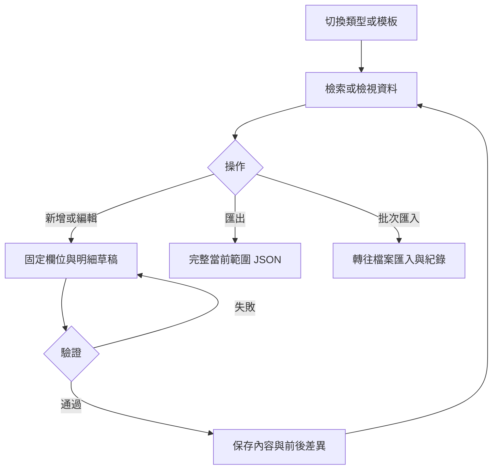

#### 搜尋與篩選

| 控制項 | 已接線行為與限制 |
| --- | --- |
| 資料類型 | 切換即更新清單，清空已套用關鍵字，狀態回「全部」 |
| 營養模板 | 僅模板類顯示，切換即更換模板；保留已套用關鍵字與狀態 |
| 關鍵字 | 按「搜尋」或 Enter 才套用；不分英文大小寫的整段部分比對，不拆詞、不模糊比對；目前不去除前後空白 |
| 比對範圍 | 元素／一般資料比對整筆資料序列化內容，含未在摘要欄顯示的明細與 key；模板比對所引用元素資料及該模板標準值，不搜尋模板基本說明 |
| 狀態 | 全部／啟用／停用，改選立即套用，與已套用關鍵字為 AND；模板頁篩選的是引用元素狀態，不是模板本身狀態 |
| 無結果／清除 | 顯示「沒有符合條件的資料」；無獨立重設按鈕，清空關鍵字後搜尋並將狀態改全部 |
| 編輯中 | 模板整頁編輯時顯示所有引用並停用搜尋工具列；避免隱藏仍待驗證的欄位 |

以上精確描述現行原型；正式搜尋是否改成限定可見欄位、去空白或多詞查詢，尚無需求依據。

#### 檢視與編輯狀態

清單或模板檢視畫面都不能直接修改資料；必須由對應按鈕進入編輯。各頁截圖依下表區分，欄位限制仍依各節規則。

| 頁面 | 檢視 → 編輯入口 | 編輯位置 |
| --- | --- | --- |
| 營養標準模板 | 模板檢視頁點「編輯」 | 原頁開放欄位輸入，出現「儲存變更／取消」 |
| 營養元素及其餘資料類型 | 清單該列點「檢視／編輯」 | 開啟可直接輸入的編輯視窗，出現「儲存／取消／關閉」；視窗內不需再按一次編輯 |
| 共用體重分類標準 | 犬種與體型頁點「編輯體重標準」 | 開啟共用標準編輯視窗 |

| 操作結果 | 模板原頁編輯 | 其他資料／體重標準編輯視窗 |
| --- | --- | --- |
| 儲存成功 | 更新整份模板，回到原頁唯讀檢視 | 更新資料並關閉視窗，回到清單或體重標準檢視 |
| 取消／關閉 | 按取消後確認放棄，還原為編輯前資料 | 沒有修改時直接關閉；已有修改則先確認是否放棄，不儲存本次變更 |
| 驗證失敗 | 保留輸入與編輯狀態，顯示錯誤 | 視窗保持開啟、保留輸入並顯示錯誤，修正後可重送 |

新增資料會直接進入新增表單，不需要先經過唯讀檢視；儲存與取消規則同上。以上「儲存成功」指通過表單驗證並套用內容；目前為瀏覽器示範，若本機保存失敗須提示，不能當成正式後端已保存。

**驗收 K0：** 類型切換顯示自己的欄位；搜尋／狀態篩選不改資料；取消不落資料；匯出範圍不被篩選截斷；新增資料不得誤變成新增 schema 欄位。

### 2.2 營養標準模板

**檢視模式：** 模板基本資料與營養標準值皆為唯讀；點右上「編輯」才開放輸入。

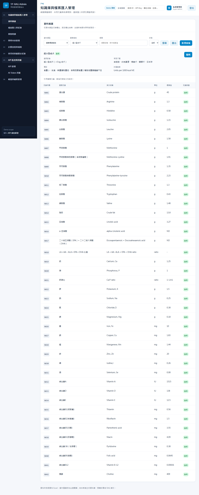

**編輯模式：** 在同一頁修改模板名稱、狀態、固定內容與元素引用／標準值；元素名稱及單位仍由主檔決定。「儲存變更」通過驗證後回到檢視，「取消」確認放棄後還原。

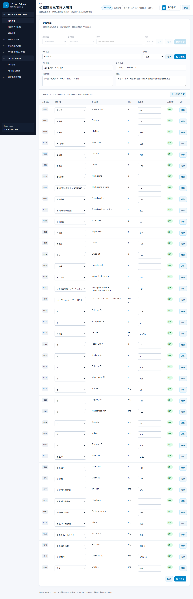

初始九個模板：超小型、小型、中型、大型、超大型成犬、高齡犬、幼犬、大型及超大型幼犬生長前期／後期。數量為示範初值，非系統上限。

| 欄位 | 型別／規則 |
| --- | --- |
| `id/name/status` | 穩定 ID、必填不重名名稱、啟用／停用 |
| 模板選用條件 | 物種單選，體型及生命階段使用多選下拉；體型未選表示不限，生命階段符合任一所選項即可。額外選用條件選填自由文字，原文保存。 |
| `meta` | 固定適用對象、常見犬種、備註、計量基準；內容可修改 |
| `items[].elementId` | 引用共用元素 ID，不得重複；新增引用只可選啟用元素，原有停用引用可保留 |
| `items[].value` | 保留空白、0、非負數字、ND、N/A、`-`、比例或範圍；負數及不符格式字串阻擋 |
| 元素名稱／英文／單位 | 從元素主檔顯示，本頁不能改主檔 |
| 編輯行為 | 單一編輯入口；同頁一次改基本資料與引用，加入／移除引用後整份儲存或取消；新增列捲動並聚焦 |
| 編輯鎖定 | 顯示全部引用，暫停類型、模板、搜尋與匯出切換；離開選單確認放棄，重整由瀏覽器提示 |
| 紀錄 | 整份修改記一次異動，未改內容不顯示虛構差異 |

| 模板按鈕／欄位 | 行為補充 |
| --- | --- |
| 新增模板 | 開基本資料視窗；名稱必填且不重複，狀態預設啟用；先建空模板，再編輯加入元素 |
| 編輯／加入營養元素 | 編輯目前模板；加入空白引用列並捲動聚焦，不自動建立元素主檔 |
| 移除 | 只移除編輯草稿中的引用，不刪元素主檔；取消可放棄，整份儲存才生效 |
| 適用對象／計量基準 | 單行文字；常見犬種／備註為多行文字，現行未設必填；不因文字描述自動判定適用條件 |
| 元素選擇／標準值 | 元素下拉帶出名稱、英文及單位；值可輸入，元素主檔資訊唯讀；不可儲存空白或重複元素引用 |

**驗收 K1：** 名稱重複、重複引用、負數阻擋；空白與 0／ND 往返不失真；同元素在不同模板的數值獨立；模板條件須隨基本資料儲存。

正式模板選用依物種、最終體型與生命階段找候選，品種用於上游體型判斷。每次選用都經 AI 判讀候選的額外條件。過重貓模板選成年期與高齡期，額外條件填 `BCS=7、8、9`；符合時優先採用，未命中則依生命階段取一般模板。缺資料時區分無法判定與不符合，多個特殊模板同時命中的處理待確認。原型提供條件維護及本機保存。

### 2.3 營養元素主檔

**清單檢視：** 此處為營養元素的唯讀清單；點該列「檢視／編輯」開啟下方表單。

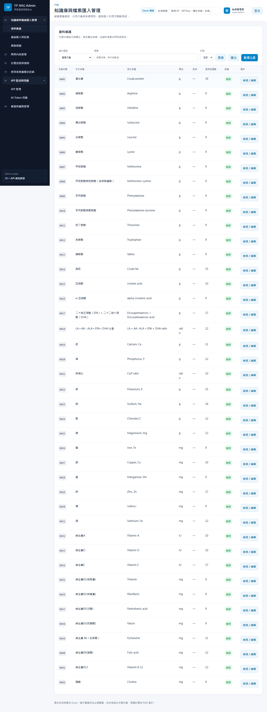

**編輯視窗：** 開啟後即可輸入，不需再按編輯。名稱、英文名稱、別名與狀態可修改；已被引用的單位仍鎖定，元素代碼不能修改。 儲存、取消及驗證失敗的處理依 §2.1。

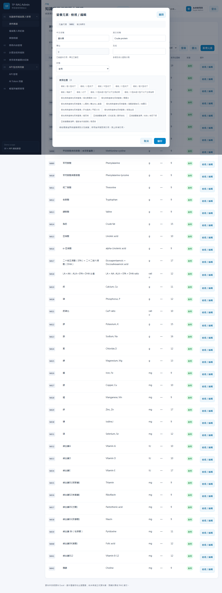

初始 42 項來自模板快照，不代表完整核定元素字典。

| 欄位／動作 | 規則 |
| --- | --- |
| ID | 建立後固定，以 ID 被模板及規則引用；現有示範 ID 不能直接當正式匯入代碼政策 |
| 中文名、英文名、單位、別名 | 中文名及單位必填；別名以逗號分隔；中文或非空英文名稱不分大小寫判重 |
| 單位 | 已被任一模板、疾病、排便、亞健康規則引用時鎖定 |
| 使用位置 | 列引用模板及三類規則所屬資料，顯示使用位置數 |
| 刪除／停用 | 未引用可確認刪除；已引用只能停用，先列使用位置與影響提醒。停用保留既有引用，禁止新增引用且不參與後續推薦／判斷（§1、Q11） |
| 未對應名稱 | 保留來源，人工對應；`CI`、`curde fat`、主檔缺少的 Vitamin C 等不能猜測合併或補單位 |

| 元素欄位 | 宣告補充 |
| --- | --- |
| ID | 系統建立，表單唯讀 |
| 中文名／單位 | 單行文字，必填並去前後空白；已有引用時單位唯讀 |
| 英文名／別名 | 單行文字，可空白並去前後空白；別名依逗號分隔保存 |
| 狀態／使用位置 | 狀態為啟用／停用；使用位置為唯讀，包含模板與三類規則，不因收合而刪除 |

**驗收 K2：** 改名不斷引用；被規則引用亦會鎖單位；停用不移除舊引用，但不能再選入或參與後續推薦／判斷；字典擴充不等於演算法自動支援新元素，正式計算參與規則待 Q6。

### 2.4 MER 係數

依物種、生命階段、絕育與生理狀態維護基準係數，可選填年齡區間及端點是否包含。懷孕與哺乳分別提供懷孕週數、哺乳幼犬數條件。清單顯示物種、適用條件、基準係數與狀態。活動量及 BCS 修正各自維護。

**驗收 K3：** 依物種提供生命階段選項，合併幼年期與個別階段依畫面選項選用；係數與年齡範圍依表單驗證。待確認的來源條件保留提示。

舊版畫面供追溯，現行欄位及操作依本節。

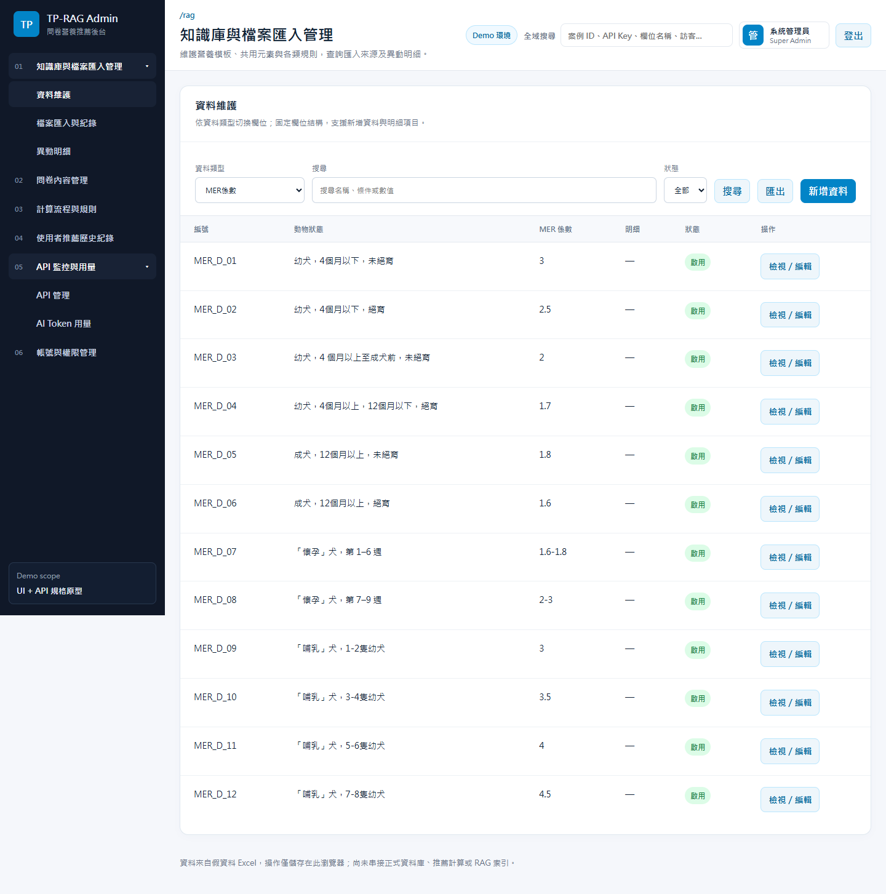

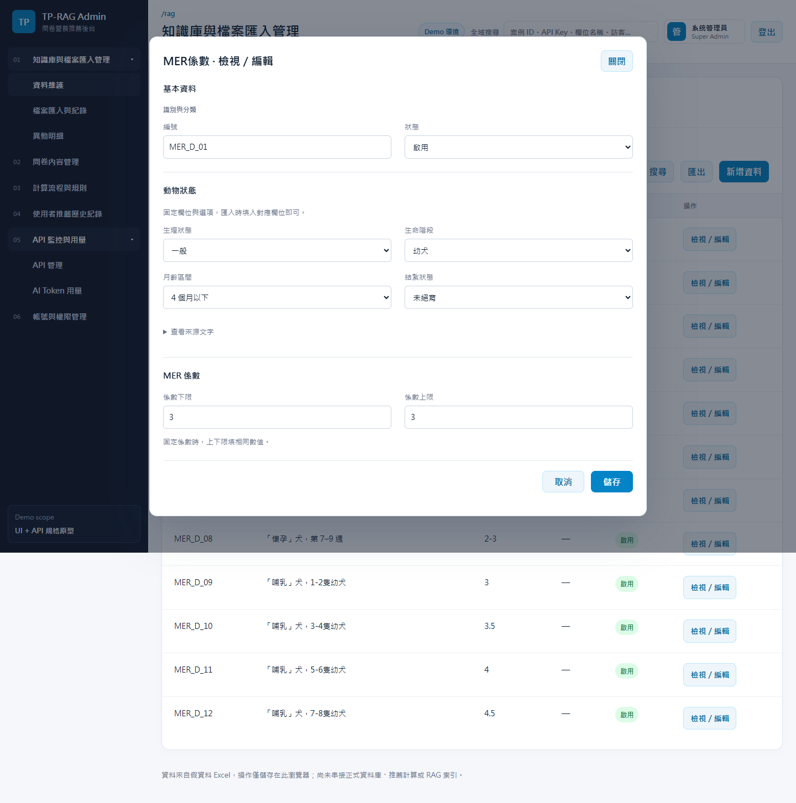

### 2.5 生命階段判斷表

先選物種，再依該物種已維護的體型設定。每個體型選擇幼年期是否分前後期。未分段時填幼年期、成年期、高齡期；分段時幼年期拆為生長前期及後期。超小型犬、小型犬、中型犬及貓採不分前後期。

每個階段填含起始年齡與單位（月／年），結束可設含整個指定月齡、未滿指定年齡或無上限。程式換算成月齡顯示判定預覽，例如 0–9 月齡等同未滿 10 個月。

**驗收 K4：** 切換分段方式後顯示對應欄位；檢查區間完整、順序及銜接，儲存失敗留在編輯表單。

舊版畫面供追溯，現行欄位及操作依本節。

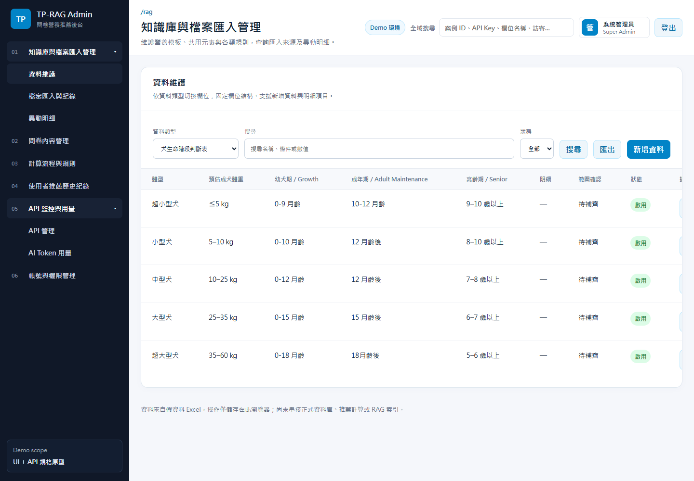

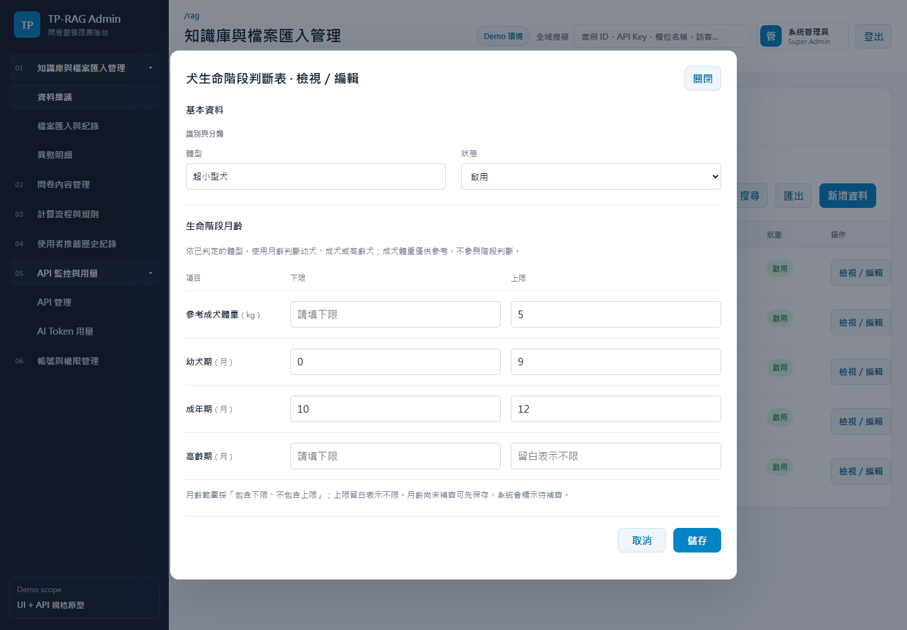

### 2.6 活動量加成

先選物種。透過「設定加成對象」指定各生命階段同階段共用或依體型分開，選項由生命階段及體型資料帶出。犬預設幼犬及高齡犬共用各自階段的加成，成犬依體型；高齡犬維持單一生命階段。切換方式保留另一模式已填的值。

等級維護包含編號、活動量等級、定義、狀態、各對象的 MER 加成與選填提示。加成以加法套用，可填正值、負值或 0。

**驗收 K5：** 各對象皆須填數值才可儲存；0 可儲存；問卷活動值對照待 Q2。

舊版畫面供追溯，現行欄位及操作依本節。

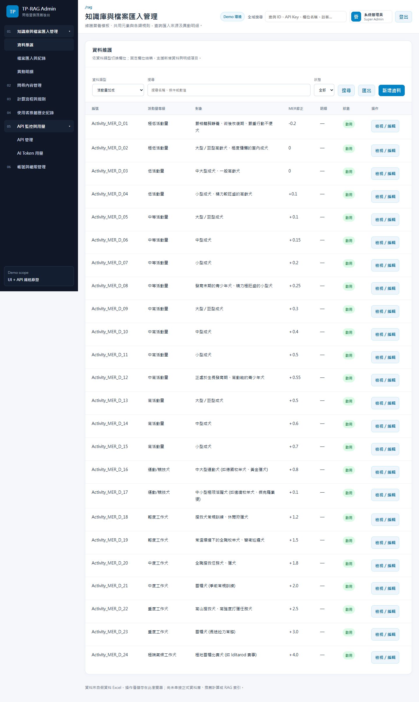

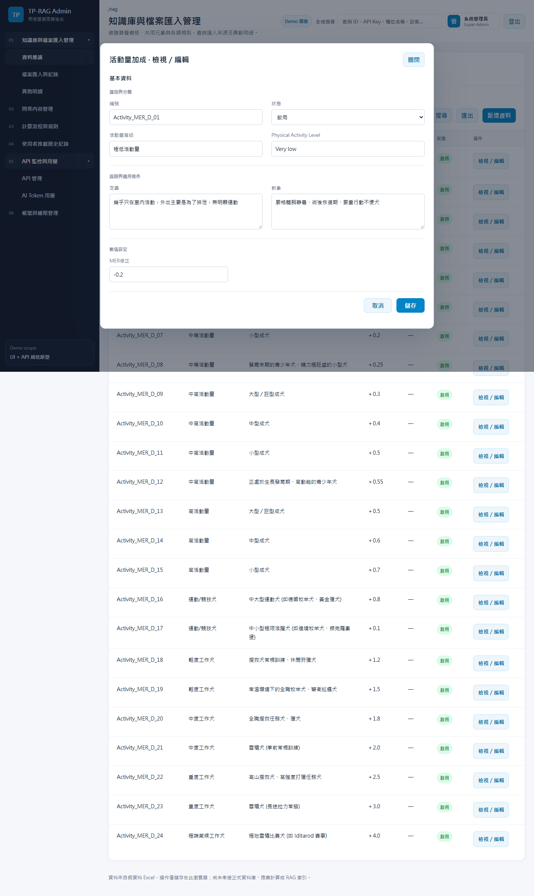

### 2.7 BCS 加成

依物種維護 1/9 至 9/9 的評分、體態分類、定義、狀態及各對象的 MER 加成。每物種每分數一筆。加成對象的設定方式同活動量，兩類設定各自保存；切換共用或依體型時保留另一模式已填的值。

**驗收 K6：** 每個適用對象須填正值、負值或 0。既有標為不適用的 BCS 對象顯示來源狀態，無須輸入。過重貓加成欄的套用條件待確認，與營養模板選用條件分開。

舊版畫面供追溯，現行欄位及操作依本節。

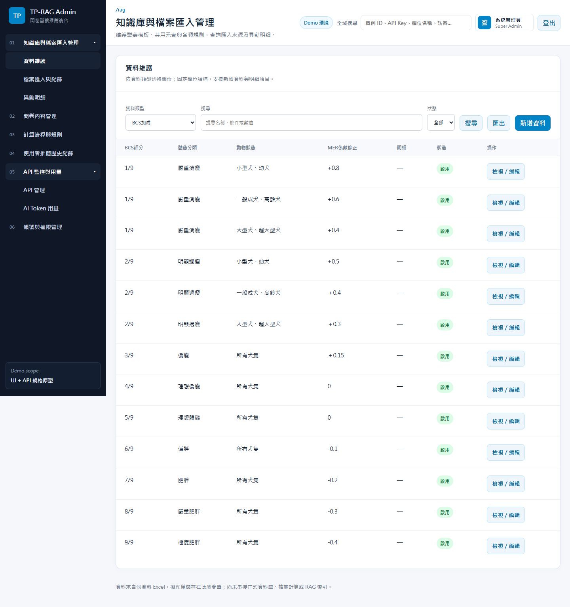

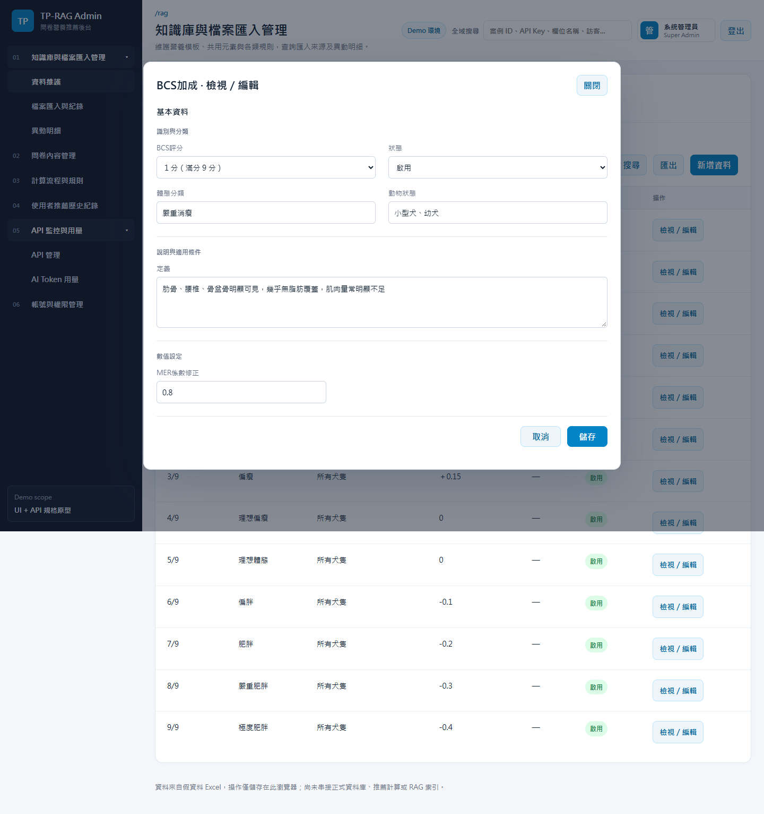

### 2.8 過敏原清單

**清單檢視：** 此處為過敏原的唯讀清單；點該列「檢視／編輯」開啟下方表單。

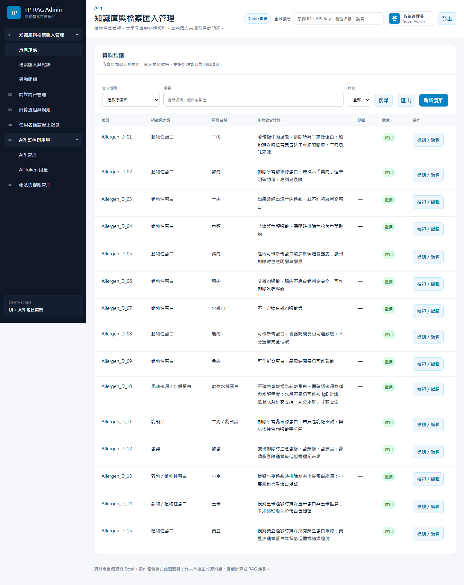

**編輯視窗：** 開啟後即可輸入，不需再按編輯。可修改分類、原料名稱、過敏來源與排除建議等固定欄位。 儲存、取消及驗證失敗的處理依 §2.1。

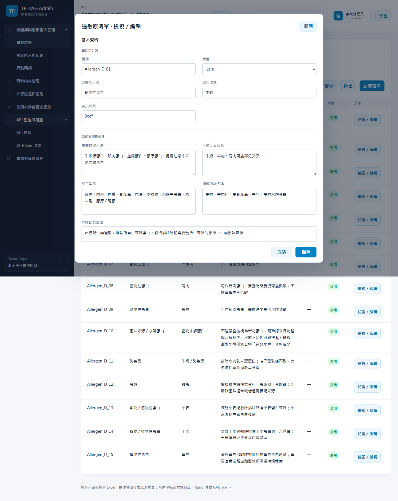

| 欄位組 | 欄位 |
| --- | --- |
| 識別 | 編號（必填唯一）、過敏原大類、原料名稱、英文名稱、狀態 |
| 說明 | 主要過敏來源、可能交叉反應、加工型態、標籤可能名稱、排除飲食建議 |

**驗收 K7：** 長說明完整保存，表格截短不截斷原資料；不可重複編號；最終結果必須排除命中的過敏原；問卷值的固定對照及交叉反應的具體處理仍待 Q2、Q7。

### 2.9 慢性病與遺傳性疾病營養

**清單檢視：** 此處為疾病營養的唯讀清單；點該列「檢視／編輯」開啟下方表單。

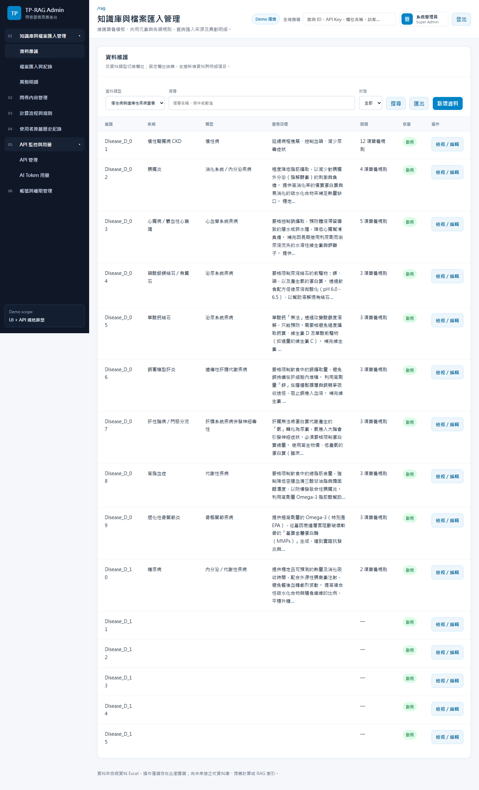

**整頁編輯：** 從清單點「檢視／編輯」進入整頁表單，可直接修改疾病說明及營養明細。「回到上一頁」返回原清單。儲存、取消及驗證失敗的處理依 §2.1。

下圖為舊版編輯畫面，現行操作與欄位依上方流程及下表。

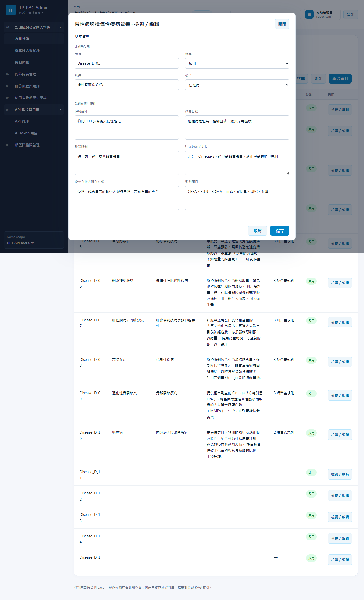

| 區域 | 欄位 |
| --- | --- |
| 基本資料 | 編號（必填唯一）、疾病、類型、好發品種、營養目標、處理優先序、狀態 |
| 說明 | 建議限制、建議增加／支持、避免食物／餵食方式、監測項目 |
| 營養規則 | 依 §2.13 維護；每列可選營養素，輸入四個生命階段的數值及每 1000 kcal ME 建議營養調整數值，並設定優先鎖定 |

**驗收 K8：** 可增刪多個營養規則；原始列可追查；只允許明確生命階段值，不把合併儲存格中的元素名稱當生命階段；規則衝突待 Q4。

### 2.10 排便分類法

**清單檢視：** 此處為排便分類的唯讀清單；點該列「檢視／編輯」開啟下方表單。

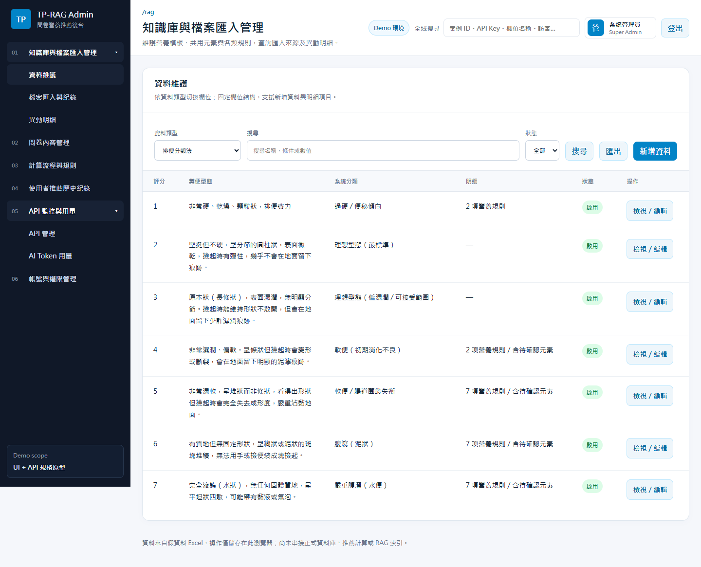

**整頁編輯：** 從清單點「檢視／編輯」進入整頁表單，可直接修改評分、分類、說明、警示及營養明細。「回到上一頁」返回原清單。儲存、取消及驗證失敗的處理依 §2.1。

下圖為舊版編輯畫面，現行操作與欄位依上方流程及下表。

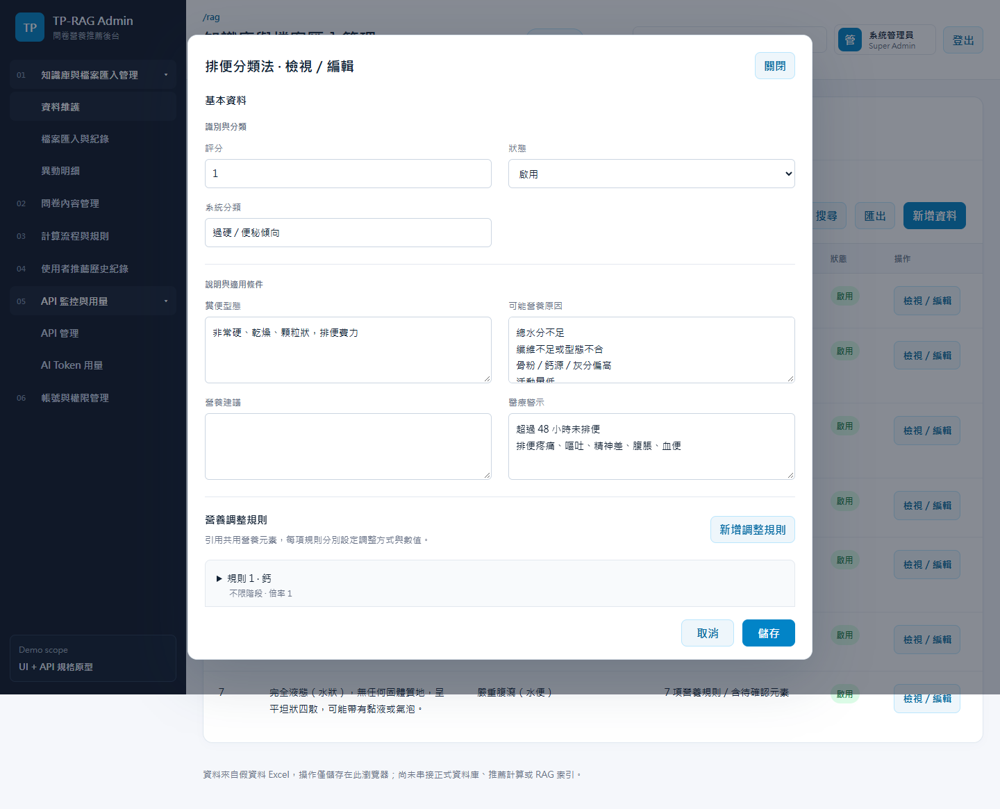

| 區域 | 欄位 |
| --- | --- |
| 基本資料 | 評分（必填識別值）、糞便型態、系統分類、可能營養原因、狀態 |
| 說明 | 營養建議、醫療警示 |
| 規則 | 每列可選營養素，輸入四個生命階段的數值及優先鎖定；原補充限制欄已移除，既有可辨識的限制顯示在鎖定條件內 |

**驗收 K9：** 可維護多項規則與完整警示；問卷 `hard/normal/soft/watery` 與來源數字評分的對照尚未核定，不能自行推定。

### 2.11 飲水量資料維護已移除

目前資料維護的類型選單不提供飲水量清單。計算頁既有飲水說明與試算範圍見 §4.2。

舊版畫面供追溯，現行欄位及操作依本節。

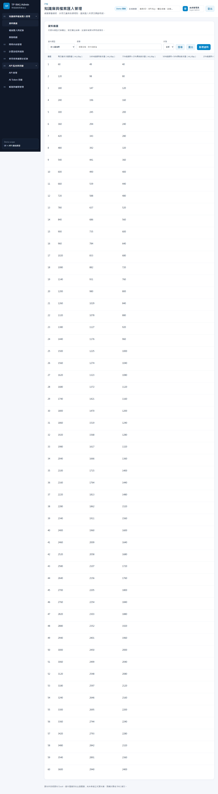

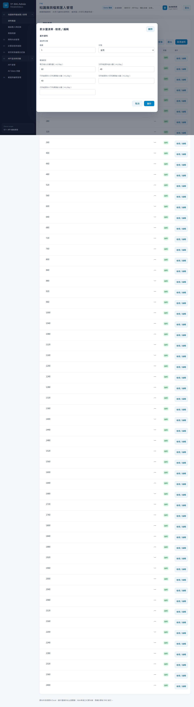

### 2.12 功能性營養模板（亞健康）

**清單檢視：** 此處為亞健康的唯讀清單；點該列「檢視／編輯」開啟下方表單。

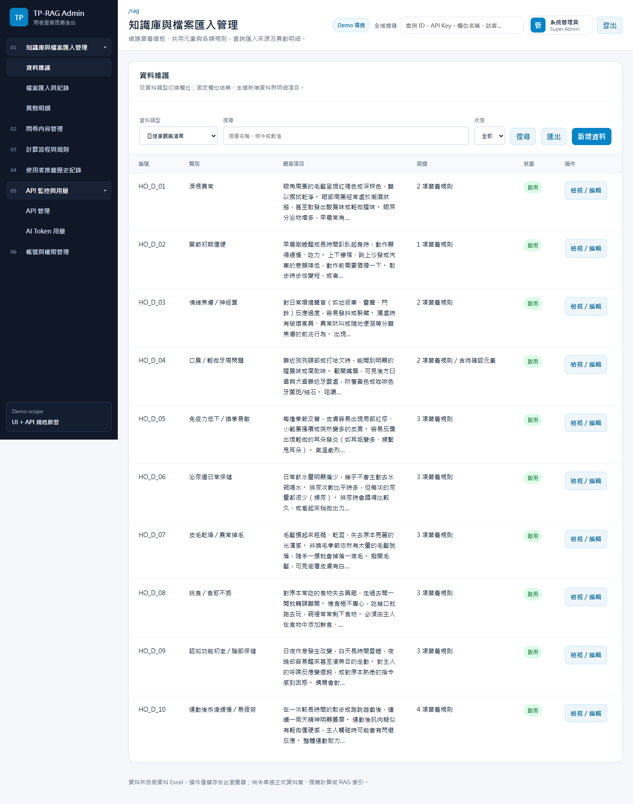

**整頁編輯：** 從清單點「檢視／編輯」進入整頁表單，可直接修改觀察、程度說明及營養調整規則。「回到上一頁」返回原清單。儲存、取消及驗證失敗的處理依 §2.1。

下圖為舊版編輯畫面，現行操作與欄位依上方流程及下表。

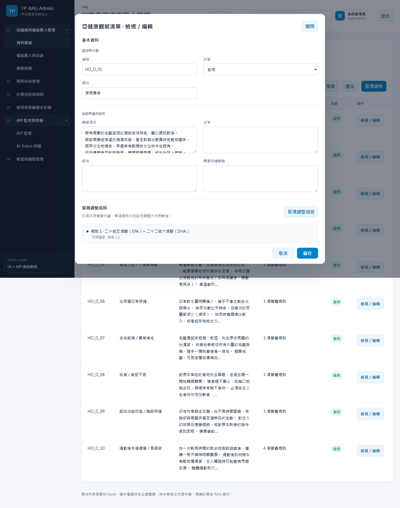

| 區域 | 欄位 |
| --- | --- |
| 基本資料 | 編號（必填唯一）、類別、觀察項目、處理優先序、狀態 |
| 說明 | 正常、輕微、需要持續觀察 |
| 規則 | 既有規則每列包含營養元素、適用生命階段、調整方式（倍率或指定比例）、調整值及優先鎖定；有生命階段營養明細的資料沿用同一表格樣式 |

**驗收 K11：** 說明空白原樣保留；多個共用元素規則可增刪；未對應元素標示待確認，不假裝正式可執行。

### 2.13 疾病／排便／亞健康共用營養調整明細

營養明細採表格列內編輯。生命階段欄依序為成犬、高齡犬、幼犬生長前期、幼犬生長後期；優先鎖定可選是／否，選是後可設定僅鎖定、min、max 或不可超過，需要限值的條件須填數值。各列可新增或移除，欄位依可用寬度分配，表頭可換行。疾病與亞健康的處理優先序為必填正整數，前台同時選取多筆時數字越小越先處理。

| key | 規則 |
| --- | --- |
| `id` | 明細穩定識別碼；原型為示範產生值 |
| `elementId/sourceName` | 共用元素引用＋來源原名；舊來源未對應可保留但標記待確認，新規則需選元素 |
| `phase` | 適用階段；來源只有明確 Puppy／Adult 才當生命階段，其他保留來源 |
| `method/value` | multiplier：非負數字；比例格式：如 `1:1`；正式比例語義及上下限待 Q4、Q6 |
| `overridable` | 對應來源 isOverridable：true 可被其他規則覆蓋，允許覆蓋的候選結果取高；false 不可被其他規則覆蓋；null 為尚未確認，處理方式待定。詳見 §4.1 |
| `sourceRows` | 保留來源列，便於核對同一資料跨列規則 |

**驗收 K12：** 停用元素不能新增引用；非數字倍率、負倍率及不符格式比例阻擋；同一資料規則修改可追到規則 ID、元素及調整值。未對應／未核定規則能否參與推薦與判斷待 Q6；知識庫不設發布或審核步驟，不把本機可儲存當作可執行。

| 規則明細控制項 | 型別、選項與動作 |
| --- | --- |
| 新增調整規則 | 新增可直接編輯的表格列；預設倍率、無元素、無值、覆蓋狀態未指定，不立刻寫入 |
| 操作欄／移除 | 移除只影響本次草稿，整份儲存才寫入；取消保留原規則 |
| 營養元素 | 下拉選啟用元素；既有停用引用可保留，未知來源名稱顯示待確認；新規則不可留空 |
| 適用生命階段 | 下拉：不指定／Puppy 幼犬／Adult 成犬，不自行補 Senior 選項 |
| 調整方式／值 | 下拉 multiplier／ratio；值為輸入框，倍率須非空有限非負數，比例須符合冒號分隔數值格式；業務語義見 Q4 |
| 覆蓋狀態 | 既有 rules[] 列使用優先鎖定下拉：未指定（null）／不鎖定（true）／鎖定（false） |
| 穩定 ID／來源 | 系統保留，使用者不手改；同次新增與移除不影響其他既有規則的識別 |

一般資料表單的欄位型別：編號、名稱與分類為單行文字；各節說明欄為多行文字；活動／BCS 修正為可正負數值；BCS 分數及疾病類型使用固定選單。識別值必填且依各節判重，其餘來源文字／數值允許保留空白，不能推定全部必填。疾病類型可選「慢性病／遺傳性疾病」，並保留來源既有分類。正式長度上限與文字內容正確性沒有核定規則。

### 2.14 物種、品種與體型

此類型在資料維護選單排第一。先選物種，預設顯示品種清單，旁邊可切到體型定義或開啟管理物種。管理物種集中新增與編輯物種。每個物種維護自己的品種對照與體型定義，生命階段與加成引用這些設定。

**品種清單**　可依品種與尺寸直接指定體型、設定公性例外，或依實際體重判定並設定缺少體重時的暫用體型。

**體型定義**　維護所選物種的體型及 kg 區間，上下限可設定是否包含。體重標準驗證保留區間次序及端點銜接檢查。

**驗收**　切換物種時只顯示該物種的品種、體型及對照；返回此類型可直接操作品種清單。

舊版畫面供追溯，現行欄位及操作依本節。

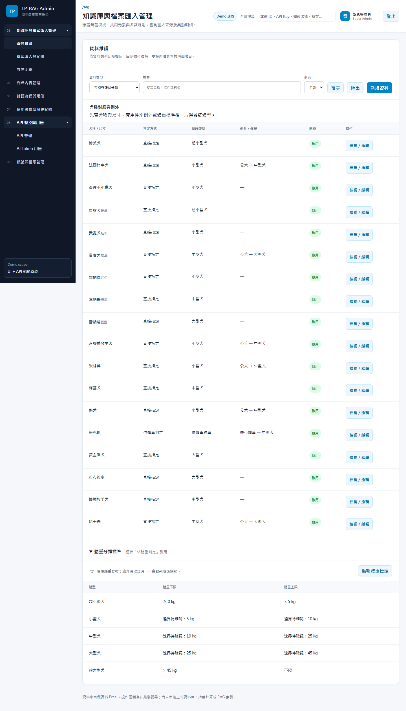

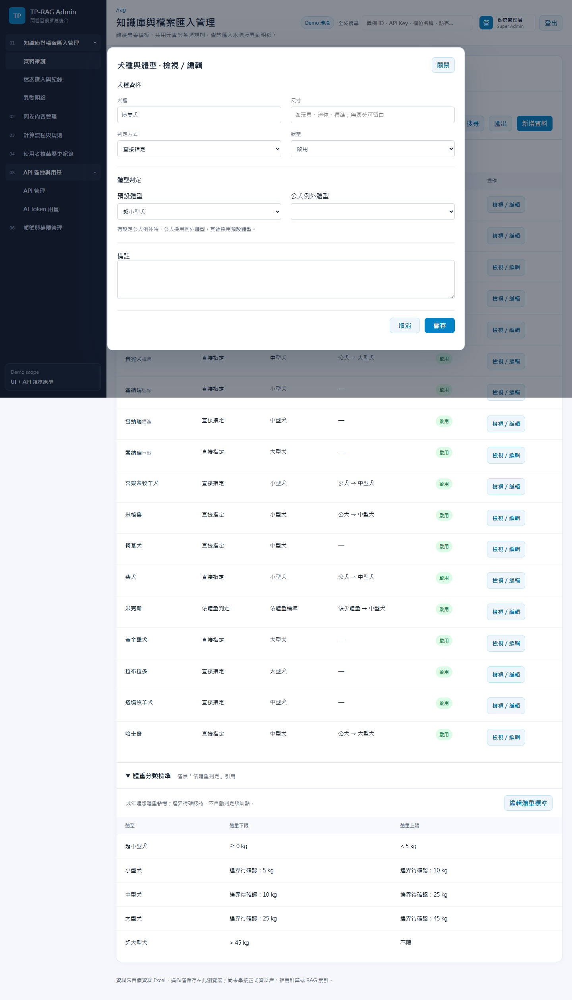

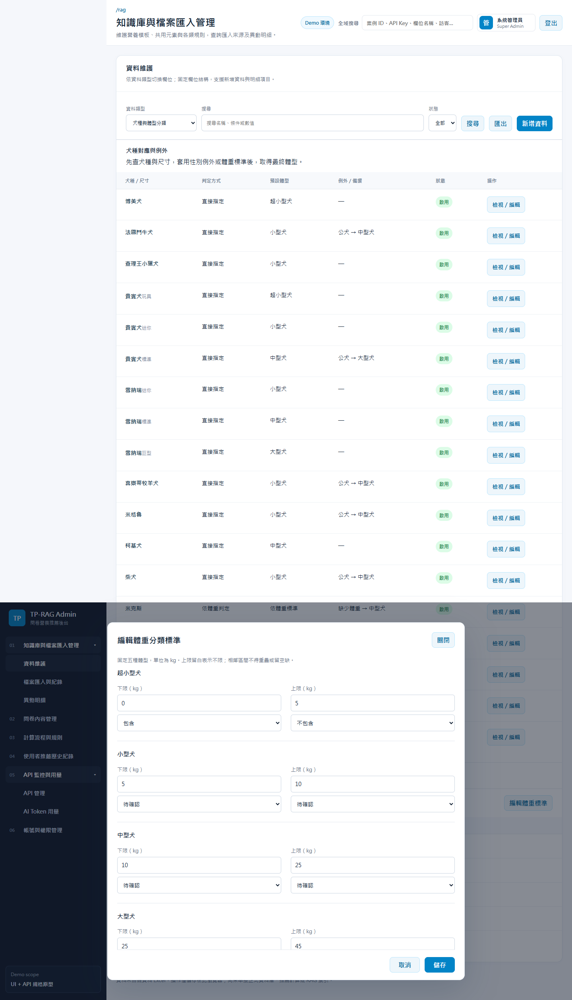

### 2.15 檔案匯入與紀錄

**已確認：完全覆蓋。** 本次選定的資料類型／目標模板，以匯入檔案整份取代；檔案未列到的舊資料也移除。任何一筆或欄位有錯，整批不覆蓋，保留原資料並列出問題。此規則取代先前「新增／更新並保留未列資料」及「部分錯誤仍繼續匯入」的做法。

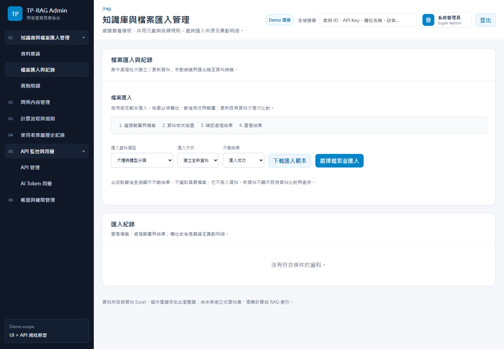

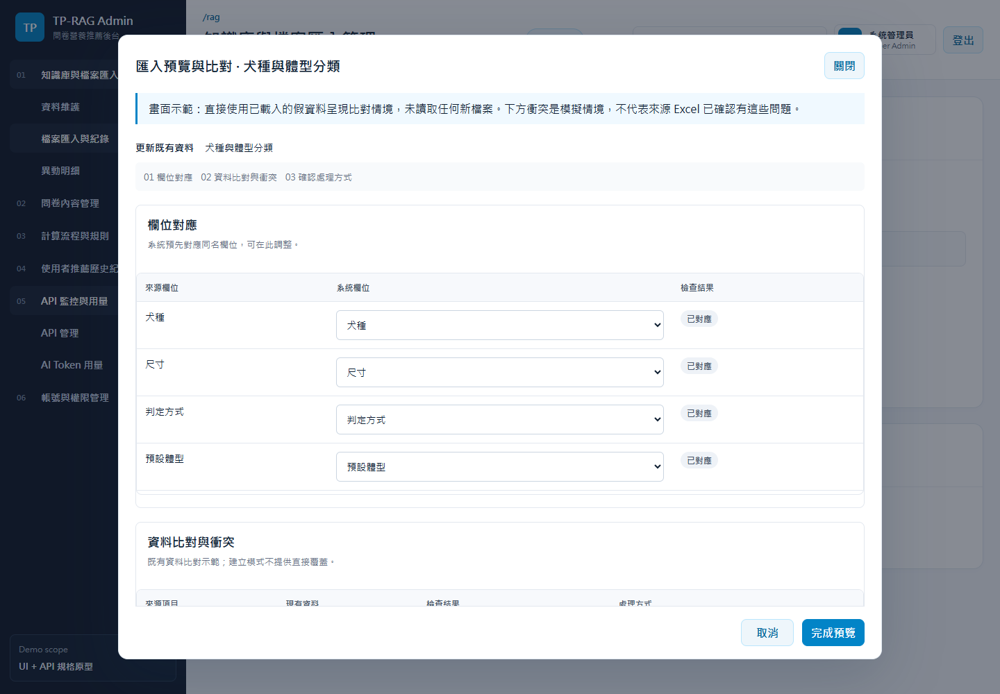

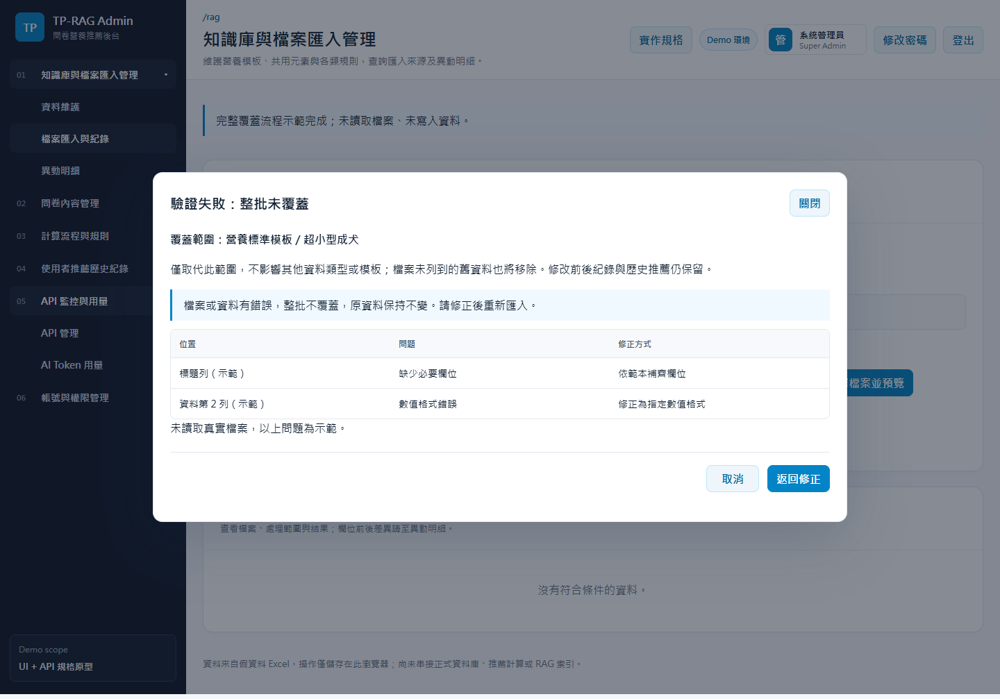

**原型界線：** 點擊後直接顯示示範驗證與確認視窗，不選取真實檔案、不寫入、不新增正式匯入或異動紀錄；真實選檔、解析、整批替換及推薦資料同步仍待實作。

**正式匯入流程（Q8、Q10）：**

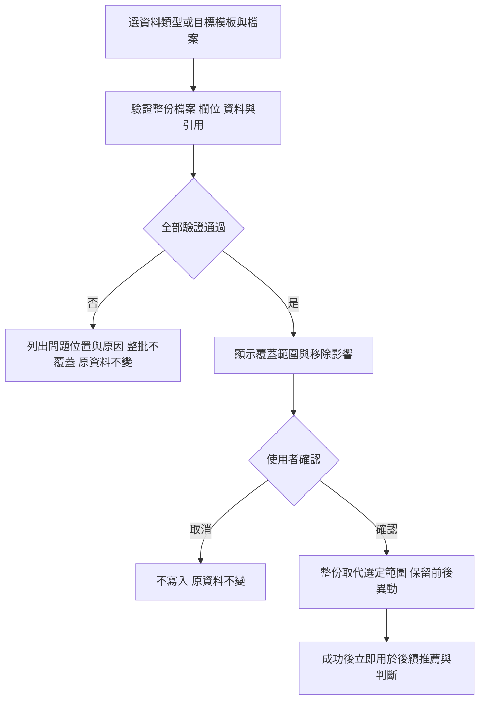

| 項目／欄位／按鈕 | 規則 |
| --- | --- |
| 匯入資料類型 | 下拉切換選定範圍，不影響其他類型 |
| 目標營養模板 | 僅模板類顯示，必須指定既有目標；只取代該模板，不改其他模板或共用元素主檔 |
| 匯入方式 | 唯讀「完全覆蓋」，不提供逐筆略過、保留現值或新增／更新分支 |
| 覆蓋內容 | 以檔案完整內容為準；檔案有的成為選定範圍新內容，檔案沒有的舊資料從現行範圍移除，不繼續保留為現行資料 |
| 下載匯入範本 | 依類型下載真正 CSV，Excel 可開啟；正式客戶格式／欄位範本仍待交付 |
| 選擇檔案並預覽 | 正式須先檢查欄位與所有資料；欄位錯誤提早提醒，其他錯誤列出資料位置與原因，不進入覆蓋 |
| 確認完整覆蓋 | 顯示資料類型、模板及移除影響，須確認後才提交；驗證與引用檢查須確保不產生斷裂引用，不能把完全覆蓋當作略過檢查 |
| 範圍與引用保護 | Q11 的逐筆刪除規則不等於禁止已確認的整份覆蓋；覆蓋須一併檢查其他模板／規則仍使用的資料。若會造成失效引用，列出問題並整批阻擋，不自動刪改範圍外資料 |
| 有任何錯誤 | 整批不覆蓋；不得先寫入部分資料，再因後續資料錯誤留下半套結果 |
| 取消／返回修正 | 不變更資料；取消確認不執行覆蓋，失敗後修正檔案再重新驗證 |
| 前後紀錄 | 保留整次範圍的修改前後內容及新增、變更、移除差異；歷史推薦不變，不提供退版或批次復原 |
| 生效 | 全部成功後立即用於後續推薦與判斷，不需審核／發布；處理失敗不得對外顯示新舊混用結果 |
| 匯入紀錄 | 時間、來源檔案、範圍、筆數、結果、前往資料維護；前往維護開目前資料，不還原歷史值。畫面無獨立紀錄搜尋 |
| 示範結果 | 全部驗證通過／檔案或資料有錯誤，只切換示範情境，不是實際檔案驗證 |

**驗收 I1：** 完整覆蓋僅作用於選定類型／模板；檔案未列到的舊資料須移出現行範圍；其他類型／模板與歷史紀錄不變。欄位、任一資料或引用檢查失敗，整批不寫入且可定位問題；驗證全通過及使用者確認後，才整份取代並保留前後異動。取消不寫入；不提供略過錯誤繼續匯入或保留未列資料的選項。成功更新立即用於後續推薦與判斷，無需審核。以上正式提交及持久化驗收仍待真實匯入服務完成，原型示範不代表通過。

### 2.16 異動明細與前往修改

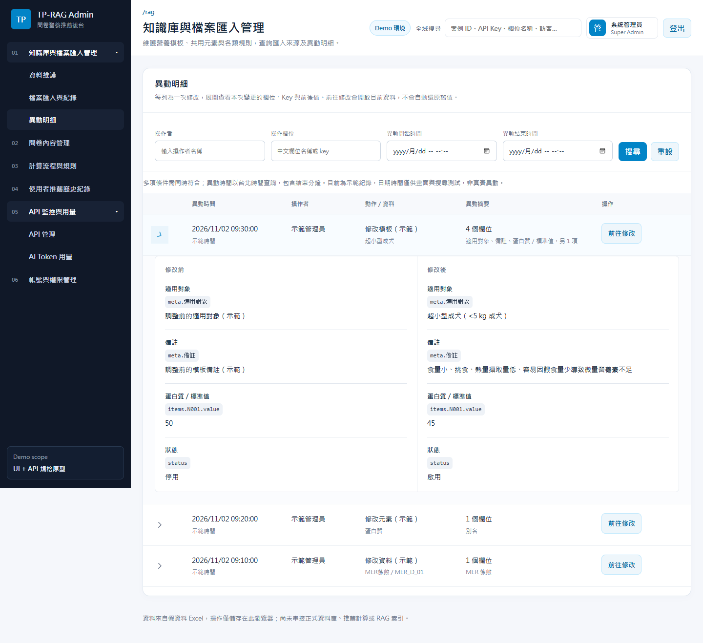

**搜尋操作：** 在清單上方輸入操作者、操作欄位或異動時間，按「搜尋」套用；文字欄位可按 Enter 搜尋。「重設」清空條件並顯示全部可查紀錄。

| 搜尋參數 | 規則 |
| --- | --- |
| 操作者 | 以操作者名稱部分比對，不分英文大小寫，忽略輸入前後空白 |
| 操作欄位 | 以異動欄位中文名稱或完整 key 路徑部分比對，不分英文大小寫；例如備註、aliases、meta.備註 |
| 異動開始／結束時間 | 以台北時間查詢；任一端可留白；包含開始時間與結束時間所選的整分鐘 |
| 多條件 | AND，同一筆異動必須同時符合所有已填條件；全部留白則查全部 |
| 欄位命中 | 任一變更欄位符合即列出該次異動，展開後仍顯示當次全部前後差異，不只顯示命中欄位 |
| 時間錯誤 | 開始晚於結束時顯示錯誤，不套用錯誤區間，保留原查詢結果及輸入供修正 |
| 無結果 | 顯示「沒有符合條件的異動紀錄」，保留搜尋條件 |
| 異動時間顯示 | 獨立欄位以台北時間顯示 YYYY/MM/DD HH:mm:ss；示範資料亦顯示完整日期時間，並逐列標示「示範時間」，可測試時間搜尋，不代表真實異動 |
| 缺少時間 | 真實或舊紀錄缺少可判定時間時顯示「未提供時間」，指定時間條件時不列入，不補造真實事件時間 |
| 查詢後操作 | 展開及前往修改仍對應原異動紀錄，不能因篩選後列序改變而跳到其他資料 |

| 區域／規則 | 定義 |
| --- | --- |
| 主列 | 一次修改一列；異動時間與操作者各自獨立成欄、動作／資料、變更欄位數、最多三欄摘要、展開箭頭、前往修改 |
| 詳情 | 預設收合，逐筆獨立；兩側同順序列中文欄位名、key path、修改前後值，不直接丟整包 JSON |
| 比較 | 模板元素按 elementId、資料與規則優先按 ID 比較；新增／刪除只列受影響欄位，排除重複衍生 metadata |
| 值呈現 | 空白、未提供 null、不存在 undefined、0、布林分開顯示 |
| 前往修改 | 開啟目前資料，模板原頁編輯並聚焦，其他資料用對應視窗；不自動還原歷史值 |
| 不可定位 | 舊紀錄缺上下文不跳錯資料；資料或欄位已不存在時須提示無法定位，不得開啟錯誤資料 |
| 無真實差異 | 原型提供三筆逐列標示的示範；不寫 localStorage。實際有差異後使用真實本機紀錄；前後相同不編造變更 |

**驗收 I2：** 操作者／操作欄位／時間可單獨或交叉搜尋；中文及 key 可命中；時間區間、錯誤提示、重設與無結果正確；篩選後仍能展開及前往正確資料。無修改保存不新增可見差異；新增引用不讓其他列誤判；展開不影響其他列；修正重新確認儲存才更新。異動明細只提供查詢前後差異與前往修改目前資料；不包含歷史版本退回或匯入批次復原。紀錄持續保存（Q9），並保留完整覆蓋前後資料與移除差異（Q8）；記錄真實操作者及維護紀錄完整性的技術方式由工程師處理。

## 3. 問卷內容管理

### 3.1 欄位庫、題目與選項編輯

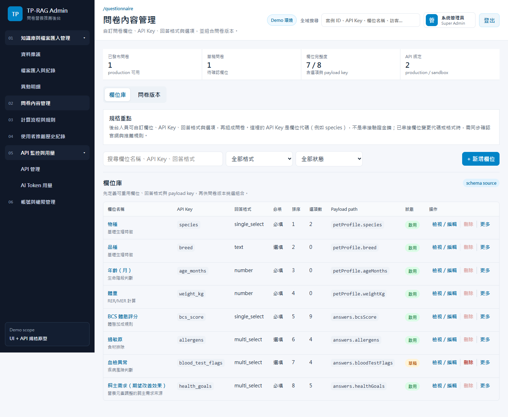

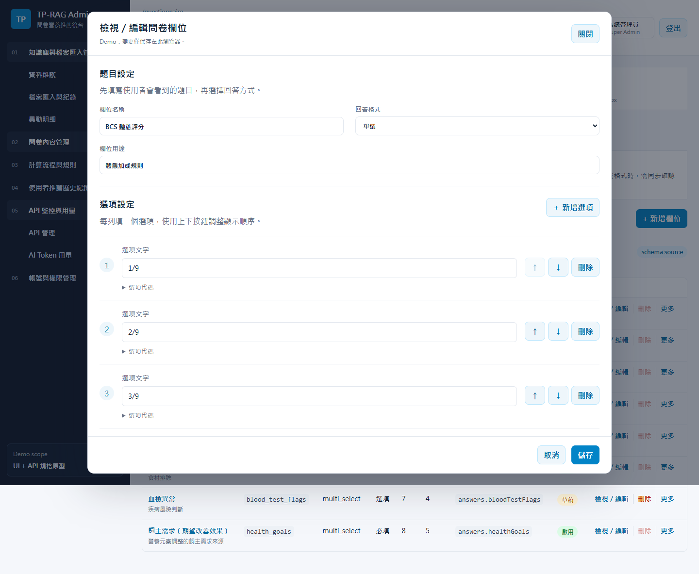

目的：維護可重用題目；題目與版本組合分開。

| 欄位 | 規則 |
| --- | --- |
| 題目名稱、用途 | 名稱必填，用途文字說明 |
| 回答格式 | `text/number/single_select/multi_select/select/slider` |
| 必填、排序、狀態 | 必填布林；排序正整數；啟用／草稿／停用 |
| 選項 | 文字＋穩定代碼；可新增、刪除、上下排序；修改文字不改代碼 |
| 選項驗證 | 文字／代碼不得空白，代碼不可重複；單選／多選／下拉至少一個選項 |
| 串接資訊 | 系統產生欄位代碼與 Payload path，畫面唯讀；欄位代碼符合英文字母／底線起頭，後接英數／底線且不可重複 |
| 缺少定義 | 數字最小最大值、slider 級距、條件必填、多語待確認；停用題目不再供新增選用，已發布版本維持當次固定內容（§3.2），不能從格式選單推定已具備 |

| 目前欄位 key | 格式 | 初始狀態／必填 | Payload path |
| --- | --- | --- | --- |
| `species` | single_select | 啟用／是；犬、貓 | `petProfile.species` |
| `breed` | text | 啟用／否 | `petProfile.breed` |
| `age_months` | number | 啟用／是 | `petProfile.ageMonths` |
| `weight_kg` | number | 啟用／是 | `petProfile.weightKg` |
| `bcs_score` | single_select | 啟用／是；1/9–9/9，代碼 1–9 | `answers.bcsScore` |
| `allergens` | multi_select | 啟用／否 | `answers.allergens` |
| `blood_test_flags` | multi_select | 草稿／否 | `answers.bloodTestFlags` |
| `health_goals` | multi_select | 啟用／是 | `answers.healthGoals` |

`health_goals` 初始五選項：維持目前健康體態 `maintain_health`、毛髮保養 `skin_coat`、關節與體力 `joint_strength`、腸胃消化 `digestion`、體重管理 `weight_management`。選項數由實際陣列計算，不能使用來源示範 `count` 常數作真實數量。

| 欄位庫控制項／欄位 | 行為補充 |
| --- | --- |
| 搜尋／回答格式／狀態篩選 | 搜尋名稱、欄位代碼、回答格式英文代碼或中文標籤；格式為全部／輸入框／數字／下拉選單／單選／多選／滑桿，狀態為全部／啟用／草稿／停用；套用、AND、重設與無結果依 S1 |
| 新增欄位／檢視／編輯 | 開欄位表單；新題目預設文字格式、非必填、草稿、排序為現有題數加一 |
| 題目名稱／用途 | 單行文字，名稱必填、用途可空白；回答格式為必選下拉 |
| 必填／排序／狀態 | 必填為勾選框，排序必填且為 ≥1 整數；狀態為啟用／草稿／停用；本問卷可覆寫必填與順序，見 §3.2 |
| 新增選項 | 新增一列空白文字及系統生成的唯一示範代碼；儲存前仍須補文字 |
| 上移／下移／刪除選項 | 立即改本次表單草稿；首列禁上移、末列禁下移，取消不回寫；選擇題刪空時不得儲存 |
| 選項文字／代碼 | 單行文字且必填；代碼可展開編輯、不可重複；改文字不自動改代碼 |
| 切回答格式 | 選擇題才顯示選項區；從無選項切入時建立兩個空白示範選項；非選擇格式儲存時不保留生效選項 |
| 串接資訊 | 可展開唯讀欄位代碼與 Payload path；不同於每個選項可編輯的代碼 |
| 列上刪除 | 刪除限制依 Q11，現行欄位刪除入口尚未接線；「更多」已移除 |

**驗收 QF1：** 九個 BCS 分數逐一保存；選項增刪改序後數量一致；非選擇格式不殘留生效選項；取消不改欄位。性別、絕育、活動量、疾病、排便、亞健康等計算輸入尚未完整建在欄位庫，見 Q2。

### 3.2 問卷版本與欄位組成

已發布問卷唯讀；需要修改時，先「複製為草稿」。草稿儲存不影響目前官網問卷；確認發布後，新版生效、舊版自動停用，不需審核。

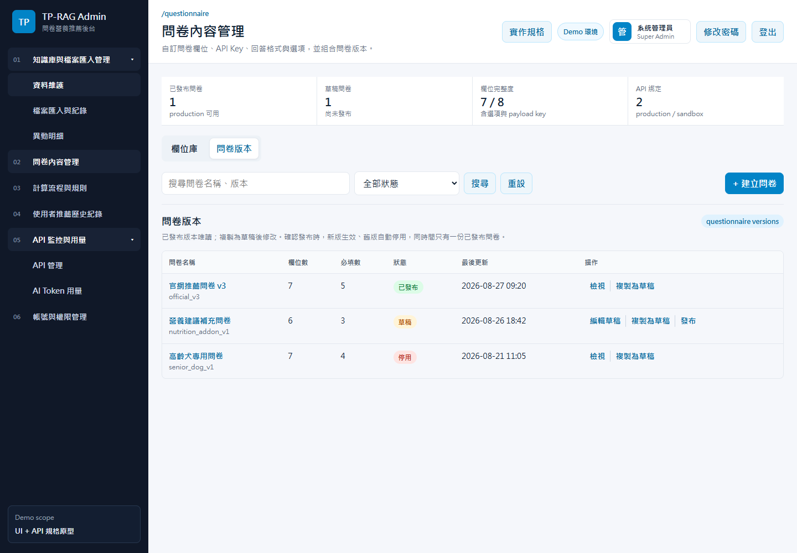

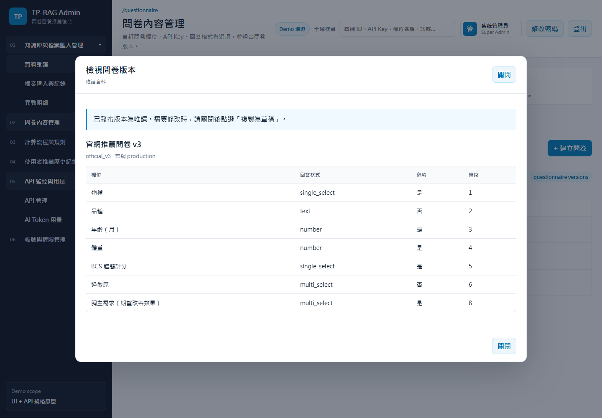

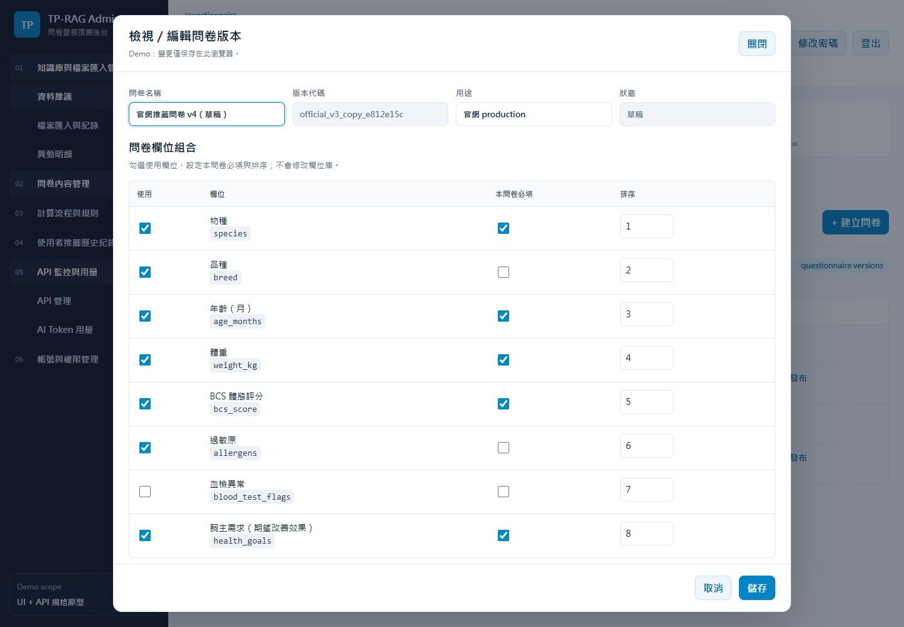

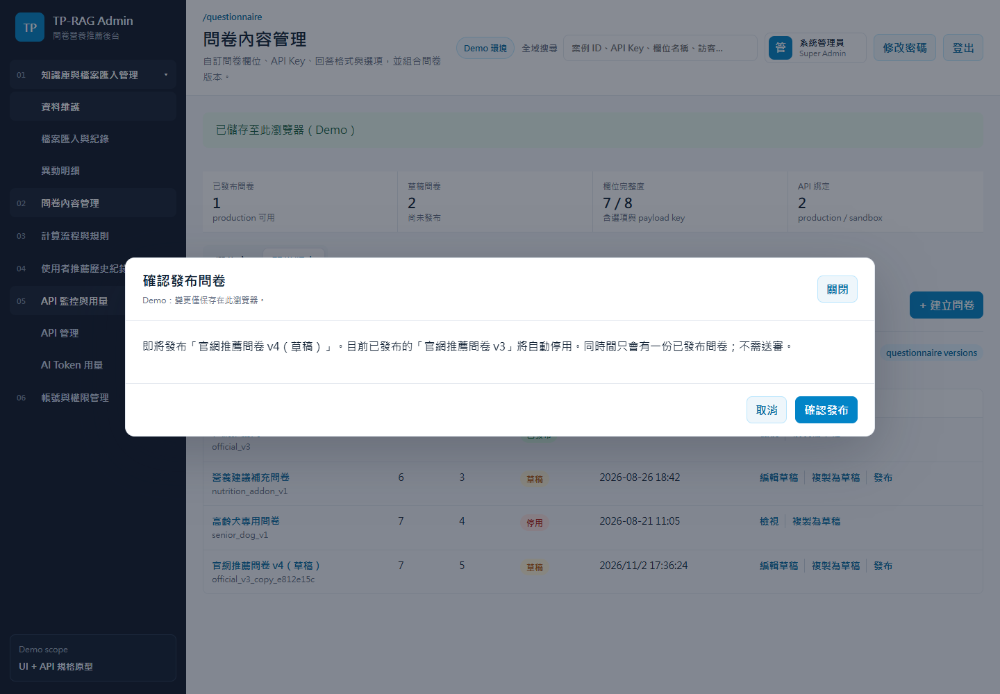

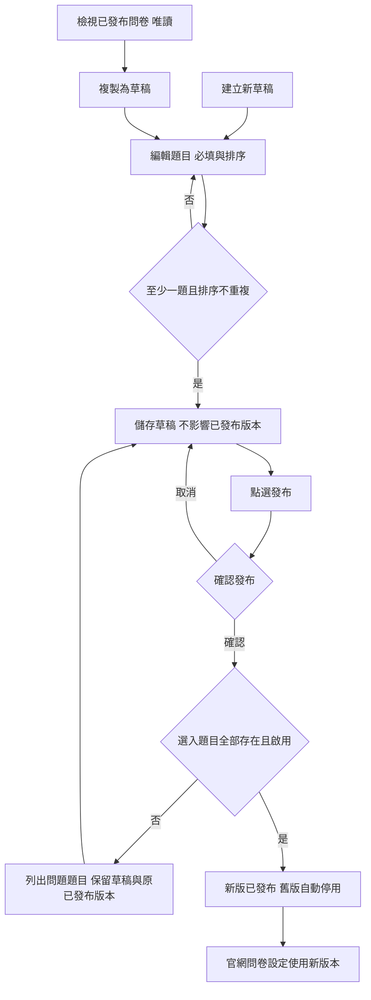

| 欄位／狀態／操作 | 規則 |
| --- | --- |
| 名稱、版本代碼、用途 | 名稱與新增版本代碼必填；代碼唯一，既有版本代碼唯讀 |
| 草稿 | 可修改題目、必填與排序；儲存維持草稿，不等於發布 |
| 已發布 | 唯讀，不可直接修改；同時間最多一份 |
| 停用 | 保留舊版本供檢視，不作為目前官網問卷；如需調整，複製為草稿 |
| 刪除保護 | 曾發布版本連同停用舊版皆保留、不可刪除；欄位或版本已被使用時阻擋刪除並列出使用位置，依 §1、Q11；歷史內容不變 |
| 複製為草稿 | 建立獨立版本與唯一代碼；帶入來源名稱、用途、題目組成，修改不回寫來源 |
| 題目組成 | 每題 key、required、order；至少一題，排序不可重複，依排序保存；必填與排序不回寫欄位庫 |
| 摘要 | 題數、必填數從組成計算，儲存更新時間 |
| 發布 | 只對已儲存草稿操作；確認提示新版名稱及將停用的舊版名稱；確認後一起切換狀態，不需送審 |
| 取消發布 | 不改任何版本狀態與目前官網問卷 |
| 已發布內容 | 固定當次題目、選項、必填與排序；後續欄位庫修改不直接影響已發布內容，需經新版發布生效 |
| 官網問卷設定 | 取目前已發布版本，不固定取清單第一筆；歷史推薦紀錄保留當次內容 |
| 初始官網版本 | official_v3：7 題、5 必填；草稿血檢題未選入 |

| 問卷版本控制項 | 行為補充 |
| --- | --- |
| 搜尋／狀態篩選 | 搜尋問卷名稱與版本代碼；狀態為全部／已發布／草稿／停用，套用、AND、重設與無結果依 S1 |
| 建立問卷 | 開空白草稿表單；名稱與版本代碼為必填單行文字，用途可空白；狀態唯讀草稿 |
| 複製為草稿 | 目前原型點擊即建立並保存獨立草稿後開編輯；取消只放棄本次表單變更，不刪已建立草稿 |
| 使用／本問卷必填／排序 | 使用與必填為勾選框，排序為 ≥1 整數；只有選入的題目組成本版本，未選入的必填與排序不參與組成驗證 |
| 可用題目 | 草稿問卷可編排啟用或草稿題目；不可新增選用停用題目，已有停用引用可保留待調整。發布前所有選入題目必須存在且為啟用，否則列出題目名稱並阻擋，不改目前已發布版本 |
| 發布／確認發布／取消 | 僅草稿列提供發布；確認視窗列舊版與新版，送出時再次檢查所有題目已啟用；有問題保留視窗並列題目，取消不改狀態。確認切換與只儲存草稿為不同動作 |

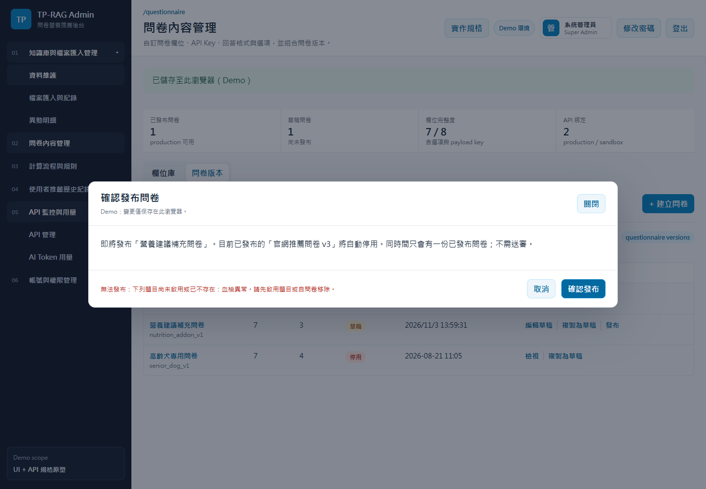

**驗收 QF2：** 已發布與停用版本只供檢視；複製產生獨立草稿；取消編輯不寫回；儲存草稿不影響目前發布版本；空組成、重複排序及重複版本代碼阻擋；草稿題目可編排，發布時有草稿／停用／不存在題目則列出名稱並阻擋，原已發布版本不變；取消發布不改狀態；確認後新版已發布、舊版停用且已發布數量為一，重新整理仍維持；官網設定改取新版，歷史紀錄不變。

## 4. 計算流程與規則

### 4.1 營養規則優先序

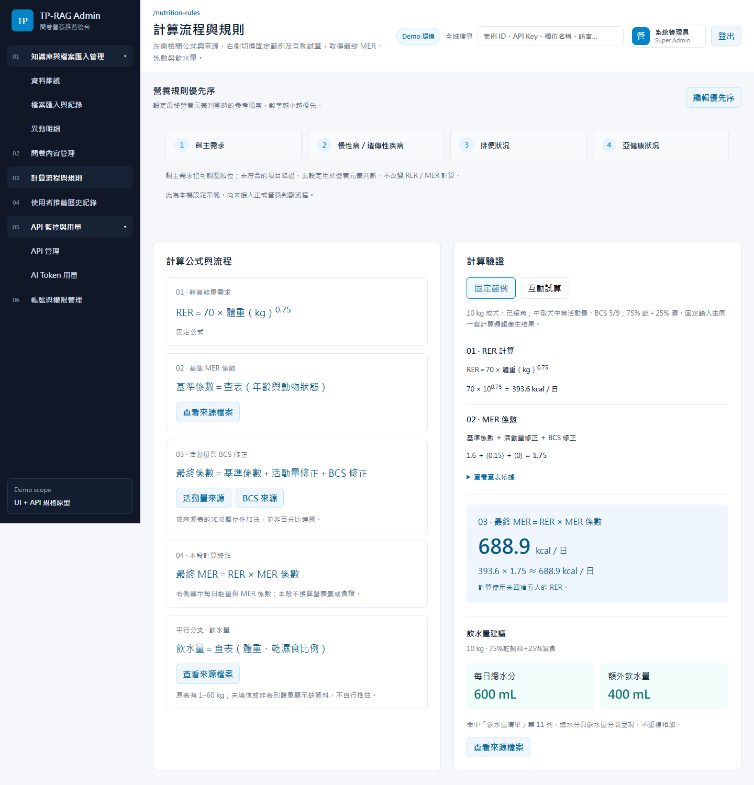

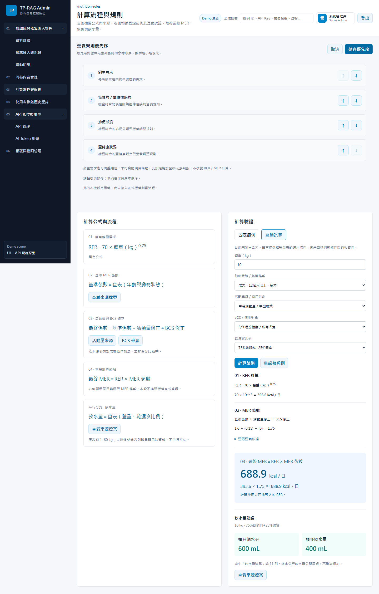

此區設定四類營養規則的順序；目前僅提供排序設定，完整套用方式仍待確認。

| 規則 | 定義 |
| --- | --- |
| 固定分類 | `owner-needs` 飼主需求、`disease` 疾病、`stool` 排便、`subhealth` 亞健康 |
| 預設 | 上述順序，飼主需求第一；全部可排序，不鎖定第一名 |
| 編輯 | 上下移動；邊界箭頭不可移出；取消還原、儲存後生效 |
| 驗證 | 恰好四項，不重複、不缺項、不接受未知 ID |
| 保存 | 原型保存 `schema/order/updatedAt`；失敗保留草稿並顯示錯誤 |
| 邊界 | 不改 RER／MER 算式；目前未接營養計算或歷史。四類順序用於執行與追蹤，不代表倍率接續連乘或後一類直接覆寫前一類；同元素結果依下表取高及不可覆蓋規則處理，剩餘業務規則見 §8 |

**驗收 C1：** 四項任意排列可保存與取消；壞資料不採用；保存失敗不冒充成功。同一元素各規則皆以模板基礎值分別計算，可覆蓋結果取高、不連乘；尚未定案的衝突與去重方式見 Q4。

#### 已確認：營養規則覆蓋與取高

| 項目 | 規則 |
| --- | --- |
| 過敏原 | 最終結果一定排除已命中的過敏原，不因其他營養規則或覆蓋設定而取消排除 |
| 適用來源 | 慢性病與遺傳性疾病營養、排便分類法、亞健康觀察清單，依各筆營養元素規則的 isOverridable 判斷 |
| isOverridable=true | 可被其他規則覆蓋；同一營養元素符合且允許覆蓋的候選結果取較高值 |
| isOverridable=false | 不可被允許覆蓋的規則取代；同一元素有多條不可覆蓋規則時，亦以同一模板基礎值分別計算並取較高結果 |
| 計算基礎 | 各規則使用同一份模板基礎值各別計算候選結果，不以前一條已調整結果作為下一條倍率的基數 |
| 不採用的算法 | 不把不同規則倍率接續相乘，也不自行把倍率或增加量累加 |

**已確認範例：** 同一營養素模板值為 10；疾病 ×1.2、排便 ×1.5，且兩者皆允許覆蓋。候選值分別為 12 與 15，最後取 **15**，不是 10 ×1.2 ×1.5＝18。

**驗收 C3：** 上述範例輸出 15；多條不可覆蓋規則的候選值亦取高，且不被允許覆蓋規則取代；最終結果仍排除命中的過敏原。此為確認後的正式實作規則，現有試算頁尚未接入營養元素調整引擎。

待客戶更新文件後討論：同規則跨分類重複命中、比例值與範圍值的比較及套用方式，暫不制定算法，以客戶後續文件為依據。未填覆蓋狀態，以及低於模板基礎值時模板值是否列入比較，亦保留待確認。已確認的單一數值取高、不連乘及過敏原最終排除原則不變。

### 4.2 公式、固定範例與互動試算

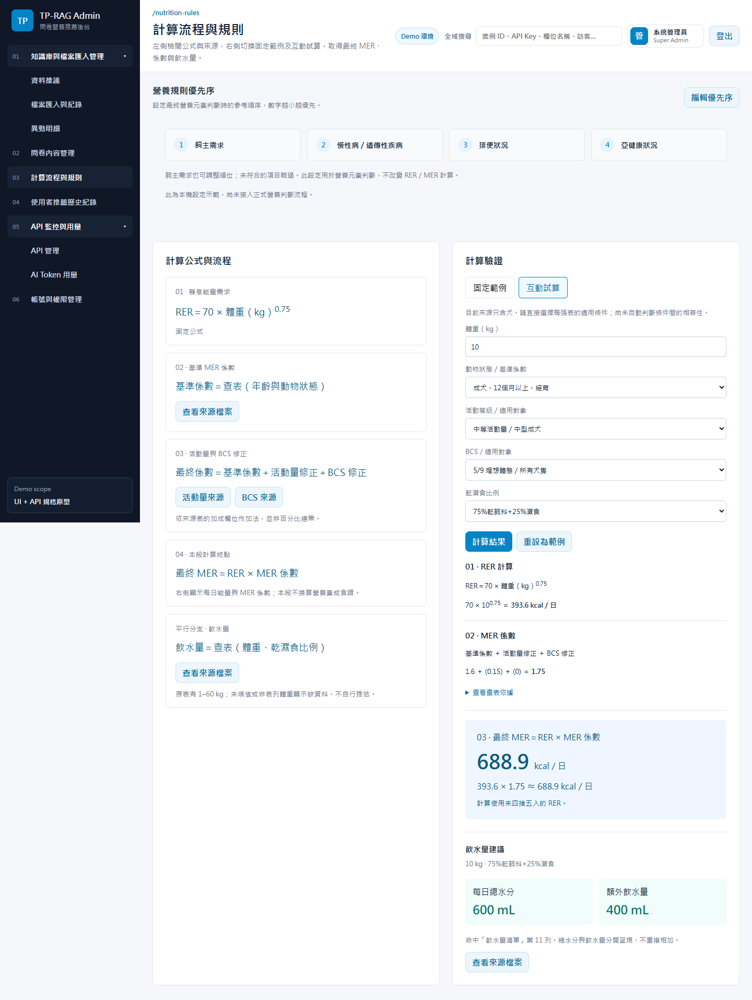

本段目前終點是 MER 與飲水量，不包含正式營養元素或食譜計算。

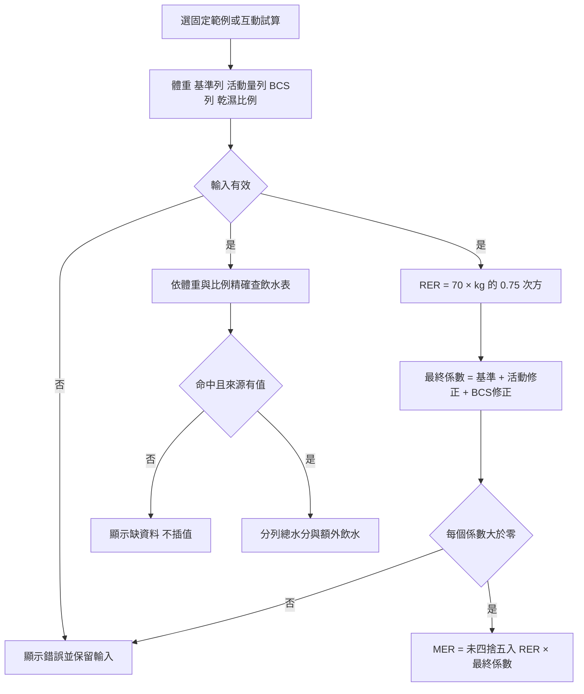

| 輸入／輸出 | 規則 |
| --- | --- |
| 體重 | 必填、有限數值、>0 kg |
| 基準、活動、BCS | 選來源表有效資料列；尚不自動判斷三者適用條件相容性 |
| 基準係數範圍 | 來源允許單值或上下限，對每個端點加活動與 BCS 修正後計算 MER 範圍 |
| 乾濕比例 | 100%乾、75%乾＋25%濕、50%乾＋50%濕、25%乾＋75%濕 |
| 飲水 | 來源 1–60 kg；精確查表，不插值；未命中與命中但欄位空白顯示不同說明；總水分不再加額外飲水 |
| 顯示精度 | RER、MER 主結果一位小數；內部不先四捨五入 RER，係數加總消除浮點尾差 |
| 改輸入 | 提示需重新計算，不把舊結果顯示成新輸入的結果；可重設為範例 |
| 來源視窗 | 展示 Excel 檔名、工作表、列號與原值；空白不當作零 |

| 試算控制項／欄位 | 行為補充 |
| --- | --- |
| 固定範例／互動試算 | 切換顯示模式；固定範例無可編輯輸入，互動值保留於本次頁面狀態 |
| 體重 | 數字輸入，step=any，畫面 min=0.01；計算邏輯要求有限且 >0，不將示範體重當正式預設限制 |
| 基準／活動／BCS | 三個下拉，值對應來源表列號，顯示來源條件；無自動相容性判斷 |
| 乾濕食比例 | 四項下拉；來源未填值的比例仍可選，查不到值時提示缺資料 |
| 計算結果 | 擷取現有輸入並重新計算；錯誤訊息顯示於結果區，不寫入歷史案例 |
| 重設為範例 | 回復 10 kg、固定來源列與 75%乾＋25%濕，立即重畫結果 |
| 查看來源檔案／活動量來源／BCS來源 | 開唯讀快照視窗，關閉不改試算；查表依據為可收合內容 |

**驗收 C2：** 固定 10 kg 範例與互動同輸入產出相同結果；0／負值／非數字體重、無效列及非正係數均阻擋；飲水空白不推估。

### 4.3 待整合的完整推薦決策鏈

以下為待整合的完整推薦流程，尚未在現行試算與歷史紀錄完整呈現。

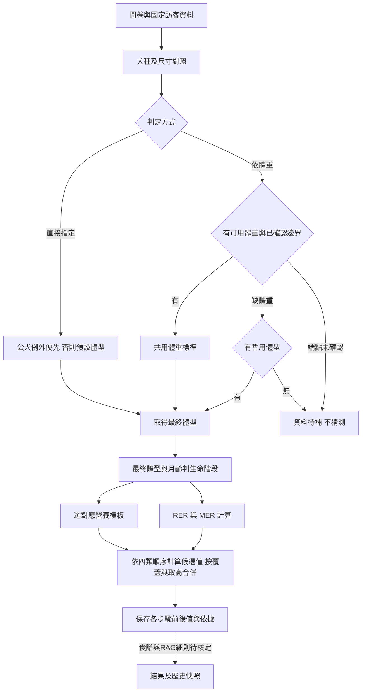

已確認：先依犬種、尺寸、公犬例外取得體型；設定依體重判定者使用實際體重分類。再以最終體型與月齡判生命階段，最後選對應模板。「犬生命階段判斷表」中的預估成犬體重僅為參考，不參與體型或生命階段判斷，也不作為模板選擇條件。模板對照、多命中衝突、未知犬種及月齡／週齡換算仍見 Q2、Q4、Q5。

## 5. 使用者推薦歷史紀錄

### 5.1 清單

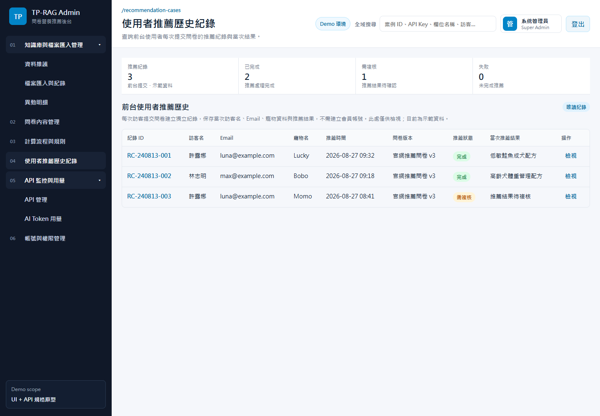

目的：追查每次訪客提交及其當次輸出，不要求會員帳號。

| 區域 | 欄位／規則 |
| --- | --- |
| 摘要 | 總筆數、完成、需複核、失敗；依畫面實際資料集合計數 |
| 清單 | 紀錄 ID、訪客名、Email、寵物名、提交時間、問卷版本、推薦狀態、當次結果、檢視 |
| 範圍 | 目前排除 `apiLogs` 中 source=sandbox 的關聯案件；此為原型篩選方式，正式環境隔離由工程師設計，不作需求端待答事項 |
| 操作 | 點 ID 或檢視開唯讀詳情；無編輯推薦歷史入口 |

| 歷史頁操作 | 現行行為 |
| --- | --- |
| 清單搜尋／篩選／匯出 | 目前無這些控制項，不推定有姓名、日期或狀態查詢 |
| 紀錄 ID／檢視 | 開同一筆唯讀詳情視窗，不編輯或重跑 |
| 問卷內容／處理紀錄／最終食譜 | 在同一視窗切頁籤；預設問卷內容，切換不改紀錄 |
| 關閉／完整紀錄展開 | 關閉回原清單；展開只顯示既有快照，不補算或儲存新資料 |

**驗收 H1：** 每次提交獨立紀錄、保留當次聯絡資訊與版本；摘要與清單一致；沒有結果快照時明示，不用目前規則補算冒充歷史。

### 5.2 詳情：問卷內容

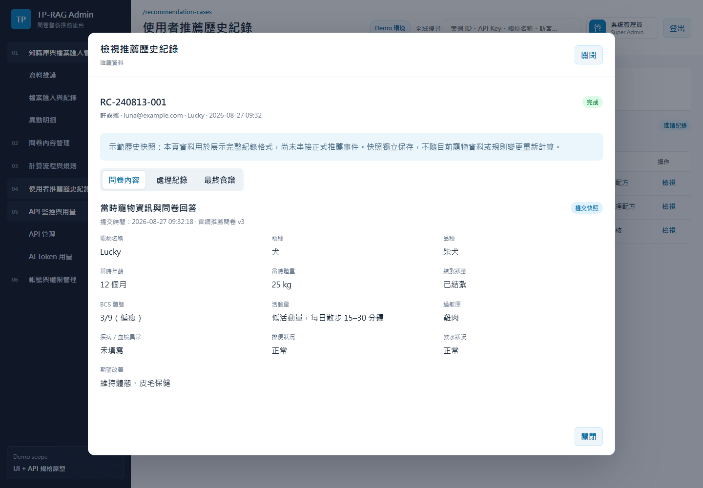

上方顯示案例、訪客、Email、寵物、時間與狀態；預設「問卷內容」頁籤，顯示當時寵物資訊及作答。快照獨立於目前主檔，缺快照時顯示尚未提供提示。

**驗收 H2：** 改目前問卷或知識庫不重算歷史作答；切頁籤不改資料；固定訪客資料的收集位置、Email 必填及驗證要求待客戶資料補齊（Q2）。

### 5.3 詳情：處理紀錄

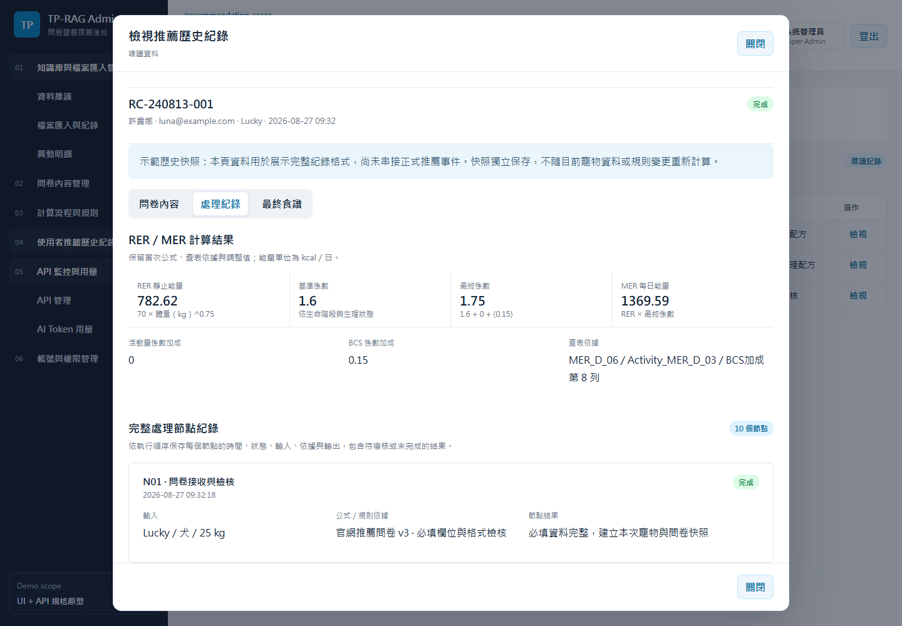

| 區域 | 快照內容 |
| --- | --- |
| 能量 | RER、基準係數、最終係數、MER；活動／BCS 加成、依據 |
| 節點 | `id/time/name/status/input/basis/output`；依當次順序保存，包含未完成與需複核節點 |
| 執行版本 | flow、calculation、rules、index、ranking；可展開完整紀錄 JSON |
| 限制 | 目前示範節點仍為舊流程，尚無 §4.3 的最終體型、模板命中及每項營養素逐步前後值 |

**驗收 H3：** 可重現當次依據與版本、不隨現有設定改變；正式新決策鏈須補每步輸入／輸出及調整來源，規則與串接待辦見 Q4、Q7。

### 5.4 詳情：最終食譜、需複核及缺資料

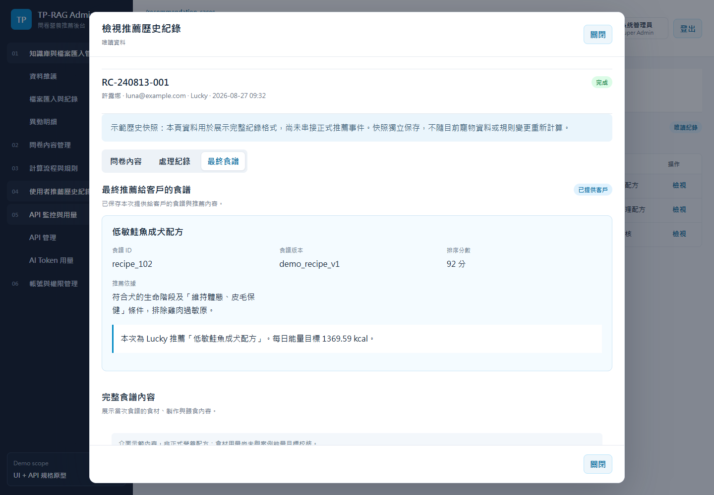

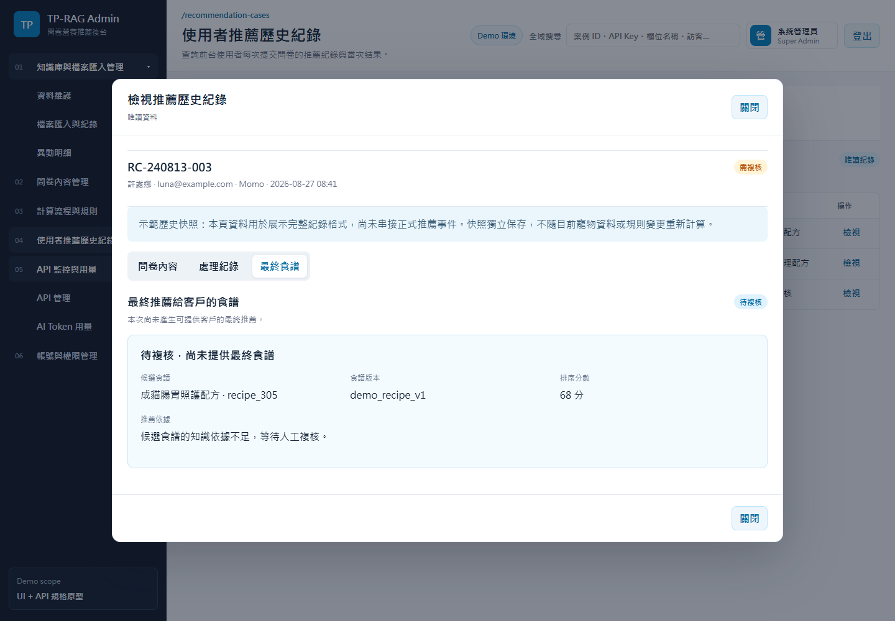

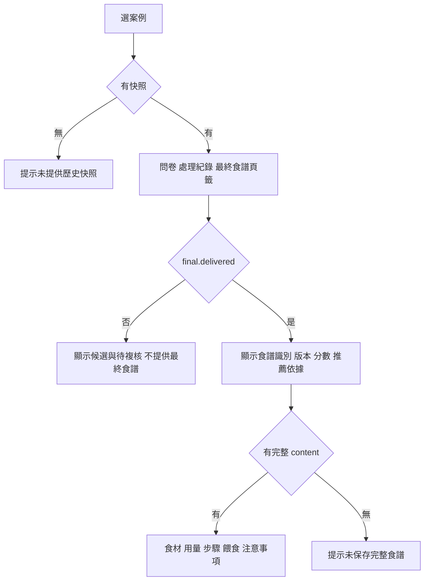

| 狀態 | 呈現規則 |
| --- | --- |
| 完成且 delivered=true | 食譜 ID、名稱、版本、排序分數、推薦依據、訊息與完整內容（若有） |
| 需複核且 delivered=false | 顯示候選食譜與原因，明示未提供最終食譜，不展示為已交付 |
| 無 content | 明示缺食材用量、步驟、餵食等內容，不自行生成 |
| 失敗 | 資料狀態已有失敗，但當前清單範例中的失敗案例被 sandbox 條件排除；失敗時應呈現的內容待 Q7，回應格式由工程師設計 |

「需複核」目前只是歷史結果的顯示狀態，不等於已核定人工審核、駁回或重跑操作；Q10 的免審核指知識庫更新，兩者不可混為同一流程。

**推薦方向（Q7）：** 由 AI 整合相關資料產出食譜，依先前第一階段範例對照；具體範例版本尚待確認，不將目前靜態示範視為正式推薦實作。

**驗收 H4：** 複核前不把候選當正式結果；缺內容提示正確；示範食譜保留「非正式營養配方、未校核能量」提示。若正式流程需保留人工複核，其責任及後續操作待 Q7；不得僅憑示範狀態新增審核、駁回或重跑功能。食譜依第一階段範例對照。

## 6. API 監控與用量

### 6.1 API 管理：格式說明與文件

目的：供官網工程師取得問卷結構與驗證／錯誤格式。目前僅有一個問卷設定 API，串接資訊預設收合。

| 契約項目 | 現行文件內容 |
| --- | --- |
| Endpoint | `GET /v1/questionnaire/schema`；不傳 JSON Body |
| Header | `x-api-key`、`Accept: application/json`；欄位的 `key` 與驗證金鑰不同 |
| 連線 | Demo 尚未連線；Base URL、環境與實際金鑰於串接時提供 |
| 成功外層 | `success:boolean`、`message:string`、`data:object`、`traceId:string` |
| 問卷內容 | `data.version`、`data.fields[]`；每題 `key/label/type/required/order`，選擇題另有 `options[{label,value}]` |
| 失敗外層 | `success:false`、`message`、`data:null`、`error.code`、`traceId` |
| 錯誤碼文件 | 401 金鑰缺失／無效；403 無權限；共用資訊另列 404／422／500；適用此 GET 端點的狀態碼及 error.code 完整表由工程師定義 |
| 管理問卷內容 | 從文件跳往問卷欄位庫 |

此圖表達文件宣告，尚無實際服務。**驗收 API1：** GET 無 Body、驗證金鑰位於 Header；成功與失敗外層一致；API 必須回傳唯一已發布問卷的題目、選項、必填及排序；文件範例與呼叫紀錄應對應各自的版本或當次快照，不使用不同版本的示範題目代替。

### 6.2 API 管理：呼叫紀錄與詳情

只列 `/v1/questionnaire/schema`，不混入舊推薦 endpoint。

| 區域 | 欄位／行為 |
| --- | --- |
| 篩選 | 開始日期、結束日期、全部／成功／失敗、關鍵字；搜尋及重設；關鍵字可 Enter 送出 |
| 搜尋範圍 | endpoint、來源、關聯案例、錯誤訊息；日期含當日；開始晚於結束時提示錯誤 |
| 狀態分組 | 成功為 2xx；失敗為 ≥400；3xx 分類由工程師依正式 API 行為定義 |
| 清單 | 時間、method＋endpoint、狀態碼、耗時、來源、錯誤、檢視 |
| 詳情 | 時間、狀態、耗時、來源、錯誤、關聯紀錄、Request／Response；敏感金鑰遮蔽，GET 不含 Body |
| 無結果 | 顯示「沒有符合條件的呼叫紀錄」 |

| 呼叫紀錄欄位／觸發 | 精確條件 |
| --- | --- |
| 日期／狀態／關鍵字 | date／下拉／文字輸入，改欄位不立即查；按搜尋或關鍵字 Enter 才套用 |
| 關鍵字 | 整段部分比對 endpoint、source、caseId、error，不分英文大小寫；目前不去前後空白 |
| 條件組合 | 狀態、開始日、結束日與關鍵字採 AND；日期任一端可空，字串日期含當日 |
| 重設 | 清日期及關鍵字，狀態回全部，立即更新清單 |
| 時間／檢視 | 開相同單筆唯讀視窗，關閉回清單；篩選後保留原始紀錄索引 |
| API格式說明／呼叫紀錄 | 切子頁，不執行真實 API；格式說明的串接資訊可展開，檢視 API 文件開唯讀視窗，「管理問卷內容」關閉視窗並轉欄位庫 |

**驗收 API2：** 篩選可重設且錯誤日期不當作有效查詢；單筆視窗唯讀、驗證金鑰遮蔽。目前 Response 由示範 schema 拼出，非真實當次快照；正式請求／回應紀錄格式由工程師設計；紀錄持續保存，檢視權限由最高管理員設定（Q9）。

### 6.3 AI Token 用量

| 區域 | 內容 |
| --- | --- |
| 摘要 | AI 呼叫筆數、輸入 Token 合計、輸出 Token 合計、總 Token 合計 |
| 紀錄 | 時間、模型、用途、輸入／輸出／總 Token、關聯紀錄 ID |
| 統計邊界 | 目前加總整個示範陣列；不等於問卷 API 呼叫次數，也不是實際帳務 |

**操作界線：** 用量頁目前沒有搜尋、日期篩選、分頁、下載或費用按鈕；關聯紀錄 ID 為文字，不是導頁連結。不得因欄位名稱推定已具備查詢功能。

**驗收 API3：** 摘要等於指定資料集合的加總，關聯 ID 保留；檢視權限由最高管理員設定，只顯示用量、不顯示費用；費用以後續帳單為主，雲端環境費用由客戶負擔；紀錄持續保存（Q9）。模型名稱只是紀錄範例，不指定正式使用模型。

## 7. 帳號與權限管理

### 7.1 登入與登出

目的：後台人員先登入，再依帳號與角色進入可查看的頁面。訪客填寫前台問卷不使用此登入。

**登入畫面：** 輸入帳號及密碼，可切換顯示密碼；忘記密碼請聯絡最高管理員。

**登入失敗：** 帳號或密碼錯誤、帳號停用或角色停用時，不進入後台，顯示統一錯誤提示。

| 欄位／操作 | 規則 |
| --- | --- |
| 帳號 | 必填，對應後台帳號；去除前後空白 |
| 密碼 | 必填，預設遮蔽；可勾選顯示，不改密碼內容 |
| 登入成功 | 顯示登入者姓名與角色；若有原先要進入的頁面且有查看權限，返回該頁；否則進入第一個有權限的模組。未指定目標時預設左側第一個「知識庫與檔案匯入管理 → 資料維護」；無該頁查看權限時，改進入第一個有權限的模組 |
| 頁面權限 | 導航僅顯示角色可查看的模組；沒有任何可查看頁面時提示聯絡管理員 |
| 登出 | 點頂列「登出」並確認後回登入畫面，清除本次示範登入狀態 |
| 忘記密碼 | 由最高管理員處理，不提供自行註冊或寄信重設入口 |
| 錯誤 | 登入失敗保留表單供修正，不顯示後台內容；正式密碼驗證與安全措施由工程師設計 |

**原型界線：** 目前為瀏覽器端示範驗證，不是正式帳號驗證服務。初始啟用示範帳號 admin／nutrition／ops 使用畫面所列示範密碼；sessionStorage 僅保存示範帳號識別，不保存輸入密碼。正式後端驗證、登入狀態保存及到期政策仍需實作。

**驗收 A3：** 未登入先顯示登入畫面；空值不送出；錯誤或停用帳號不能進入；正確啟用帳號登入後顯示對應身分；登出後回登入；重新登入的預設入口為資料維護，不沿用上次的匯入／異動子頁。前端隱藏頁面不取代後端授權。

### 7.2 後台帳號頁

目的：維護後台操作者及其角色，不建立訪客會員。

| 欄位 | 型別／規則 |
| --- | --- |
| 姓名、Email | 必填文字；Email 使用 email 輸入驗證 |
| 帳號 `account` | 新帳號由最高管理員以 Email 開通，登入帳號自動帶入同一 Email 且不可手改；Email 不可重複。既有示範短帳號維持相容 |
| 角色 `role` | 從角色清單選擇；選取後權限摘要跟隨角色 |
| 權限摘要 `scope` | 衍生顯示，不由帳號任意填寫 |
| 狀態 | 啟用／停用 |

流程：清單 → 新增或檢視／編輯 → 驗證 → 儲存 → 更新清單。編輯最後一位啟用 Super Admin 時，不可停用或改成其他角色。清單提供搜尋與角色篩選，只提供啟用／停用管理，不提供刪除入口，新帳號僅由最高管理員開通，使用者登入後會收到修改自己密碼的提醒；初始密碼的交付方式仍待確認。最高管理員可由該列「重置密碼」為其他帳號設定新密碼，見 §7.4。

| 帳號控制項／欄位 | 行為補充 |
| --- | --- |
| 後台帳號／角色權限 | 切頁籤；不送出尚未儲存的表單 |
| 搜尋／角色篩選 | 搜尋姓名、Email、帳號、角色；角色選項為全部及現有角色名稱（含新增／更名角色），套用、AND、重設與無結果依 S1 |
| 姓名／Email | 單行文字／email，必填且去前後空白；Email 不分大小寫判重 |
| 帳號／權限摘要 | 唯讀文字；新帳號由 Email 自動帶入帳號；既有帳號 ID 不隨 Email 編輯改變 |
| 角色／狀態 | 必選啟用角色／啟用或停用；新增時角色必須主動選取，權限摘要由角色帶入 |
| 新增帳號／檢視／編輯／重置密碼 | 開對應表單；最高管理員限制依 §7.4–7.5，不把模組查看權當作可開通或重置權限 |
| 刪除 | 不提供；停用帳號保留資料及歷史操作者紀錄，並保護最後一位啟用最高管理員 |

**驗收 A1：** 重複帳號被阻擋；既有帳號不可改識別碼；角色變動更新摘要；始終保留至少一位啟用系統管理員。

**最高管理員開通：** 新增帳號時填寫姓名、Email 及角色，登入帳號自動使用 Email。須明確選擇啟用中的角色；一般管理者不可開通。

### 7.3 角色權限頁與編輯視窗

角色代碼、名稱、說明、權限範圍說明、套用帳號數、狀態；代碼既有值唯讀、名稱不可重複，帳號數由帳號關聯計算。

| 權限 | 規則 |
| --- | --- |
| 進入／查看 `view` | 以目前七個模組的穩定 `moduleId` 表示 |
| 寫入 `write` | 允許時必須同時允許查看；API 管理、Token、推薦歷史不開放寫入 |
| 刪除 `del` | 允許時必須同時允許查看；目前只有問卷、知識庫列為可配置，帳號與角色不支援刪除，不代表各頁已有正式刪除能力 |
| Super Admin | 必須啟用，保持各模組可用的完整權限；不能藉表單移除 |
| 停用角色 | 必須沒有任何帳號歸屬。若仍有帳號，先提示數量與帳號姓名，需到後台帳號逐一變更角色；即使帳號本身已停用，也不可保留歸屬 |
| 更名／範圍修改 | 同步更新套用帳號的所屬角色名稱與權限摘要，不修改使用者姓名或登入帳號 |

| 預設角色 | 查看範圍 | 可寫入／刪除範圍 |
| --- | --- | --- |
| Super Admin | 全部 | 依上述模組能力 |
| 營養師 | 問卷、計算、知識庫、推薦歷史 | 寫入前三者；問卷與知識庫有刪除設定 |
| 工程 | API、推薦歷史、Token、知識庫 | 無 |
| 唯讀 | 推薦歷史 | 無 |

| 角色控制項／欄位 | 行為補充 |
| --- | --- |
| 搜尋／狀態篩選 | 搜尋角色名稱、權限範圍說明；狀態為全部／啟用／停用，套用、AND、重設與無結果依 S1 |
| 新增角色／角色名稱／檢視／編輯 | 開角色表單；名稱為必填單行文字、不可重複；既有代碼唯讀，新增代碼需唯一 |
| 說明／權限範圍說明 | 單行文字，可空；套用帳號數唯讀，依歸屬計算，不手改 |
| 模組權限 | 七列各有查看、寫入、刪除勾選框；不支援的能力停用；檢查「寫入／刪除必須有查看」後才保存 |
| 角色刪除 | 不提供，只可停用；所有歸屬帳號（含已停用帳號）移轉後才允許停用 |

**驗收 A2：** 角色仍有帳號歸屬時停用被阻擋；所有帳號轉移後才可停用，包含已停用帳號也需轉移。寫入／刪除卻不允許查看時阻擋；Super Admin 防護有效；更名後帳號對應一致。角色 UI 並未證明後端授權檢查，正式後端授權檢查由工程師實作。

**停用前提醒：** 編輯角色時顯示目前歸屬的帳號數與姓名，提醒先將所有帳號轉移至其他角色。

**阻擋停用：** 帳號尚未全部轉移就儲存停用，保留表單並提示「請先將所有帳號更改為其他角色，才能停用」，原角色狀態不變。不自動轉移帳號，也不將「停用角色」與「停用個別帳號」混為同一操作。

### 7.4 最高管理員重置其他帳號密碼

已確認：由最高管理員直接設定新密碼，不寄送重設連結。

**操作入口：** 最高管理員在後台帳號清單點目標帳號的「重置密碼」。目前登入帳號本身不提供此入口；其他角色無此操作權限。

**重置視窗：** 顯示目標姓名及帳號，輸入新密碼與確認新密碼；此操作只改密碼，不修改帳號角色或啟用狀態。

| 欄位／狀態 | 規則 |
| --- | --- |
| 目標帳號 | 顯示姓名與帳號供核對，唯讀 |
| 新密碼、確認新密碼 | 必填且遮蔽；兩次內容須完全一致；正式密碼長度與強度驗證由工程師設計，不把示範密碼當正式規則 |
| 執行權限 | 依最高管理員角色識別判斷，不依可改名稱或按鈕是否顯示判斷；送出時再次檢查權限與目標存在 |
| 確認重置 | 通過驗證後套用新密碼並關閉視窗，回帳號清單顯示結果；不在提示中顯示密碼 |
| 取消／關閉 | 已輸入內容時先確認放棄；不變更目標密碼 |
| 驗證失敗 | 視窗保留，顯示錯誤供修正；原密碼不變 |
| 失去權限／目標不存在 | 阻擋提交，不套用變更 |

**密碼不一致：** 保留視窗，不執行重置。

**完成提示：** 返回清單，不顯示新密碼。

**原型界線：** 新密碼只在本次頁面開啟期間的記憶體中生效，可用於同頁登出後登入；重新整理後還原示範密碼，不寫入 localStorage／sessionStorage，也未變更正式系統密碼。正式實作需由後端驗證最高管理員身分並處理密碼保存，不能將此示範作為正式認證機制。

**驗收 A4：** 最高管理員可替其他帳號重置；一般角色看不到入口且不能執行；自身無此入口；空值或兩次不同阻擋；取消不變更；成功後新密碼可登入、舊密碼失效；角色及啟用狀態不變。正式重置後是否讓對方既有登入失效、是否要求首次登入改密碼及密碼交付方式待 Q1。

### 7.5 使用者登入後修改自己的密碼

最高管理員以 Email 開通新帳號後，使用者登入可進入可查看的後台頁面，頁面上方顯示修改密碼提醒；點提醒的「修改密碼」或頂列同名按鈕，開啟自己的密碼表單。

| 欄位／操作 | 規則 |
| --- | --- |
| 目前密碼 | 必填且遮蔽，須驗證正確 |
| 新密碼、確認新密碼 | 必填且遮蔽，兩次內容須一致 |
| 儲存新密碼 | 驗證通過後完成修改、關閉表單並移除新帳號提醒；新密碼可登入，舊密碼失效 |
| 取消／驗證錯誤 | 取消不修改密碼；已輸入時先確認放棄。驗證錯誤保留表單供修正；尚未完成修改時提醒保留 |
| 權限 | 登入者只能修改自己的密碼；替別人重置仍限最高管理員，兩種操作分開 |

**原型界線：** 新帳號使用畫面標示的示範密碼登入，不寄送開通或密碼郵件。修改密碼只在本次開啟期間生效，不保存輸入密碼；重新整理仍還原示範密碼。正式密碼驗證與保存由工程師實作，初始密碼交付方式待 Q1。此版提供登入後提醒，不自行新增強制攔截流程。

**驗收 A5：** 最高管理員才能以 Email 開通新帳號，重複 Email 被阻擋；新使用者登入後看到提醒；錯誤目前密碼或兩次新密碼不一致時不修改；取消後提醒仍存在，成功後移除；使用者不能藉此修改別人的密碼。

## 8. 規則判斷待討論

以下為會影響推薦或計算結果的業務規則，需討論確認後實作；目前示範數值與文字不作最終核定。

| 討論主題 | 需釐清內容 | 對應章節 |
| --- | --- | --- |
| 營養規則命中與調整 | 已確認模板基礎值各別計算、可覆蓋結果取高、不連乘，過敏原最終必排除。多條不可覆蓋規則亦已確認取高；重複命中及比例／範圍值處理待客戶更新文件後討論；未填覆蓋狀態另待確認 | §4.1、Q4 |
| 體型、生命階段與模板判定 | 已確認體型依犬種／尺寸／公犬例外與實際體重分類；生命階段表的預估成犬體重不參與判斷。剩餘討論為體重端點、月齡／週齡換算與模板對照；不可把說明文字當執行規則 | §2.5、§2.14、§4.3、Q5 |
| 元素及數值適用規則 | 未知元素／單位如何核定、範圍與比例意義、未確認規則能否參與推薦／判斷（知識庫不設發布或審核） | §2.3、§2.13、Q6 |

## 9. 需求端待討論事項

本節僅列需求端／客戶需決定的功能範圍、操作流程及業務規則。保留原問題與需求端回答，已回答部分以回答內容為準，未回答部分繼續待確認；算法尚待客戶更新文件者，收到文件後再討論。

登入與密碼保存、API 格式與錯誤碼、部署環境、資料庫與識別碼、交易與併發處理、資料同步與歷史快照的實作方式，由工程師依已確認的功能與驗收條件設計，不列為需求端待答題目。

| ID | 需求端需確認的內容 | 對應功能頁／章節 | 需求端回答 |
| --- | --- | --- | --- |
| Q1 | 新帳號如何取得初始密碼；管理員如何交付重置後的新密碼；重置後是否要求對方重新登入或修改密碼；停用角色時既有帳號如何處理 | §7 | 已確認：由後台最高管理員以 Email 開通使用者帳號，使用者登入後自行重設密碼。停用「角色」前須將所有歸屬帳號變更為其他角色，角色沒有任何帳號歸屬才能停用（包含已停用帳號）。初始密碼及管理員重置後新密碼的交付細節尚未指定，保留待確認。 |
| Q2 | 訪客姓名／Email 在哪一步收集、哪些必填；性別、絕育、活動、疾病、排便、亞健康及犬種尺寸等題目的內容／選項，以及答案與業務規則的對照 | §2–5 | 待客戶提供正確資料後，再補齊訪客姓名／Email 的收集步驟與必填設定、各題目內容／選項，以及答案與業務規則的對照。目前保留待補資料，不自行補造或核定。 |
| Q3 | 問卷是否需審核後發布；已發布問卷能否直接修改；如何切換到新版本、是否允許暫無已發布問卷；停用題目的影響及數字／滑桿允許作答範圍 | §3 | **已確認：** 不需審核；已發布版本唯讀，複製為草稿後修改；儲存不影響現行版，確認發布後新版生效、舊版自動停用，同時間最多一份已發布問卷。已發布題目內容固定，欄位庫調整需經新版發布。**待確認：** 是否允許主動停用後暫無已發布問卷；數字／滑桿範圍待客戶資料補齊。 |
| Q4 | 待客戶更新文件後確認重複命中、比例與範圍值的處理；未填是否可覆蓋時如何處理、模板基礎值是否列入取高。已確認的取高、不連乘及過敏原最終排除原則維持不變 | §2.13、§4–5 | 待客戶更新文件後討論。 |
| Q5 | 體重與月齡的精確分界、未知犬種或缺少資料時如何處理、MER 適用條件區間、14週與月齡的對應，以及各體型／階段使用哪個模板 | §2、§4 | **待客戶資料：** 體重／月齡分界、缺資料處理、MER 適用區間、14 週對應與模板對照，收到客戶正確資料後補齊。 |
| Q6 | 客戶核定的營養元素名稱、別名與單位；疑似拼字錯誤或新增元素如何確認；停用或未確認的資料能否繼續用於推薦 | §2 | **已回答：** 系統無法確保使用者輸入內容一定正確，不承諾自動辨識或修正所有輸入錯誤。客戶核定名稱／別名／單位仍以交付資料為準；停用資料不參與後續推薦／判斷（Q11）；**待確認：** 未確認資料是否可使用；被停用元素仍在啟用模板／規則內時，相關模板／規則是略過受影響部分或停止推薦，不能自行推定。 |
| Q7 | 最終食譜需提供哪些內容、採用哪些資料與排序依據；缺資料或推薦失敗時使用者看到什麼；需要人工複核時由誰處理、如何確認結果 | §4–5 | **已確認：** 由 AI 整合全部相關資料推薦食譜，內容與呈現參照先前第一階段範例。不另自行設計推薦內容或排序規則；第一階段範例的具體交付版本待對照確認。缺資料、推薦失敗及人工複核的處理尚未回答。 |
| Q8 | 客戶預計交付的匯入檔案格式與欄位範本；重複資料要更新、略過或保留現值；檔案未含的舊資料是否保留；部分資料有錯時整批停止或允許其他筆匯入 | §2.15 | **已確認：** 本次選定資料類型／目標模板以匯入檔案完整覆蓋，檔案未列出的舊資料也移除；任何欄位或任一資料錯誤，整批不覆蓋，保留原資料並列出問題位置與原因；全部驗證通過並確認後才整份生效，保留修改前後內容與移除紀錄，其他範圍及歷史推薦不變。不採部分成功、略過錯誤或保留檔案未列資料。檔案格式／欄位範本仍待客戶提供。 |
| Q9 | 推薦與用量紀錄需要的查詢條件／統計期間；哪些資料允許哪些角色查看、哪些個資需遮蔽；紀錄保存多久及刪除政策；是否需要顯示費用 | §5–6 | **已確認：** 由最高權限管理員設定檢視權限；此處只顯示用量，不顯示費用，費用以後續帳單為主；紀錄持續保存，不設自動到期刪除。雲端環境使用費用由客戶負擔；不再另列費用計價或雲端費用為需求端待答事項。 |
| Q10 | 知識庫修改儲存後是否立即用於後續推薦，或需審核／發布後才生效 | §2 | **已確認：** 知識庫更新儲存成功後，立即用於後續推薦與規則判斷；目前不需審核或發布機制，不回寫既有歷史結果。 |
| Q11 | 哪些資料可刪除；已被引用或已發布的資料是否只能停用；刪除前需要呈現哪些影響供使用者確認 | §1–3、§7 | **已確認：** 未被引用的資料可刪除，刪除前再次確認；已被引用則阻擋刪除、列出使用位置並提供停用。停用保留資料供查閱，禁止新增選用且不再參與後續推薦或判斷；若仍被啟用中的模板／規則使用，停用前提醒影響位置與數量。曾發布問卷含停用舊版皆保留、不可刪除，新版發布後舊版自動停用；欄位庫停用不改既有已發布問卷固定內容，依 §3.2；歷史推薦與異動紀錄持續保留，不因來源資料刪除／停用改變，不含退版或批次復原。帳號／角色不提供刪除、只可停用，並依 §7 的歸屬帳號與最高管理員保護規則處理。 |

## 10. 交付與驗收使用方式

| 檢查層級 | 本文件的用法 |
| --- | --- |
| 頁面／互動 | 按模組逐頁實作；用各節 A／API／QF／C／K／I／H 驗收編號及相鄰截圖核對 |
| 已補齊操作 | 四頁搜尋篩選依 S1；「更多」及全域搜尋已移除，登入者區塊只顯示姓名角色；帳號／角色只可停用；草稿題目可編排，但問卷發布要求所有選入題目已啟用。欄位刪除與正式匯入／後端整合仍依各節標示範圍實作，不把原型可操作等同正式服務完成 |
| 規則 | 原型已有驗證可作工程基線；Q 編號未決內容先核定，不以示範數值補需求 |
| 交付待補 | Q2／Q5 等待客戶資料，Q4 等待更新算法文件；Q7 第一階段範例版本需對照，推薦失敗／缺資料處理未定；Q8 匯入格式／欄位範本待客戶提供（完整覆蓋及任一錯誤整批不覆蓋已確認）；Q6 停用元素對所屬模板／規則的處置未定。相關部分先保留待確認，其他已確認模組可開始實作 |
| 整合 | 另驗證後端持久化、授權、真實匯入、計算資料連動與推薦快照；頁面可點擊不算這些整合通過 |
| 檢視 | 各功能頁以相鄰截圖與文字規則核對；截圖不代表所有輸入組合、正式營養正確性或手機版已通過驗收 |

圖片內日期、帳號與案例均為原型示範資料。表單較長時截圖僅顯示當時可視範圍，未顯示欄位以本節欄位表說明為準。
